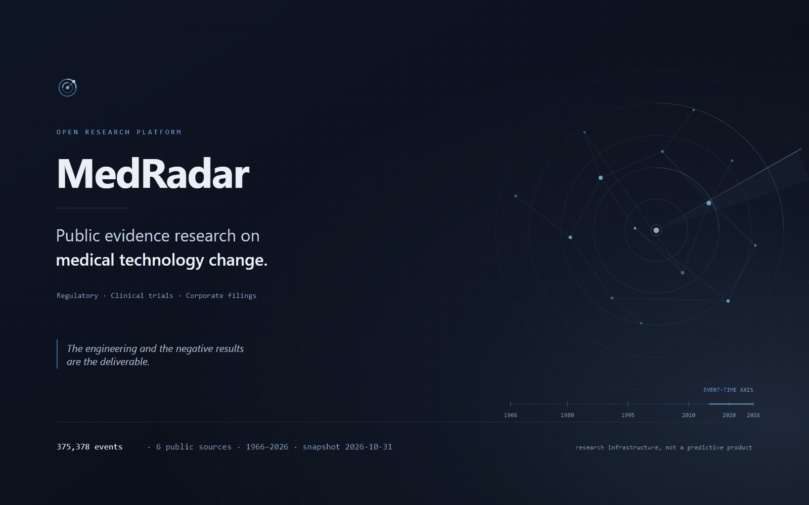
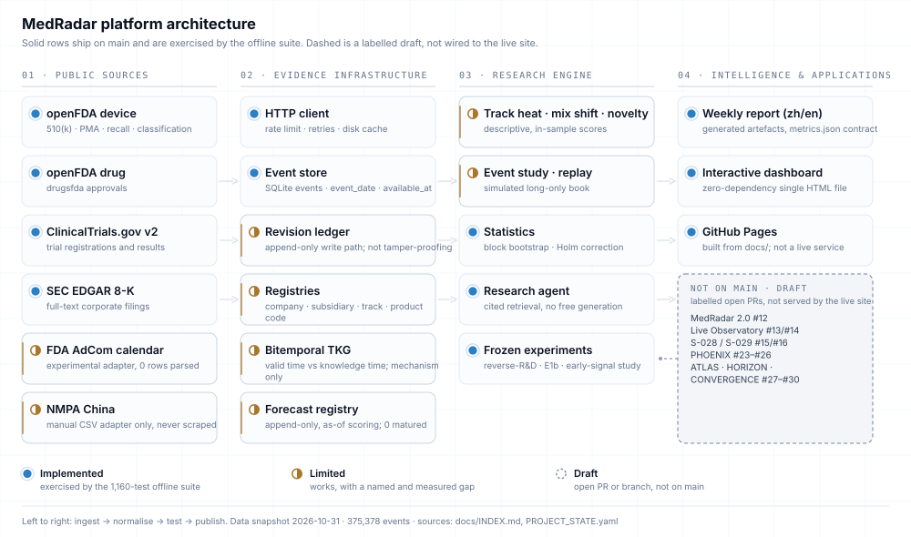
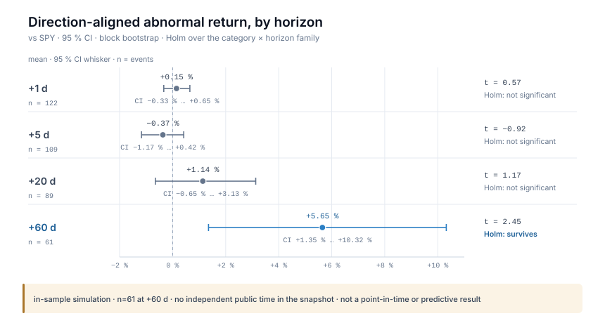
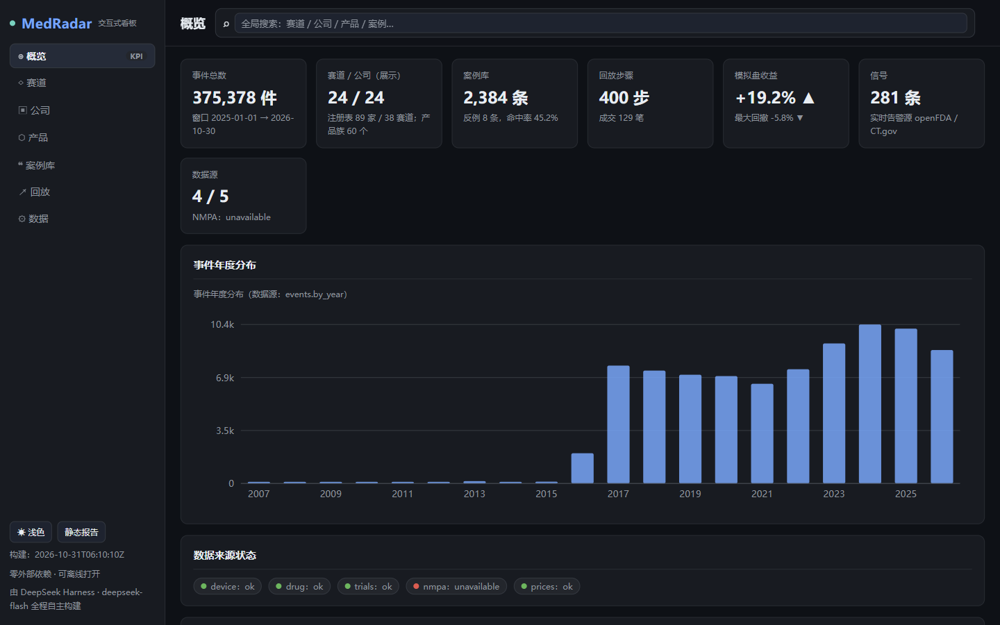
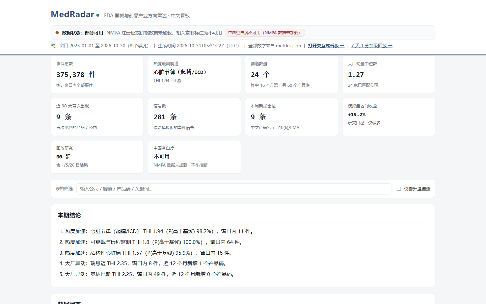

<p align="center">
  <a href="https://chazy11.github.io/medradar/">
    
  </a>
</p>

<p align="center">
  <a href="CHANGELOG.md"></a>
  <a href="https://github.com/ChazY11/medradar/actions/workflows/ci.yml"></a>
  <a href="docs/DATA.md"></a>
  <a href="pyproject.toml"></a>
  <a href="LICENSE"></a>
</p>

<p align="center">
  <a href="https://chazy11.github.io/medradar/"><b>Website</b></a> &nbsp;·&nbsp;
  <a href="#platform">Platform</a> &nbsp;·&nbsp;
  <a href="#research">Research</a> &nbsp;·&nbsp;
  <a href="#start">Get started</a> &nbsp;·&nbsp;
  <a href="docs/INDEX.md">Documentation</a> &nbsp;·&nbsp;
  <a href="README.zh-CN.md">中文</a>
</p>

## Can public evidence see medical-technology change coming?

MedRadar collects free regulatory, clinical-trial and corporate-filing evidence about medical-device
and drug makers into one auditable event store, then tests — with frozen experiments, named baselines
and published negative results — whether that evidence carries signal *before* the market notices.

> **Research infrastructure, not a validated predictive product.** No method in this repository has
> demonstrated out-of-sample predictive ability, and the shipped snapshot cannot support genuine
> point-in-time claims. The engineering and the negative results are the deliverable.
> → [Limitations](#limitations) · [Method contract](docs/METHODS.md)

<p align="center">
  <sub><b>375,378</b> events · <b>6</b> free public sources · event dates <b>1966–2026</b> · snapshot <b>2026-10-31</b> · <b>1,160</b> offline tests · package <b>v0.5.0</b> · MIT</sub>
</p>

---

## Platform in one picture

<picture>
  <source media="(prefers-color-scheme: dark)" srcset="docs/assets/architecture/architecture-en-dark.svg">
  
</picture>

<p align="center"><sub>Source: <a href="tools/homepage/build_architecture.py"><code>tools/homepage/build_architecture.py</code></a> — generated from the repository tree, not drawn as a mock-up. Light and dark variants ship together; the research engine and applications rows are paired with the repository path that implements them.</sub></p>

**How to read the diagram.** Everything solid exists on `main` and is exercised by the offline suite.
Rows marked **limited** work but carry a named, measured gap. The dashed lane on the right is labelled
**draft**: open PRs and branches that are **not** on `main` and **not** wired to the live site.

- **Implemented** — on `main`, exercised by the 1,160-test offline suite.
- **Limited** — works, with a named and measured gap (for example entity resolution at 35.2 % / 52.4 %).
- **Draft** — an open PR or branch; not shipped, not served, not claimed.

Platform detail, source inventory and coverage: **[the Platform page ↗](https://chazy11.github.io/medradar/platform/)**
· repository navigation: [`docs/INDEX.md`](docs/INDEX.md).

---

## What is implemented, and how far it is validated

Vocabulary: **working** = on `main` and exercised by the offline suite; **partial** = works with a
measured, named gap; **mechanism only** = the machinery is correct but its inputs cannot support the
claim it would enable.

| Capability | What it does | Validation status | Entry |
|---|---|---|---|
| **Multi-source ingest** | openFDA device 510(k)/PMA/recall/classification, openFDA drug approvals, ClinicalTrials.gov v2, SEC EDGAR 8-K → one event schema; counts reproduce from live sources | **working** | [`medradar/collect_device.py`](medradar/collect_device.py) · [`collect_drug.py`](medradar/collect_drug.py) · [`clinical.py`](medradar/clinical.py) |
| **Bitemporal event store** | `event_date` / `available_at` / `timestamp_quality` on every row, plus an append-only revision ledger behind `events` — explicitly **not** tamper-proofing | **working** | [`medradar/db.py`](medradar/db.py) · [`medradar/evidence_core/`](medradar/evidence_core/) |
| **Entity resolution** | Company/subsidiary and technology-track keys plus product codes; 35.2 % of events carry a company key and 52.4 % a technology track. Unmatched events are counted and reported, never guessed | **partial** | [`config/`](config/) · [`docs/DATA.md`](docs/DATA.md) |
| **Descriptive analytics** | Track heat (shrinkage-adjusted rate), mix shift (Jensen–Shannon), novelty (first occurrence) — descriptive, in-sample scores, not validated signals | **descriptive only** | [`medradar/analyze.py`](medradar/analyze.py) |
| **Event study, replay, simulated book** | Direction-aligned abnormal returns, block bootstrap, Holm correction, an in-sample long-only simulated book — no out-of-sample claim | **working, simulation** | [`medradar/eventstudy.py`](medradar/eventstudy.py) · [`replay.py`](medradar/replay.py) |
| **Reports and zero-dependency dashboard** | A Chinese report, an English one-pager, a CSV and a self-contained HTML dashboard generated from one `metrics.json` — generated artefacts, not a live service | **working** | [`medradar/report.py`](medradar/report.py) · [`docs/dashboard.html`](docs/dashboard.html) |

Also on `main`, at a lower level of validation: the bitemporal knowledge store
([`medradar/tkg/`](medradar/tkg/), **mechanism only**) and the append-only forecast registry
([`medradar/forecast_registry.py`](medradar/forecast_registry.py), **mechanism only** — 25 registered
forecasts, 0 matured, calibration state `insufficient_matured_forecasts`).

**Not on `main`, not claimed:** MedRadar 2.0 (#12), Live Observatory (#13/#14), S-028 / S-029
(#15/#16), PHOENIX (#23–#26), DATA-EXPANSION / ATLAS / HORIZON / CONVERGENCE (#27–#30). Every one is
a labelled draft; none is served by the live site. See [Roadmap](#roadmap).

---

## Research, including what it failed to find

### The positive result, at its real size

Direction-aligned abnormal returns over the simulated event study (block bootstrap, Holm-corrected over
the full category × horizon family). Only the 60-day horizon survives:

| Horizon | n | Mean abnormal return | t | 95 % CI |
|---|---:|---:|---:|---|
| +1 d | 122 | +0.15 % | 0.57 | [−0.33 %, +0.65 %] |
| +5 d | 109 | −0.37 % | −0.92 | [−1.17 %, +0.42 %] |
| +20 d | 89 | +1.14 % | 1.17 | [−0.65 %, +3.13 %] |
| **+60 d** | **61** | **+5.65 %** | **2.45** | **[+1.35 %, +10.32 %]** |

<p align="center">
  
</p>

<p align="center"><sub>Source: <code>docs/metrics.json</code> → <code>trading.event_study</code>, generated 2026-10-30 · window 2025-11-21 → 2026-10-30 · figure: <a href="tools/site/make_figures.py"><code>tools/site/make_figures.py</code></a> (parses the committed data; the test fails if the art drifts).</sub></p>

**Time-data caveat carried with every return number.** The snapshot has no independent public time —
all 375,378 rows have `published_at = available_at = event_date` — so this result rests on a
same-day-public-time assumption and is **not a point-in-time result**. It is an in-sample simulation
with 38 simulated trades over ~11 months, long-only, and not investment advice.

### The negative results, which matter more

- **Market-to-R&D (12-month horizon).** No added source produces a detectable ranking gain: marginal
  PR-AUC financial −0.0013, market −0.0015, publication −0.0001, all-sources −0.0068. The model barely
  beats a per-pair base rate — AP 0.7935 vs 0.7913, Δ +0.0022, 95 % CI [−0.032, +0.037]. More data
  improves calibration (ECE 0.0811 → 0.0628), not ordering. Frozen artefacts:
  [`experiments/reverse_rd_v1/`](experiments/reverse_rd_v1/) · [`experiments/reverse_rd_v2/`](experiments/reverse_rd_v2/).
- **Early-signal study (five firms).** Phase 0 returned **CONDITIONAL-GO**, but the lead-time gate —
  *was the change detectable earlier?* — returned **NO-GO**.
  → [`research/studies/early_signal_5firms/PHASE0_REPORT.md`](research/studies/early_signal_5firms/PHASE0_REPORT.md)
- **S-028 / S-029 relation studies.** Both **NO-GO**: the evidence-based relation network did not beat
  its null on held-out data. They live on draft branches (PR #15/#16) and are **not** presented as a
  released capability.

### Can the missing public timestamp be recovered? (E1b)

| Source | Retrospective public time | Verdict |
|---|---|---|
| SEC EDGAR | **yes** — `acceptanceDateTime`, immutable archive, amendments as new accessions | STRONG |
| ClinicalTrials.gov | **partial** — first-post date only, date granularity, `ACTUAL` records only | MEDIUM |
| openFDA 510(k)/PMA | **no** — no public-posting field exists; `decision_date` is the event date | prospective observation only |

Full report: [`docs/refoundation/phase2/E1B_SOURCE_RECOVERY.md`](docs/refoundation/phase2/E1B_SOURCE_RECOVERY.md)
(28 requests, 5 records per source — a shape test, not a population estimate).

More: **[Research page ↗](https://chazy11.github.io/medradar/research/)** · [`docs/RESEARCH.md`](docs/RESEARCH.md)
· [`docs/CASES.md`](docs/CASES.md) · [`docs/CALIBRATION.md`](docs/CALIBRATION.md).

---

## Generated artefacts, not a live service

Every image below is a screenshot of a page the repository generates from the committed snapshot.
None is a mock-up; none shows a feature that does not exist on `main`.

<p align="center">
  
</p>

<p align="center"><sub><b>Page:</b> <code>docs/dashboard.html</code> (interactive dashboard, zero-dependency single file) · <b>snapshot:</b> 2026-10-31 (<code>docs/metrics.json</code>) · <b>package:</b> v0.5.0 · <b>offline artefact:</b> yes — all data inlined, opens without a server · <b>on main:</b> yes · <b>capture:</b> Chromium, 1440×900, real generated page, no edits to data or UI.</sub></p>

<p align="center">
  
</p>

<p align="center"><sub><b>Page:</b> <code>docs/report.html</code> (generated Chinese report, nineteen chapters) · <b>snapshot:</b> 2026-10-31 · <b>package:</b> v0.5.0 · <b>offline artefact:</b> yes — self-contained HTML · <b>on main:</b> yes · <b>note:</b> the report is Chinese-first today; the site and this README are English.</sub></p>

Explore every artefact — dashboard, report, replay, figures and the data audit — on the
**[Explore page ↗](https://chazy11.github.io/medradar/explore/)**.

---

## Get started

```bash
git clone https://github.com/ChazY11/medradar.git && cd medradar
pip install -e .                      # standard library only; no API key

python -m pytest -q -o addopts=""     # 1,160 offline tests at the verified baseline, no network
medradar demo                         # offline, committed snapshot, < 60 s → out/demo/index.html
```

A live radar run needs network (still no API key), about three minutes:

```bash
medradar run --months 24 --with-trade --with-dashboard
# → out/index.html · out/report_zh.md · docs/dashboard.html · docs/report.html · out/summary.csv
```

The 1.3 GiB SQLite snapshot is intentionally **not** committed, so a clean clone reproduces the
**procedure**, not the exact numbers. The frozen studies rebuild from the recorded commands:

```bash
python -m medradar.intelligence.pipeline collect --source fda --months 120   # needs `.[bulk]`
python experiments/reverse_rd_v2/run_v2.py --db data/medradar.sqlite --holdouts 3
```

<div id="start"></div>

- **First run:** [`medradar/onboarding.py`](medradar/onboarding.py) · `medradar --help`
- **Data contract:** [`docs/SCHEMA.md`](docs/SCHEMA.md) · **data inventory:** [`docs/DATA.md`](docs/DATA.md)
- **Method contract:** [`docs/METHODS.md`](docs/METHODS.md) · **assumption register:** [`docs/ASSUMPTIONS.md`](docs/ASSUMPTIONS.md)
- **Reproduction guide:** **[Documentation page ↗](https://chazy11.github.io/medradar/documentation/)** · [`docs/INDEX.md`](docs/INDEX.md)

---

## Limitations

1. **Event-time only.** Every row in the committed snapshot has
   `published_at = available_at = event_date` (375,378 / 375,378) and `timestamp_quality = 'date'`.
   **Independent public time = 0 rows.** Return studies rest on a same-day-public-time assumption.
2. **Genuine point-in-time claims are not supported** until source publication timestamps are
   re-acquired — recoverable for EDGAR, date-only for ClinicalTrials.gov, and for openFDA obtainable
   only by observing it from now on.
3. **Entity resolution is partial.** 35.2 % of events carry a company key and 52.4 % a technology
   track. Unmapped events stay unmapped and are counted; they are never guessed.
4. **The revision ledger is not tamper-proofing.** It records the application write path; a database
   owner can still mutate the head table or replace the file.
5. **510(k)/PMA rows carry no public timestamp**, so they enter industry counts but never return
   studies — a real loss of sample, deliberately not papered over.
6. **The AdCom collector parses zero rows** (FDA renders the calendar client-side) and is marked
   experimental; it returns `empty`/`source_changed`, never a silent `ok`.
7. **The simulated book is in-sample, long-only, 38 trades over ~11 months.** Shorts are alerted,
   never traded; fees, squeeze-outs and delisting are unmodelled.
8. **No causal claims.** Difference-in-differences and synthetic control are roadmap items, not results.
9. **NMPA is deliberately not scraped** (WAF). Without a user-supplied CSV every China value is
   `null`, never zero.

The full argument and per-number provenance: [`docs/METHODS.md`](docs/METHODS.md) ·
[`docs/CALIBRATION.md`](docs/CALIBRATION.md) · [`docs/ASSUMPTIONS.md`](docs/ASSUMPTIONS.md).

---

## Roadmap

Shipped: `v0.3.0` research foundation (bitemporal TKG + immutable forecast registry), `v0.4.0` harder
target + purged multi-window evaluation, `v0.5.0` continuous forecast cycle and the cited research
agent. Full record: [`ROADMAP.md`](ROADMAP.md).

Next, and explicitly **not done**:

1. **Re-acquire independent public timestamps** — EDGAR first; it can carry a true public instant today.
   Without this, no point-in-time claim is possible.
2. **Mature enough forecast windows** to make any calibration claim at all.
3. **Feed graph features into the models**, not only into the retrieval agent.
4. **Patent features once a USPTO Open Data Portal key exists**; versioned historical track taxonomy.
5. **NMPA CSV importer, AdCom parsing**, and the draft lanes tracked in PRs #12–#30.

---

## Project status

<!-- BEGIN GENERATED: status -->
<!-- generated: do not edit by hand; regenerate with tools/governance/gen_views.py -->
<!-- source-sha256: 15f5a2466519f41c586481d038b895c8e9d328a054905f4a8e83422b3e51b989 -->
<!-- payload-sha256: fd63aa6432b7f9a863e7b9bb6810f0bc9c6f67a96370aa1d391742b00a3276a7 -->
**Project status** — generated from [`PROJECT_STATE.yaml`](PROJECT_STATE.yaml) at `2026-11-13T04:50:58+08:00` by `python tools/governance/gen_views.py`; edit the state file, never this block.

| Item | Value |
| --- | --- |
| Observed main head | [`b2a14c0`](https://github.com/ChazY11/medradar/commit/b2a14c0a92332c004445de686daee97754cf94cb) — 2026-11-03 (may lag main; stale-by-design is a warning) |
| Verified baseline | `b2a14c0` (1,157 passed, 1,160 collected) |
| Release | 0.5.0 (unreleased) |
| Tests | 1,157 passed, 3 skipped, 0 failed (1,160 collected, offline) |
| Capabilities | 7 working · 6 draft · 1 retired |
| Research studies | 1 (0 with a public claim) |
| Data snapshot | 2026-10-31 — 375,378 events (local build; `data/` is gitignored) |
| Open PRs | 28 open (27 draft), 10 merged |
| Branch protection | not applied |

See [`docs/governance/GOVERNANCE.md`](docs/governance/GOVERNANCE.md) for the gates and [`docs/RESEARCH_INDEX.md`](docs/RESEARCH_INDEX.md) for the generated research index.
<!-- END GENERATED: status -->

---

## Contributing, citation and licence

The highest-value contributions are the curated knowledge files, not code: company and subsidiary
aliases, track dictionaries, product-code mappings. The core package stays standard-library-only, and
every new metric updates [`docs/METHODS.md`](docs/METHODS.md) and [`docs/SCHEMA.md`](docs/SCHEMA.md)
first. Start at [CONTRIBUTING.md](CONTRIBUTING.md) and
[`docs/GOOD_FIRST_ISSUES.md`](docs/GOOD_FIRST_ISSUES.md).

If you cite this repository, cite it as research infrastructure and cite a specific tagged artefact
(a report, a study directory, a frozen experiment), not as a predictive claim.

MIT — see [LICENSE](LICENSE). Source data belongs to its publishers: openFDA is public domain;
ClinicalTrials.gov and SEC EDGAR have their own terms. Nothing here is investment advice. This is a
research and education project.

<p align="center"><sub>Data snapshot 2026-10-31 · package v0.5.0 · MIT · <a href="README.zh-CN.md">中文版</a> · <a href="docs/INDEX.md">documentation index</a></sub></p>
