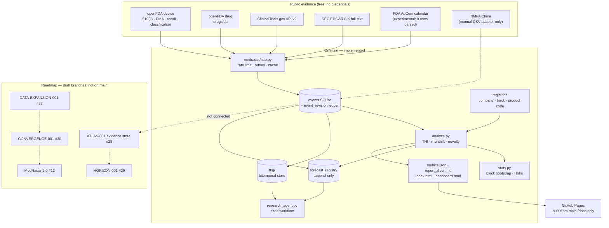

# MedRadar

**A research project on one question: can publicly observable evidence give reliable early warning of
meaningful change in medical-technology development?**

MedRadar collects free public regulatory, clinical-trial and corporate-filing evidence about
medical-device and drug makers into one auditable event store, then tests — with frozen experiments,
named baselines and explicit negative results — whether that evidence carries signal *before* the
market notices.

**Status: research infrastructure, not a validated predictive product.** No method in this repository
has demonstrated out-of-sample predictive ability, and the shipped dataset cannot support genuine
point-in-time claims (see [Limitations](#limitations)). The engineering and the negative results are
the deliverable.

> 中文 → [README.zh-CN.md](README.zh-CN.md) · All documentation → [docs/INDEX.md](docs/INDEX.md) ·
> Method contract → [docs/METHODS.md](docs/METHODS.md)

| | |
|---|---|
| Package version | `0.5.0` (`pyproject.toml`, the only source) |
| Test suite | **1,148 offline tests (1,145 passed, 3 skipped)** — no network, no API key (`python -m pytest -q -o addopts=""`) |
| Data snapshot | **2026-10-31** · 375,378 events · 1.3 GiB SQLite (not committed) |
| Released claims | descriptive event-time statistics and the negative results below — nothing else |
| Licence | MIT |

---

<!-- BEGIN GENERATED: status -->
<!-- generated: do not edit by hand; regenerate with tools/governance/gen_views.py -->
<!-- source-sha256: d9040a766a111ad0d0f9b3a344a6f36d829fdc56ff5cc274915b0655ddb88e10 -->
<!-- payload-sha256: 98a04a32c481340ffd14409e3a0fb65276f1bb3252901de439e18b1318f860b5 -->
**Project status** — generated from [`PROJECT_STATE.yaml`](PROJECT_STATE.yaml) at `2026-11-13T02:57:53+08:00` by `python tools/governance/gen_views.py`; edit the state file, never this block.

| Item | Value |
| --- | --- |
| Main head | [`b2a14c0`](https://github.com/ChazY11/medradar/commit/b2a14c0a92332c004445de686daee97754cf94cb) — 2026-11-03 |
| Version | 0.5.0 (`pyproject.toml`) |
| Tests | 1,145 passed, 3 skipped, 0 failed (1,148 collected, offline) |
| Capabilities | 7 working · 6 draft · 1 retired |
| Research studies | 1 (0 with a public claim) |
| Data snapshot | 2026-10-31 — 375,378 events (local build; `data/` is gitignored) |
| Open PRs | 28 open (27 draft), 10 merged |
| Branch protection | not applied |

See [`docs/governance/GOVERNANCE.md`](docs/governance/GOVERNANCE.md) for the gates and [`docs/RESEARCH_INDEX.md`](docs/RESEARCH_INDEX.md) for the generated research index.
<!-- END GENERATED: status -->

## What is implemented, and how far it is validated

Vocabulary: **working** = implemented on `main` and exercised by the offline suite; **partial** =
works with a measured, named gap; **mechanism only** = the machinery works but its inputs cannot
support the claim it would enable.

| Capability | Where | Validation status |
|---|---|---|
| Ingest openFDA device (510(k)/PMA/recall/classification), openFDA drug approvals, ClinicalTrials.gov v2, SEC EDGAR 8-K | `medradar/collect_*.py`, `medradar/intelligence/` | **working** — counts reproduce from live sources |
| Unified event store with `event_date` / `available_at` / `timestamp_quality` | `medradar/db.py` | **working**, with a data caveat below |
| Append-only revision ledger behind `events` + versioned migrations | `medradar/evidence_core/` | **working** for the application write path; explicitly **not tamper-proofing** ([contract](docs/refoundation/phase2/EVIDENCE_CORE_V1.md)) |
| Company / subsidiary and technology-track resolution | `medradar/config.py`, `config/*.json` | **partial** — 35.2 % of events carry a company key and 52.4 % a technology track (`docs/DATA.md`); unmatched events are reported, never guessed |
| Track heat (shrinkage-adjusted rate), mix shift (Jensen–Shannon), novelty (first occurrence) | `medradar/analyze.py` | **descriptive only** — in-sample scores, no out-of-sample validation |
| Event study, replay, simulated long-only book | `medradar/eventstudy.py`, `medradar/replay.py`, `medradar/paper.py` | **working, simulation** — in-sample, long-only, not investment advice |
| Bitemporal knowledge store (valid time vs knowledge time) | `medradar/tkg/` | **mechanism only** — the store is correct; the imported history has no independent public clock |
| Append-only forecast registry with as-of scoring | `medradar/forecast_registry.py` | **mechanism only** — 25 registered forecasts, 0 matured; calibration state `insufficient_matured_forecasts` |
| Deterministic evidence-grounded research agent (cited, not generative) | `medradar/research_agent.py` | **working** as a retrieval-and-citation workflow; establishes no causality |
| Reports and zero-dependency dashboard | `medradar/report.py`, `docs/dashboard.html` | **working** — generated artefacts, not live service |

**Not in `main`, not claimed:** MedRadar 2.0 (#12), Live Observatory (#13/#14), S-028/S-029 (#15/#16),
PHOENIX (#23–#26), DATA-EXPANSION / ATLAS / HORIZON / CONVERGENCE (#27–#30). See
[Roadmap](#roadmap) — every one is a labelled draft, and none is served by the live site.

---

## Architecture

Solid edges exist on `main`. Dashed nodes are roadmap drafts and are **not** wired in.



---

## What the research found — including what it failed to find

### The positive result, at its real size

Direction-aligned abnormal returns over the simulated event study (block bootstrap, Holm-corrected
over the full category × horizon family). Only the 60-day horizon survives:

| Horizon | n | Mean abnormal return | t | 95 % CI |
|---|---|---|---|---|
| +1 d | 122 | +0.15 % | 0.57 | [−0.33 %, +0.65 %] |
| +5 d | 109 | −0.37 % | −0.92 | [−1.17 %, +0.42 %] |
| +20 d | 89 | +1.14 % | 1.17 | [−0.65 %, +3.13 %] |
| **+60 d** | **61** | **+5.65 %** | **2.45** | **[+1.35 %, +10.32 %]** |

Source: `docs/metrics.json` → `trading.event_study`, generated 2026-10-30, snapshot window
2025-11-21 → 2026-10-30. This is the simulation lane; it is in-sample and makes no out-of-sample
claim. **Time-data caveat:** the snapshot has no independent public time — all 375,378 rows have
`published_at = available_at = event_date` — so this result rests on a same-day public-time
assumption and is **not** a point-in-time result (see Limitations).

### The negative results, which matter more

**Market-to-R&D (12-month horizon).** Frozen artefacts: `experiments/reverse_rd_v1/`,
`experiments/reverse_rd_v2/` — 55,090 FDA events, 43,420 SEC facts across 32 companies, 6,701
continuation examples over 25 quarterly origins, 41,003 dormant→active entry examples over 24 origins.

| Finding | Measurement |
|---|---|
| No added source produces a detectable ranking gain | marginal PR-AUC on continuation: financial −0.0013, market −0.0015, publication −0.0001, all-sources −0.0068 |
| The model barely beats a per-pair base rate | AP 0.7935 (model) vs 0.7913 (base rate), Δ +0.0022, 95 % CI [−0.032, +0.037] |
| More data improves calibration, not ordering | ECE 0.0811 → 0.0628; FPR 0.2753 → 0.2472 |
| The entry target is unstable across windows | differences sit inside the 0.014–0.026 window std |

Patents were **not evaluated** (USPTO Open Data Portal requires a key); procurement is **excluded**
(its snapshot is not point-in-time usable).

**Early-signal study (five firms).** Phase 0 is CONDITIONAL-GO; the lead-time gate is **NO-GO** —
the study did not show the change was detectable earlier. See
[`research/studies/early_signal_5firms/PHASE0_REPORT.md`](research/studies/early_signal_5firms/PHASE0_REPORT.md).

**S-028 / S-029 relation studies (branch-only, drafts).** Both are **NO-GO**: the
evidence-based relation network did not beat its null on held-out data. Full record lives on the
draft branches (PR #15/#16); neither is presented as a released capability.

**Source-recovery experiment (E1b).** Can the missing *public* timestamp be recovered per source?

| Source | Retrospective public time | Verdict |
|---|---|---|
| SEC EDGAR | **yes** — `acceptanceDateTime`, immutable archive, amendments as new accessions | STRONG |
| ClinicalTrials.gov | **partial** — first-post date only, date granularity, `ACTUAL` records only; historical content state not recoverable | MEDIUM |
| openFDA 510(k)/PMA | **no** — no public-posting field exists; `decision_date` is the event date, not the publication date | prospective observation only |

Full report: [`E1B_SOURCE_RECOVERY.md`](docs/refoundation/phase2/E1B_SOURCE_RECOVERY.md) (28 requests,
5 records per source, a shape test — not a population estimate).

---

## Limitations

1. **Event-time only.** Every row in the committed snapshot has
   `published_at = available_at = event_date` (375,378 / 375,378) and `timestamp_quality = 'date'`;
   `first_seen_at` comes from a bulk import. **Independent public time = 0 rows.** Return studies
   therefore rest on a same-day-public-time assumption.
2. **Genuine point-in-time claims are not supported** until source publication timestamps are
   re-acquired — recoverable for EDGAR, date-only for ClinicalTrials.gov, and for openFDA obtainable
   only by observing it from now on.
3. **Entity resolution is partial.** 35.2 % of events carry a company key and 52.4 % a technology
   track (`docs/DATA.md`). Unmapped events stay unmapped and are counted; they are never guessed.
4. **The revision ledger is not tamper-proofing.** It records the application write path; a database
   owner can still mutate the head table or replace the file.
5. **510(k)/PMA rows carry no public timestamp**, so they enter industry counts but never return
   studies — a real loss of sample, deliberately not papered over.
6. **The AdCom collector parses zero rows** (FDA renders the calendar client-side) and is marked
   experimental; it returns `empty`/`source_changed`, never a silent `ok`.
7. **The simulated book is in-sample, long-only, 38 trades over ~11 months.** Shorts are alerted, never
   traded; borrow fees, squeeze-outs and delisting are unmodelled.
8. **No causal claims.** Difference-in-differences and synthetic control are roadmap items, not results.
9. **NMPA is deliberately not scraped** (WAF). Without a user-supplied CSV every China value is `null`,
   never zero.

---

## Reproduce

```bash
git clone https://github.com/ChazY11/medradar.git && cd medradar
pip install -e .
python -m pytest -q -o addopts=""   # 1,148 offline tests, no network, no API key
medradar demo                       # offline, committed snapshot, < 60 s → out/demo/index.html
```

A live radar run needs network (still no API key), ~3 minutes:

```bash
medradar run --months 24 --with-trade --with-dashboard
#   out/index.html  · out/report_zh.md  · docs/dashboard.html  · out/summary.csv
```

The 1.3 GiB SQLite snapshot is intentionally not committed, so a clean clone reproduces the
**procedure**, not the exact numbers. The frozen studies are rebuilt with:

```bash
python -m medradar.intelligence.pipeline collect --source fda --months 120   # needs `.[bulk]`
python experiments/reverse_rd_v2/run_v2.py --db data/medradar.sqlite --holdouts 3
```

---

## The dashboard snapshot

<p align="center">
  
</p>

*Committed snapshot — **dataset 2026-10-31**, **package v0.5.0**. It shows the demo views of the
generated report; it is not a live service and not a forecast. Rebuild with `medradar dashboard`; the
interactive file is [`docs/dashboard.html`](docs/dashboard.html). Image policy:
[`README_VISUAL_PLAN.md`](docs/refoundation/phase3/README_VISUAL_PLAN.md).*

---

## Roadmap

Shipped already: `v0.3.0` research foundation (bitemporal TKG + immutable forecast registry),
`v0.4.0` harder target + purged multi-window evaluation, `v0.5.0` continuous forecast cycle and the
cited research agent. See [ROADMAP.md](ROADMAP.md) for the full record.

Next, and explicitly **not** done:

1. Re-acquire independent public timestamps (EDGAR first; it can carry a true public instant today).
2. Mature enough forecast windows to make any calibration claim at all.
3. Feed graph features into the models, not only into the agent.
4. Patent features once a USPTO ODP key exists; versioned historical track taxonomy.
5. NMPA CSV importer; AdCom parsing; the draft lanes tracked in PRs #12–#30.

## Contributing

The highest-value contributions are the curated knowledge files, not code: company and subsidiary
aliases, track dictionaries, product-code mappings. The core package stays standard-library-only, and
every new metric updates [`docs/METHODS.md`](docs/METHODS.md) and [`docs/SCHEMA.md`](docs/SCHEMA.md)
first. Start at [CONTRIBUTING.md](CONTRIBUTING.md) and
[`docs/GOOD_FIRST_ISSUES.md`](docs/GOOD_FIRST_ISSUES.md); navigation for everything else is
[`docs/INDEX.md`](docs/INDEX.md).

## Licence

MIT. Source data belongs to its publishers (openFDA is public domain; ClinicalTrials.gov and SEC EDGAR
have their own terms). Nothing here is investment advice. This is a research and education project.
