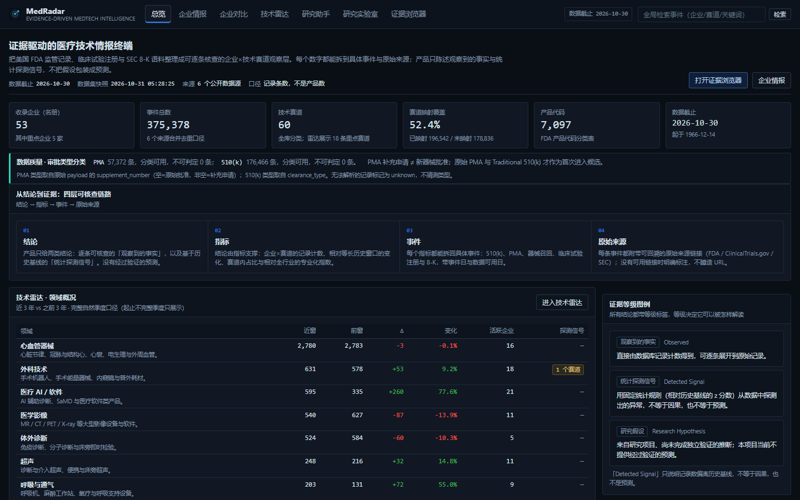
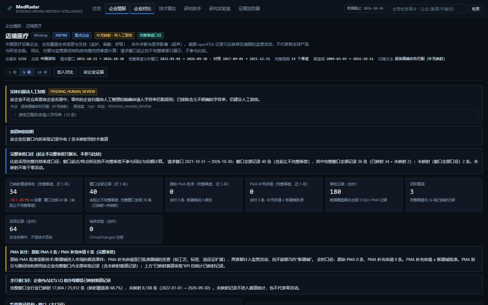
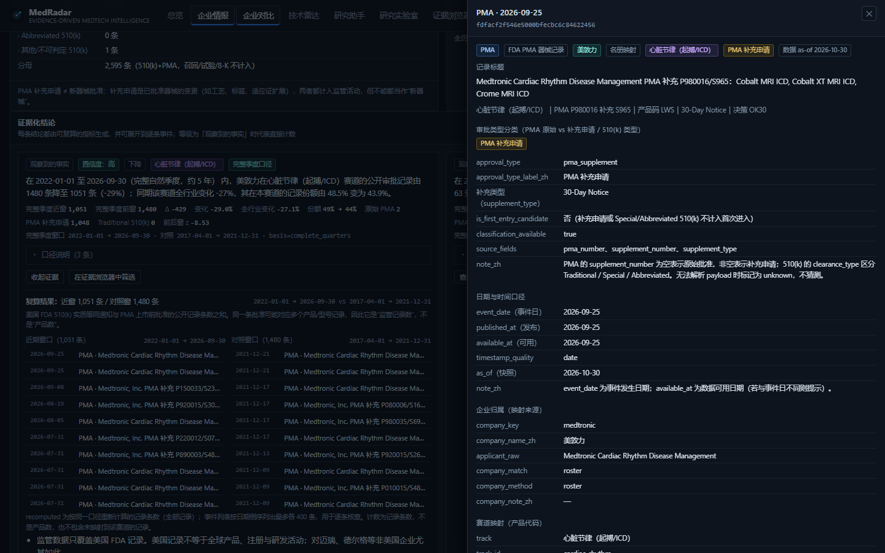
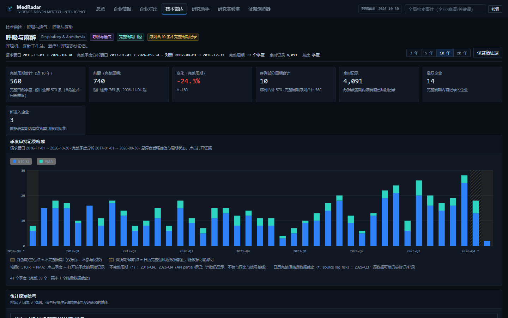
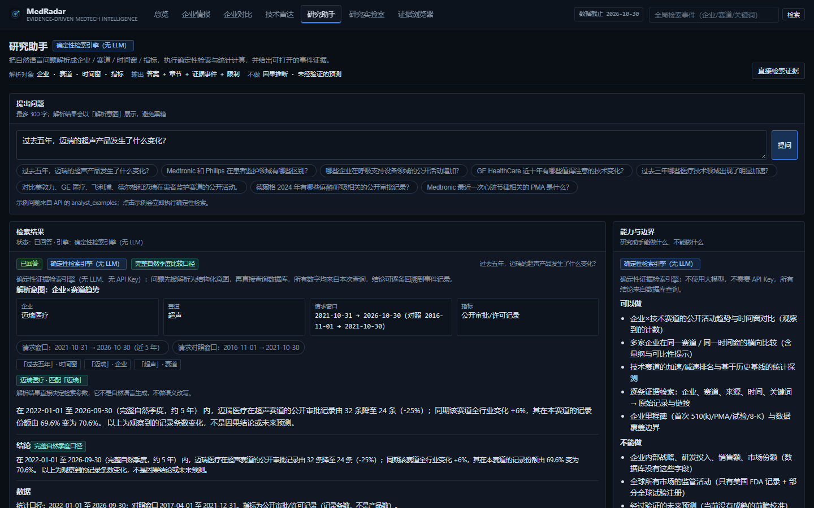
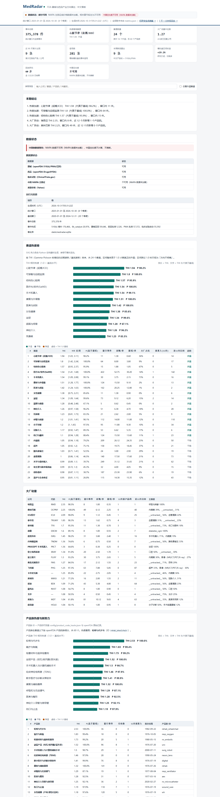

# MedRadar

[](https://github.com/ChazY11/medradar/blob/main/docs/ATTRIBUTION.md)


**An open-source radar for FDA device & drug industry direction — built for people who need to know
what US majors are actually building next, not what they said in an earnings call.**

MedRadar turns free public FDA data into a weekly, quantified, Chinese-language intelligence
brief: which technology tracks are heating up, which majors are quietly re-allocating their
portfolio, what appeared for the first time, and where China still has a gap.

## MedRadar 2.0 — the product (MVP)

`feat/medradar-2.0-mvp` turns the research pipeline into a runnable web product:
**Company Intelligence · Technology Radar · AI Research Analyst · Evidence Explorer · Research Lab**.
Every number is computed read-only from the same `data/medradar.sqlite`; every conclusion expands
to the underlying FDA/ClinicalTrials/8-K records; limitations are printed next to the numbers.

```bash
# the research store must exist (built by `medradar run`); this checkout already has it
python -m medradar web --port 8787
# open http://127.0.0.1:8787
```

- deterministic analyst, **no API key required**, no fabricated queries;
- Dräger and Mindray are supported through a reviewed exact-alias mapping (they are absent from the original roster);
- observed change / detected signal / research hypothesis are labelled separately — there is **no validated forecast** in the product;
- comparisons use **equal-length complete natural quarters**; LQ uses the same track-mapped denominators on both sides and shows "not applicable" for small samples; PMA original approvals are separated from PMA supplements (supplements are not new devices);
- docs: [vision](docs/PRODUCT_VISION.md) · [architecture](docs/PRODUCT_ARCHITECTURE.md) ·
  [user guide](docs/PRODUCT_USER_GUIDE.md) · [acceptance](docs/PRODUCT_ACCEPTANCE.md) ·
  [statistical audit](docs/PRODUCT_STATISTICAL_AUDIT.md) · [roadmap](docs/PRODUCT_ROADMAP.md)



| Company intelligence | Claim → evidence trace |
| --- | --- |
|  |  |
| **Technology radar** | **Research analyst** |
|  |  |

## MedRadar Live Observatory — continuous, auditable observation

`feat/live-observatory-v1` adds the piece the snapshot pipeline could never answer:
**what did we actually observe, and when did we first observe it?**

A separate, append-only Observation Ledger (`data/observatory/observatory.sqlite`)
records every public record from official APIs with a real `first_seen_at` written
once by the collector, an immutable payload-version chain, and an explicit
`NEW / UPDATED / UNCHANGED / REMOVED_OR_UNAVAILABLE / FETCH_FAILED` state. The
existing 1.37 GB research store is only read; existing statistics are untouched.

```bash
# incremental observation of the official sources (default: sec_edgar,ctgov,europepmc)
python -m medradar observatory sync
python -m medradar observatory status          # sync state, failures, measured lag
python -m medradar observatory watch --interval-minutes 60   # local continuous polling
python -m medradar observatory replay --as-of 2026-11-03T10:00:00Z   # point-in-time replay
python -m medradar web --port 8787             # then #/observatory
```

- official sources only: **SEC EDGAR**, **ClinicalTrials.gov API v2**, **Europe PMC**;
  FDA 510(k)/PMA reuse the existing collectors and are **not** claimed to be real-time;
- issuer coverage is **verified per company**, not assumed: Medtronic / GE HealthCare /
  Philips have SEC CIKs; Dräger has none (the EDGAR name match is an individual filer);
  Mindray stopped filing in 2016 — each with the evidence that was checked;
- two different claims are never merged in the UI: *"the event happened on X"* vs
  *"MedRadar first observed it on Y"*; measured latency is shown only where the source
  publishes a real availability timestamp, otherwise "not measurable" with the reason;
- every acceptance scenario (A–G) has a synthetic tier, a real-API tier and a real
  incremental tier: `python scripts/observatory_acceptance.py --live`;
- docs: [user & operations guide](docs/LIVE_OBSERVATORY.md) ·
  [design & interface contract](docs/LIVE_OBSERVATORY_DESIGN.md) ·
  [prospective observation registry](docs/PROSPECTIVE_OBSERVATION_REGISTRY.md)

## MedRadar Observatory Reliability — built to preserve evidence for years

`feat/observatory-reliability-v1` is the answer to "if this runs for five years, can it
still prove what it observed on a given day?" It adds persistence, supervision, audit
and validation around the same append-only ledger — no new predictors, no rewritten product.

- **Single-writer lease** (`data/observatory/collector.lock`): a second collector is
  refused, stale leases are taken over with an audit record, SIGTERM/exit releases it.
- **Consistent backups** via the SQLite online-backup API, SHA-256 manifests, integrity +
  consistency recorded per snapshot, retention (7 daily / 4 weekly / 6 monthly), quarantine
  instead of deletion for unverifiable bundles, and cache pruning that never touches the
  ledger or frozen research files.
- **Restore drills** into an isolated directory, verifying observation counts,
  `first_seen_at` identity (400/400 in the real drill), version chains and watermarks,
  then proving a post-restore write gets a *fresh* `first_seen_at` while old rows keep theirs.
- **Integrity audit** (`observatory audit`): 11 checks with `PASS / FAIL /
  REQUIRES_MANUAL_REVIEW` verdicts and concrete evidence — missing evidence is never a PASS.
- **Honest health** (`observatory health`): `OPERATIONAL / DEGRADED / PAUSED /
  NOT_DEPLOYED / VALIDATION_IN_PROGRESS` computed from freshness, runs, backups, drills,
  structure alerts and the lease — never from an HTTP 200. `NO_NEW_RECORDS` is normal;
  `FETCH_FAILED` is a failure and is shown as one.
- **Supervised operation**: systemd service/timer templates for Linux; a Windows Task
  Scheduler installer that runs **one pass per trigger** (`-MaxCycles 1`) because a forced
  task end cannot cleanly stop a long-running child; ledger lease + `IgnoreNew` prevent overlap.
- **Seven-day continuous validation** (`observatory validate status`): planned vs executed
  vs missed slots, scheduler/source success rates, freshness, measured latency, duplicate
  rate, integrity violations, recovery and storage growth — computed only from real
  `sync_run` rows. It is currently **VALIDATION_IN_PROGRESS** (started 2026-11-03,
  window ends 2026-11-10); it will not report PASSED before that instant.
- **Acquisition phase** is append-only metadata: `INITIAL_DISCOVERY` (first go-live sweep)
  vs `INCREMENTAL_DISCOVERY` vs `HISTORICAL_BACKFILL`; "event older than observation" is
  not backfill, and the existing immutable rows were labelled without being rewritten.
- docs: [reliability architecture & decision](docs/RELIABILITY_DESIGN.md) ·
  [deployment runbook](docs/DEPLOYMENT.md) ·
  [backup & recovery](docs/BACKUP_AND_RECOVERY.md) ·
  [seven-day validation protocol](docs/CONTINUOUS_VALIDATION_PROTOCOL.md) ·
  [health & validation semantics](docs/HEALTH_AND_VALIDATION.md) ·
  [acceptance report](docs/RELIABILITY_ACCEPTANCE.md)

> Deployment status on this workstation is **DEPLOYED_LOCAL** (Windows Task Scheduler,
> one pass per trigger, verified `LastTaskResult=0`). Production remains **NOT_DEPLOYED**:
> a durable host, offsite backup target and an authorised SEC contact are required before
> any `DEPLOYED_SERVICE` claim, and none of them were purchased or assumed.


> The stable core through `v0.2.2` was built with DeepSeek Harness using `deepseek-flash`.
> The research foundation (`medradar/tkg`, `forecast_registry`) and the Market-to-R&D lane were
> authored in independent Kimi Code sessions; `v0.3.0` consolidates their branches after an
> independent forensic audit and defect-fix pass. Authorship is recorded per increment in
> [docs/ATTRIBUTION.md](docs/ATTRIBUTION.md) and the merge/audit/fix decisions in
> [docs/INTEGRATION_2026-11-02.md](docs/INTEGRATION_2026-11-02.md).

> 中文文档 → [README.zh-CN.md](README.zh-CN.md) · Methodology → [docs/METHODS.md](docs/METHODS.md)



### What one run produces (snapshot, 2026‑10‑31)

| | |
|---|---|
| Events ingested | **375,378** (510(k) 176,466 · PMA 57,372 · recalls 59,646 · trials 55,592 · drug approvals 5,326 · EDGAR catalysts 20,976) |
| Coverage | 89 companies, 60 tracks, **204 device product families**, 7,097 product codes, **1.2 GiB SQLite** |
| Strongest track right now | 心脏节律 THI 1.94 (P=98.2%) · 可穿戴监测 1.80 · 结构性心脏病 1.57 · 手术机器人 1.54 |
| Signals emitted | 281 (→ tradable subset) |
| Case library | The historical snapshot contains **2,384 traceable cases**; v0.3.0 recomputes studies under the corrected taxonomy and extreme-return audit instead of carrying forward old category counts |
| Replay | **400-step, 7-year timeline** (2019–2026) with 10/25/50 bps cost tiers; 1-minute fills for the last 7 days |
| Frontier radar | **50 device tracks across 23 domains**; AdCom schedules/materials, first-posted trials, pre-submissions and designations in one feed |
| Research integrity | Clinical holds, RTF, CRL, pre-submissions and designations are separate; absolute abnormal returns above 100% are audited and excluded from inference |
| Market-to-R&D | **6,701 continuation + 41,003 dormant→active entry examples** (25/24 quarterly origins) from 55,090 FDA events + 43,420 SEC facts + 3,453 procurement awards; purged multi-window evaluation and a 7-source ablation, honest negative result (below) |
| Research infrastructure | Bitemporal knowledge store (valid time vs knowledge time) and an immutable forecast registry with as-of scoring; deterministic point-in-time export |
| Forecast cycle | Canonical registry with a separate `nowcast` cohort; continuous cycle registers 25 real forecasts, verifies matured windows, exports a deterministic artifact; idempotent re-run |
| Temporal graph | 55,090 events imported read-only → **57,381 nodes / 114,419 edges**; PIT snapshot hash stable, idempotent re-import, read-only pair context/timeline queries |
| Research agent | Deterministic 8-tool workflow with cited evidence, 5 question templates, conflict detection and counter-evidence; real demo: 5 questions / 55 claims / 224 unique citations / 0 missing |
| Simulated book | in-sample, long-only, not investment advice |
| Tests | **678 offline tests**, no network, no API key |
| Report | 19 chapters, self-contained HTML dashboard (no CDN, no external assets) |
| Products | 204 families, **2,740 Chinese product names** |
| Research | event-time model, point-in-time signals, block bootstrap, Holm correction |
| Timing scope | Public-time quality is explicit (`datetime` / `date` / `estimated` / `unknown`). Only real `datetime`/`date` availability enters return studies; historical decision dates without a public timestamp remain descriptive only |
| Database | 1.2 GiB SQLite, 1966–2026 drug approvals, 1999–2026 trials |
| Calibration | 25 hand-labelled real 8‑Ks: type accuracy **1.00 vs 0.60**, direction **0.92 vs 0.72** for the LLM judge |

> Numbers move every week; every one of them is reproducible from `medradar run`.

---

## Try it in 60 seconds

```bash
# 1) clone the repository (or download the Release ZIP) and enter its root
# 2) install and run the offline demo
pip install -e .
medradar demo           # offline, uses the committed snapshot, no API key, <60s
# open out/demo/index.html (interactive dashboard: out/demo/dashboard.html)
```

Or open the **interactive dashboard** directly: [`docs/dashboard.html`](docs/dashboard.html) — 7 views
(overview, tracks, companies, products, cases, replay, data), live search, sortable tables,
case-evidence drawer, replay cost-tier switch and URL routing. It is a single self-contained HTML
file (3.3 MB, zero external requests), so it also works offline and on GitHub Pages.

Then, for a live data run:

```bash
medradar run --months 24 --with-trade    # ~3 min, free public data only
medradar replay --days 30                # event-to-fill timeline with cost tiers
medradar replay --start 2019-01-01 --end 2026-10-31 --source events   # 7-year, 400 steps
medradar cases --limit 20                # traceable case library with evidence quotes
medradar products --limit 10             # product families + new-product radar, in Chinese
medradar dashboard                       # rebuild docs/dashboard.html from the latest metrics
```

## What it answers

| Question | Metric | Output |
|---|---|---|
| What happens before approval? | AdCom meetings/materials, first-posted trials, pre-submissions and designations | `out/frontier.json` + `out/frontier.md` |
| Which device tracks are accelerating? | `THI` — shrinkage-adjusted recent rate ÷ baseline rate | Track heat table |
| Is a specific major changing direction? | Jensen-Shannon divergence of its product-code mix | Migration table ("who is re-allocating") |
| What is genuinely new? | First-ever `(company, product_code)` occurrences | "First seen" weekly list + product-family radar |
| Which device product families are rising? | 204 families, 2,000 Chinese product names | Product radar chapter |
| Is pharma shifting therapeutic focus? | Trial-start rates + phase mix per area | Drug radar |
| Where is the China gap? | US activity share vs loaded NMPA registrations | `cn_gap` table (honest `unavailable` when no CN data) |
| Does any of it predict equity returns? | Event study: direction-aligned abnormal returns at +1/+5/+20/+60, block bootstrap + Holm | [Case library](docs/CASES.md) + `out/trading.json` (simulation only) |

## Frontier lane: public signals before approval

```bash
python -m medradar collect --sources adcom,trials --months 24
python -m medradar frontier
```

The frontier feed combines FDA Advisory Committee schedules and briefing materials, first-posted
clinical trials, pre-submissions and breakthrough/priority designations from SEC filings. Its 50
tracks cover life support (ventilation, ECMO, oxygen, resuscitation, monitoring), IVD (NGS, liquid
biopsy, MRD, companion diagnostics, microbiology, digital pathology), BCI, neuromodulation,
cardiovascular, imaging, robotics, SaMD/AI, renal and diabetes.

This is public-source monitoring, not a pending-application oracle. Non-public 510(k)/PMA review
status is confidential, so the machine-readable output explicitly sets
`pending_510k_pma_monitoring=false` rather than manufacturing a pipeline from decision dates.

**Known limitation (2026-11):** FDA renders the Advisory Committee calendar rows client-side, so a
static fetch currently parses zero meetings. `collect --sources adcom` therefore returns
`status="empty"`/`"source_changed"` with a warning instead of a silent `"ok"`, and the source is
marked experimental in [docs/DATA.md](docs/DATA.md). The other frontier inputs (first-posted trials,
8-K pre-submissions/designations) are unaffected.

## Live lane: event alerts + simulated trading (5–15 min)

The batch radar answers *"what is the industry doing"*. The live lane answers *"what just happened"*.

```bash
python -m medradar live --once --since-hours 2              # one cycle (cron / DSH automation)
python -m medradar live --interval 600                      # loop every 10 minutes
python -m medradar live --once --backfill-days 7 --no-trade # seed recent catalysts (never traded)
python -m medradar live --reset                             # wipe the simulated book
```

Each cycle: SEC EDGAR 8-K feed (seconds) → EDGAR full-text backfill → FDA press RSS →
ClinicalTrials.gov status changes → keyword classifier → **simulated order at the latest real
Yahoo quote plus 10 bps slippage** → mark-to-market → alert (console + `out/live_alerts.jsonl` +
optional `MEDRADAR_WEBHOOK_URL`).

Honest latency, measured 2026‑10‑31:

| Source | Latency | Tradable? |
|---|---|---|
| SEC 8-K filings | seconds | ✅ |
| FDA press RSS | ~8 days stale at the time of writing | ❌ informational |
| ClinicalTrials.gov updates | hours | terminations only |
| openFDA 510(k)/PMA | 12 days | ❌ slow lane only |
| FDA submissions under review | **not public** | physically impossible |

Long-only, ≤5% per name, ≤25% per track, −20% stop, 60‑trading‑day exit. Shorts are **alerted but
not traded**: borrow fees and squeeze-outs would turn the P&L into fiction. This is a simulation —
no broker, no orders, no money at risk.

**Execution guards** (added after a pre‑release review):

* only the fresh EDGAR feed can open a position — backfill, FDA RSS and trial updates are alert‑only;
* a quote older than 30 minutes may mark the book but never fills an order;
* position size is computed on the *slipped fill price*, so cash cannot go negative;
* `--no-trade` freezes exits as well as entries;
* duplicate alerts for the same `(ticker, day, kind)` are collapsed across sources.

**Timing honesty**: `signal_date = event_date + 1`, and the fill is the open of the next trading day —
roughly **two trading days after the event**. Conservative, not same‑day. Alerts whose public
timestamp is only date‑level are excluded from the trading study.

### LLM judgement of the filing text (decides position size)

A keyword classifier can say "positive". It cannot tell a first‑in‑class approval from a label
tweak — and that difference is exactly what should scale a position from 1% to 5%. So the live lane
sends the 8‑K text to an LLM and asks for a **structured, evidence‑quoted verdict**:

```json
{"direction": 1, "materiality": 0.82, "confidence": 0.9, "catalyst_type": "approval",
 "asset": "Keytruda", "indication": "first-line NSCLC", "is_pivotal": true,
 "revenue_relevance": "high", "evidence_quotes": ["..."], "rationale_zh": "..."}
```

* **Provider-agnostic**: any OpenAI-compatible endpoint.
  `MEDRADAR_LLM_BASE_URL` (default `https://api.deepseek.com`), `MEDRADAR_LLM_API_KEY`,
  `MEDRADAR_LLM_MODEL` (default `deepseek-chat`).
* **Cached** by content hash — the same filing never costs tokens twice.
* **Budgeted** — `--llm-budget 4` calls per cycle; over budget it falls back to the keyword judge.
* **Evidence-first** — a verdict without a verbatim quote is down-weighted to half confidence.
* **Sizing** — `position = 5% × clamp(materiality, 20%, 100%)`, so a routine earnings 8-K gets ~1%
  and a first-in-class approval gets the full 5%.

```bash
# without a key it uses the deterministic fallback and says so ("judge": "heuristic(no-llm-key)")
python -m medradar judge --file filing.txt --headline "Company 8-K"

# with a key
export MEDRADAR_LLM_API_KEY=sk-...
python -m medradar judge --url https://www.sec.gov/Archives/... --headline "Company 8-K"
```

Calibrated on **25 hand-labelled real 8‑Ks** (approvals / CRLs / trial readouts / earnings) —
full report in [docs/CALIBRATION.md](docs/CALIBRATION.md):

| metric | LLM judge | keyword baseline |
|---|---|---|
| catalyst_type accuracy | **1.00** | 0.60 |
| direction accuracy | **0.92** | 0.72 |
| materiality Spearman ρ | **0.80** | 0.58 |
| high-materiality F1 (≥0.5) | **0.94** | 0.67 |
| buys a CRL (should short) | **0** | 2 of 5 |

The baseline labels 4/9 trial readouts and 5/5 earnings as "approval" — and `earnings` is the
"do not trade" switch, so that error matters. Materiality runs ~+0.15 high versus human labels;
use it for ranking, or shrink by 0.85 before sizing.

## Quickstart

```bash
# from the repository root (clone it or unpack the Release ZIP first)
# no API key, no dependencies beyond Python 3.10+

medradar demo                 # 60-second offline demo (snapshot, no network)
# open out/demo/index.html

# 24 months is the quick start (~2-3 min); use --months 120 for ten years
python -m medradar run --months 24 --with-trade --with-dashboard

# outputs
#   out/index.html          (also copied to docs/index.html for GitHub Pages)
#   docs/dashboard.html     (interactive 7-view dashboard)
#   out/report_zh.md        (Chinese research report)
#   out/summary.csv         (flat metrics for Excel)
```

Everything is resumable: every HTTP response is cached under `data/cache/`, every stage can be
re-run on its own.

```bash
python -m medradar collect --sources device,drug,trials,adcom --months 120
python -m medradar frontier --out-dir out
python -m medradar analyze --window-quarters 8 --baseline-quarters 20
python -m medradar report
python -m medradar trade --capital 100000
python -m medradar status
python -m medradar selftest        # offline, no network
```

## Data sources (all free, no credentials)

| Source | Content | Freshness (measured 2026‑10‑31) |
|---|---|---|
| openFDA `device/510k` | 510(k) clearances, 176k records | updated 2026‑10‑19 (T−12d) |
| openFDA `device/pma` | PMA & supplements, 57k | T−12d |
| openFDA `device/recall` | device recalls, 60k | T−2d |
| openFDA `device/classification` | ~6.5k product codes → regulated definitions | static |
| openFDA `drug/drugsfda` | NDA/BLA/ANDA review & approvals, 29k | T−2d |
| ClinicalTrials.gov API v2 | trial registrations (drug **and** device) | posted ≤21 days after enrollment starts |
| FDA Advisory Committee Calendar | Public meetings, agendas and briefing materials | page-date estimates; descriptive only |
| SEC EDGAR full-text search | 8-K regulatory, clinical and designation event stream (optional) | near real time |

**NMPA (China) is deliberately not scraped.** `www.nmpa.gov.cn` answers HTTP 412 and `www.cmde.org.cn`
HTTP 202 behind a JavaScript WAF. MedRadar ships an honest adapter instead: drop a CSV export at
`data/nmpa_registrations.csv` and the China-gap table lights up; without it every CN value is `null`
and the report says *"不可用（NMPA 数据未加载）"*. It never fabricates a zero.

## How the numbers are computed (short version)

* **Shrinkage first.** A company with 2 clearances this quarter has an infinite growth rate and no
  information. Every rate is a Gamma–Poisson posterior with the entity's own baseline as prior
  (strength: 3 quarters). `THI = posterior mean ÷ baseline rate`; `prob_up` is the posterior
  probability that the true rate beats the baseline.
* **Direction = mix, not volume.** A company can clear fewer devices while decisively moving into a
  new category. We measure the product-code mix shift with Jensen–Shannon divergence and report the
  tracks that moved ≥8 percentage points.
* **Novelty = first occurrence.** A new `product_code` for a given company is the earliest visible
  trace of a new product line.
* **Signals carry an explicit `signal_date`** (event date + 1 day) so the trading study cannot peek
  at the future.

Full definitions, assumptions and threats to validity: [docs/METHODS.md](docs/METHODS.md).

## Research-grade guarantees

| Guarantee | How it is enforced |
|---|---|
| **No lookahead** | every event carries public-time metadata; return studies require real `available_at` plus `datetime`/`date` quality, while `estimated`/`unknown` and missing timestamps are counted and excluded |
| **Point-in-time features** | the "is this new?" test and the track-popularity boost use only history published before the event |
| **Honest latency** | EDGAR seconds, FDA RSS days, openFDA 12 days — each source is labelled with what it can actually support |
| **Cost sensitivity** | replay reports 10 / 25 / 50 bps tiers instead of a single flattering number |
| **Multiple testing** | track claims are Holm-corrected; sample splits (dev / validation / holdout) are reported |
| **Survivorship** | tickers without price coverage are flagged, not silently dropped |
| **Reproducible calibration** | `medradar.calibration` replays recorded LLM responses by content fingerprint; drift makes the score script fail |
| **Assumption registry** | every modelling assumption is listed with status in [docs/ASSUMPTIONS.md](docs/ASSUMPTIONS.md) |
| **Bitemporal separation** | every TKG assertion carries `valid_time` and a knowledge time (`recorded_at`); as-of queries never return a fact whose knowledge time is later than the cutoff, and corrections never resurrect old revisions |
| **Immutable forecasts** | the forecast registry is physically append-only (SQL triggers reject UPDATE/DELETE and key-rebind INSERT-OR-REPLACE); corrections are new versions; scoring uses only forecasts/resolutions known by `as_of` |
| **Purged evaluation** | rolling-origin training uses only examples whose 12-month label window closed at or before the origin; the old leaky-label numbers are kept as a labelled diagnostic block, not as headline results |
| **Independent leakage replay** | the Market-to-R&D audit re-derives all 21 features from the source tables through a separate as-of SQL path and compares them with the stored values (6,701 examples / 140,721 values / 0 mismatches), instead of re-reading a self-declared field |
| **Naive baselines** | every forecast comparison includes constant / company / track / per-pair historical base-rate baselines with a paired bootstrap CI |
| **Semantics guards** | SEC revenue stays consolidated company facts (never product sales); USAspending amounts are obligations, not revenue, and the current snapshot is excluded from historical gain claims |

## Market-to-R&D / Horizon forecasting

The research lane adds SEC XBRL Company Facts, USAspending awards, official openFDA bulk ingestion,
point-in-time company–track examples, purged rolling-origin Reverse R&D baselines and a persistent
12-month forecast registry. It predicts **future public R&D/regulatory milestones**, not stock
returns and not the unobservable date internal research began.

```bash
pip install -e '.[bulk]'          # only extra: ijson, for streaming the official openFDA ZIPs
python -m medradar.intelligence.pipeline collect --source fda --months 120
python -m medradar.intelligence.pipeline collect --source sec
python -m medradar.intelligence.pipeline collect --source procurement --start-date 2016-01-01
python -m medradar.intelligence.pipeline research --horizon 12
```

### Frozen real-data runs (rebuilt 2026-11-02)

**v1** (`experiments/reverse_rd_v1/`): 55,090 in-window FDA events · 43,420 SEC facts over 32
companies · 3,453 procurement awards (obligations, 0 point-in-time usable) · 6,701 examples over 25
quarterly origins · holdout 2025-10-01 (307 rows / 129 positives).

**v2** (`experiments/reverse_rd_v2/`): purged multi-window evaluation (3 chronological holdouts
2025-04 / 2025-07 / 2025-10) plus a harder **dormant→active track-entry** target — 41,003 examples
over 24 origins, 503 positives (1.23% base rate), with an explicit left-censoring statement.

| Holdout 2025-10-01 | Continuation (307 rows / 129 pos) | Entry (1,716 rows / 26 pos) |
|---|---:|---:|
| PR-AUC, R&D only | 0.7935 | 0.1139 |
| PR-AUC, + consolidated financials | 0.7922 | 0.1163 |
| Brier, R&D only / + financials | 0.1721 / 0.1721 | 0.0143 / 0.0143 |
| ECE-10, R&D only / + financials | 0.0811 / 0.0737 | 0.0041 / 0.0046 |

**Source ablation (A–G on identical purged rows, 3 windows).** Market features (8, from the local
daily price lane), OpenAlex publication features (5) and consolidated financials were each added on
top of the R&D-only baseline. **No added source produces a statistically detectable ranking gain.**
On continuation every marginal PR-AUC delta is negative (financial −0.0013, market −0.0015,
publication −0.0001, all −0.0068) while the all-source model improves calibration (ECE 0.0811→0.0628)
and FPR (0.2753→0.2472) — better calibrated, not better ranking. On entry the final holdout favours
the shared-only baseline over the entry-specific/new-feature specifications, while the three-window
mean favours the richer specs; the differences sit inside the 0.014–0.026 window std, so they are not
a stable effect. Procurement is excluded (its snapshot is not point-in-time usable) and patents were
**not evaluated** (USPTO Open Data Portal requires an API key); hiring is deferred. The continuation
headline is still mostly persistence: a per-pair base-rate baseline scores AP 0.7913 vs the model's
0.7935 (Δ +0.0022, 95% CI [−0.032, +0.037]).

```bash
pip install -e '.[bulk]'          # only extra: ijson, for streaming the official openFDA ZIPs
python -m medradar.intelligence.pipeline collect --source fda --months 120
python -m medradar.intelligence.pipeline collect --source sec
python -m medradar.intelligence.pipeline collect --source procurement --start-date 2016-01-01
python -m medradar.intelligence.pipeline collect --source market --prices-db /path/to/base-medradar/data/medradar.sqlite
python -m medradar.intelligence.pipeline collect --source publications
# v1 aggregates
python -m medradar.intelligence.pipeline research --horizon 12
# v2: entry dataset + multi-window metrics, then one cell per source specification
python experiments/reverse_rd_v2/run_v2.py --db data/medradar.sqlite --holdouts 3
python experiments/reverse_rd_v2/run_ablation.py --db data/medradar.sqlite --target continuation --spec C --out cells/continuation_C.json
python experiments/reverse_rd_v2/merge_ablation.py --cells cells --out experiments/reverse_rd_v2/ablation_metrics.json
```

A separate two-layer research foundation sits under this lane: a **bitemporal knowledge store**
(`medradar/tkg`) with independent valid-time / knowledge-time queries, deterministic point-in-time
export and a read-only `events` adapter; and an **immutable forecast registry**
(`medradar/forecast_registry.py`) with 3/6/12/24 calendar-month windows, append-only resolutions and
as-of Brier / log-loss / ECE evaluation.

## Phase 3: closed research loop

- **One forecast ledger.** The canonical registry is the system of record. It gained an immutable
  `nowcast` record kind for forecasts registered while their window is already open (the quarterly
  Horizon case), scored in a separate cohort and never mixed into the pure-future headline.
  `medradar/intelligence/forecasting/registry_adapter.py` maps Horizon records through stable
  idempotency keys and resolves matured forecasts from the real events table with coverage guards.
- **Continuous cycle.** `scripts/forecast_cycle.py` trains the frozen model, scores the current
  quarter, registers nowcasts, verifies matured windows and exports a deterministic artifact + cycle
  log. Real run: 25 nowcasts registered, 25 pending (windows end 2027-10), calibration
  `insufficient_matured_forecasts`, second run fully idempotent. A weekly GitHub workflow is
  committed (`forecast-cycle.yml`) but was not executed here — no green run is claimed.
- **Temporal graph.** `scripts/tkg_import_research.py` imports the 55,090-event history read-only into
  the bitemporal store (171,800 assertions → 57,381 nodes / 114,419 edges; source hash unchanged),
  exports a deterministic PIT snapshot and proves idempotent re-import. `graph_context.py` exposes
  read-only pair context/timeline under independent known-time/valid-time cutoffs.
- **Research agent.** `medradar/research_agent.py` is a deterministic, evidence-grounded workflow (not
  a chatbot): plan → 8 point-in-time tools → evidence table → 5 conflict rules → labelled hypothesis
  → counter-evidence → baseline/statistical validation → cited synthesis → uncertainty → research log
  → stop condition. Every claim cites a stored id; probabilities come only from the model/registry.
  Real demo (`experiments/reverse_rd_v2/agent_demo.json`): 5 questions, 55 claims, 224 unique cited
  ids, 314 citation checks, 0 missing, 3 cross-source conflicts.

What is **not** claimed: no matured forecast yet (calibration is `insufficient_data`), the TKG
knowledge clock for the current import is the backfill time (not historical publication time), the
agent narrates stored evidence rather than establishing causality, and patents/hiring remain absent
evidence gaps. Details: [docs/PHASE3.md](docs/PHASE3.md), [docs/PHASE3_REGISTRY.md](docs/PHASE3_REGISTRY.md),
[docs/PHASE3_AGENT.md](docs/PHASE3_AGENT.md), [docs/TKG_INTEGRATION.md](docs/TKG_INTEGRATION.md).

```bash
python scripts/forecast_cycle.py --db data/research.sqlite --registry data/registry.sqlite \
  --out out/forecast_cycle --horizon 12 --top-n 25 --coverage-end 2026-10-15 --offline
python scripts/tkg_import_research.py --db data/research.sqlite --tkg data/tkg.sqlite \
  --known-at 2026-12-31T00:00:00Z --report-out experiments/reverse_rd_v2/tkg_import_report.json
python -m medradar.research_agent ask --company medtronic --track spine \
  --template market_leading_indicator --as-of 2026-11-02 \
  --db data/research.sqlite --registry data/registry.sqlite --tkg data/tkg.sqlite
```

SEC revenue stays consolidated (never relabelled product sales). USAspending obligations are not
revenue and its current snapshot is excluded from historical gain claims. See
[Reverse R&D methodology](docs/REVERSE_RD.md), the [integration record](docs/INTEGRATION_2026-11-02.md),
[docs/TKG.md](docs/TKG.md), [docs/FORECAST_REGISTRY.md](docs/FORECAST_REGISTRY.md),
[docs/PHASE1.md](docs/PHASE1.md), [docs/PHASE2.md](docs/PHASE2.md), [docs/PHASE3.md](docs/PHASE3.md),
and the frozen experiment configuration/results under `experiments/reverse_rd_v1/` (v1) and
`experiments/reverse_rd_v2/` (v2 multi-window + source ablation + Phase-3 reports).

## Simulated US-equity study (not investment advice)

`medradar trade` runs a **paper** portfolio on the generated signals: next-open entry, 60-day hold,
−20% stop, ≤5% per name, ≤25% per track, 20 bps + \$1 per fill, long only. It reports an event study
(abnormal return vs SPY) with t-statistics and bootstrap confidence intervals rather than a
decorative equity curve.

Deliberately **not** modelled in v1: short borrow fees, merger squeeze-outs, delisting returns.
Long-only v1 therefore overstates what a real strategy could do. The report says so on every page.

## Repository layout

```
config/         curated knowledge: parent→subsidiary aliases, Chinese track dictionary, source notes
medradar/       standard-library-only package
  util.py       dates, text normalisation, Gamma–Poisson / bootstrap / JS-divergence
  http.py       polite HTTP: rate limit, retries, response cache, offline replay
  db.py         one unified `events` table + registries + prices + signals + paper tables
  config.py     CompanyRegistry / TrackRegistry fuzzy matching
  collect_*     openFDA / ClinicalTrials.gov collectors
  nmpa.py       honest pluggable China adapter (CSV / demo / off)
  analyze.py    metrics engine → out/metrics.json (contract: docs/SCHEMA.md)
  products.py   device product families, Chinese catalog, new-product radar
  families.py   keyword-based family builder (regenerates config/product_families.json)
  replay.py     event-to-fill replay: 1m (last ~7d) or daily, 3 cost tiers, standalone HTML
  stats.py      block bootstrap, Holm/Bonferroni, time splits, survivorship, power
  calibration.py reproducible LLM-judge calibration (recorded fixtures, no key needed in CI)
  onboarding.py demo / doctor / watchlist
  report.py     Chinese report + self-contained HTML dashboard
  prices.py     Yahoo daily bars (research use)
  eventstudy.py abnormal-return study
  paper.py      simulate-only portfolio with frictions
  tkg/          bitemporal store: valid-time vs knowledge-time, as-of query, deterministic PIT export
  forecast_registry.py  append-only forecast ledger + as-of Brier/log-loss/ECE evaluation
  intelligence/ Market-to-R&D lane: SEC XBRL, USAspending, openFDA bulk, PIT examples, Reverse R&D models
  adcom.py      FDA Advisory Committee calendar (currently experimental: JS-rendered rows)
  frontier.py   pre-approval frontier feed (AdCom + first-posted trials + 8-K pre-submissions)
docs/           schema contract, methodology, GitHub Pages demo
tests/          offline tests (synthetic fixtures, no network)
```

## Extending it

* **Add a company** → `config/companies_device.json` (parent key + subsidiary aliases). Measured
  impact: J&J resolves from 2 to 100+ 510(k) per two years once Ethicon/DePuy/Biosense Webster are
  listed.
* **Add a track** → `config/tracks_device.json` with Chinese name + English keywords. Product-code
  mapping is generated from openFDA classification on the next collect run.
* **Add a data source** → write `collect_<name>(db, fetcher, months, limit)` that only touches the
  `events` table. Analysis, report and trading need no changes.

## Roadmap

- [x] `v0.3.0` — consolidated research foundation (bitemporal TKG + immutable forecast registry) and
  Market-to-R&D lane (SEC XBRL / USAspending / openFDA bulk, point-in-time dataset, purged
  rolling-origin baseline, independent leakage replay, naive/persistence baselines)
- [x] `v0.4.0` Phase 1 — harder target: dormant→active track entry (left-censored, documented);
  purged multi-window evaluation (`holdouts=K`) with per-window baselines and bootstrap CIs
- [x] `v0.4.0` Phase 2 — market features from the local daily price lane (12m return, volatility,
  drawdown, relative SPY/XBI, regime) and OpenAlex publication features, all point-in-time; frozen
  A–G source ablation (patents key-blocked, procurement excluded; both documented)
- [x] `v0.5.0` Phase 3 — unified canonical registry with a separate nowcast cohort, Horizon adapter and
  idempotent continuous forecast cycle; TKG imported from the real 55,090-event history with
  deterministic PIT snapshots; deterministic evidence-grounded research agent with cited synthesis and
  counter-evidence
- [ ] Phase 3 remainder — execute the weekly workflow on GitHub once windows mature (needs ≥20 matured
  forecasts before calibration claims); feed graph features into the models rather than only the agent
- [ ] Phase 2 remainder — patent features once a USPTO ODP API key is available; versioned historical
  track taxonomy instead of the current curated mapping
- [ ] Causal designs (DiD / synthetic control) once a defensible point-in-time demand shock exists
- [ ] NMPA CSV importer UI + province-level gap analysis
- [ ] FDA statistical-review PDF mining (trial-design red flags straight from FDA reviewers)
- [ ] SHAP-style attribution for "why did this track's THI move"
- [ ] Short-side event study once borrow-fee data is available

## License & disclaimer

MIT. Source data belongs to its publishers (openFDA is public domain; ClinicalTrials.gov and SEC
EDGAR have their own terms). Nothing here is investment advice. This is a research and
education project.
