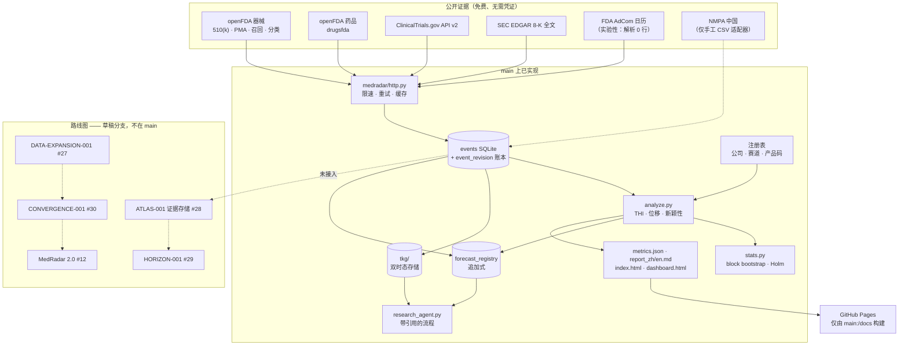

# MedRadar

**一个只回答一个问题的研究项目：公开可观察的信息，能否为医疗技术发展的重要变化提供可靠的早期信号？**

MedRadar 把公开、免费的监管、临床试验与公司披露证据，收集进一个可审计的事件库，然后用冻结的实验、
具名的基线与明确的负结果，检验这些证据是否在市场察觉之前就携带信号。

**状态：研究基础设施，不是已验证的预测产品。** 本仓库没有任何方法展示出样本外预测能力，已发布的数据集
也无法支撑真正的时点（point-in-time）声明（见「局限」）。工程实现与负结果本身就是交付物。

> English → [README.md](README.md) · 全部文档导航 → [docs/INDEX.md](docs/INDEX.md) ·
> 方法契约 → [docs/METHODS.md](docs/METHODS.md)

| | |
|---|---|
| 包版本 | `0.5.0`（以 `pyproject.toml` 为唯一来源） |
| 测试 | **1,160 个离线测试（1,157 通过，3 跳过）** —— 不联网、无需 API key（`python -m pytest -q -o addopts=""`） |
| 数据快照 | **2026-10-31** · 375,378 条事件 · 1.3 GiB SQLite（不入库） |
| 对外可声明的结论 | 事件时间（event-time）描述性统计，以及下面的负结果；仅此而已 |
| 许可证 | MIT |

---

## 已实现什么，以及验证到什么程度

用词约定：**可用** = 已在 `main` 实现并由离线测试覆盖；**部分** = 可用，但有一个已量化的缺口；
**仅机制** = 机器部分正确，但其输入无法支撑它本应支撑的声明。

| 能力 | 位置 | 验证状态 |
|---|---|---|
| 采集 openFDA 器械（510(k)/PMA/召回/分类）、openFDA 药品批准、ClinicalTrials.gov v2、SEC EDGAR 8-K | `medradar/collect_*.py`、`medradar/intelligence/` | **可用** —— 计数可从公开源复现 |
| 统一事件库（`event_date` / `available_at` / `timestamp_quality`） | `medradar/db.py` | **可用**，但受下面的数据前提限制 |
| `events` 背后的追加式修订账本 + 版本化迁移 | `medradar/evidence_core/` | 对**应用写入路径**可用；明确**不是**防篡改（[契约](docs/refoundation/phase2/EVIDENCE_CORE_V1.md)） |
| 公司/子公司与技术赛道消歧 | `medradar/config.py`、`config/*.json` | **部分** —— 35.2 % 事件带公司键，52.4 % 有技术赛道（`docs/DATA.md`）；未匹配事件如实计数，绝不猜测 |
| 赛道热度（收缩后的速率）、结构位移（Jensen–Shannon）、新颖性（首次出现） | `medradar/analyze.py` | **仅描述性** —— 样本内得分，无样本外验证 |
| 事件研究、回放、模拟多头组合 | `medradar/eventstudy.py`、`replay.py`、`paper.py` | **可用，仅模拟** —— 样本内、仅多头、不构成投资建议 |
| 双时态知识库（有效时间 vs 知识时间） | `medradar/tkg/` | **仅机制** —— 存储正确；导入的历史没有独立公开时钟 |
| 追加式预测注册表与 as-of 评分 | `medradar/forecast_registry.py` | **仅机制** —— 已登记 25 条预测，0 条到期；校准状态 `insufficient_matured_forecasts` |
| 确定性的、带引用的研究智能体（检索与引用，非生成式臆造） | `medradar/research_agent.py` | **可用**（作为检索与引用流程）；不建立因果 |
| 报告与零依赖看板 | `medradar/report.py`、`docs/dashboard.html` | **可用** —— 生成产物，不是在线服务 |

**不在 `main`、也不对外声明：** MedRadar 2.0（#12）、Live Observatory（#13/#14）、S-028/S-029
（#15/#16）、PHOENIX（#23–#26）、DATA-EXPANSION / ATLAS / HORIZON / CONVERGENCE（#27–#30）。
见「路线图」—— 每一项都是有标注的草稿，在线站点不会展示其中任何一个。

---

## 架构

实线为 `main` 上已存在的路径；虚线节点是路线图草稿，**尚未接入**。



---

## 研究发现了什么 —— 包括没发现什么

### 正结果，按它的真实大小陈述

模拟事件研究中方向对齐的超额收益（block bootstrap，在「类别 × 窗口」全家族内做 Holm 校正）。
只有 60 日窗口通过：

| 窗口 | n | 平均超额收益 | t | 95 % 置信区间 |
|---|---|---|---|---|
| +1 日 | 122 | +0.15 % | 0.57 | [−0.33 %, +0.65 %] |
| +5 日 | 109 | −0.37 % | −0.92 | [−1.17 %, +0.42 %] |
| +20 日 | 89 | +1.14 % | 1.17 | [−0.65 %, +3.13 %] |
| **+60 日** | **61** | **+5.65 %** | **2.45** | **[+1.35 %, +10.32 %]** |

来源：`docs/metrics.json` → `trading.event_study`，生成于 2026-10-30，快照窗口 2025-11-21 →
2026-10-30。这是模拟层的结果：样本内，不作样本外声明。**时间数据警示：** 快照没有独立公开时间——全部 375,378 行都是 `published_at = available_at = event_date`——因此该结果建立在「事件日即公开日」的同日假设上，**不是**时点结果（见「局限」）。

### 负结果，才是更重要的那一半

**Market-to-R&D（12 个月周期）。** 冻结产物：`experiments/reverse_rd_v1/`、`reverse_rd_v2/` ——
55,090 条 FDA 事件、32 家公司的 43,420 条 SEC 财务事实、25 个季度起点的 6,701 条持续性样本、
24 个起点的 41,003 条「休眠→进入」样本。

| 发现 | 实测 |
|---|---|
| 增加数据源没有带来可检测的排序增益 | 持续性目标边际 PR-AUC：财务 −0.0013、市场 −0.0015、论文 −0.0001、全来源 −0.0068 |
| 模型几乎打不过逐对基准率 | AP 0.7935（模型）vs 0.7913（基准率），Δ +0.0022，95 % CI [−0.032, +0.037] |
| 更多数据改善校准，不改善排序 | ECE 0.0811 → 0.0628；FPR 0.2753 → 0.2472 |
| 「进入」目标跨窗口不稳定 | 差异落在 0.014–0.026 的窗口标准差之内 |

专利**未评估**（USPTO Open Data Portal 需要 key）；采购数据**被排除**（其快照不具备时点可用性）。

**早期信号研究（五家公司）。** Phase 0 为 CONDITIONAL-GO；提前量（lead-time）门禁为 **NO-GO** ——
该研究未能证明变化可以被更早检出。见
[`research/studies/early_signal_5firms/PHASE0_REPORT.md`](research/studies/early_signal_5firms/PHASE0_REPORT.md)。

**S-028 / S-029 关系研究（仅分支，草稿）。** 两项都是 **NO-GO**：基于证据的关系网络在留出数据上没有跑赢零假设。完整记录在草稿分支（PR #15/#16）；不作为已发布能力。

**来源恢复实验（E1b）。** 缺失的**公开**时间戳能否按来源找回？

| 数据源 | 回溯性公开时间 | 结论 |
|---|---|---|
| SEC EDGAR | **可以** —— `acceptanceDateTime`，不可变档案，修订以新 accession 出现 | STRONG |
| ClinicalTrials.gov | **部分** —— 仅有首次公示日期、日期粒度、且仅 `ACTUAL` 记录；历史内容状态不可回溯 | MEDIUM |
| openFDA 510(k)/PMA | **不可以** —— 不存在公开公示时间字段；`decision_date` 是事件日期，不是发布时刻 | 只能前瞻观测 |

完整报告：[`E1B_SOURCE_RECOVERY.md`](docs/refoundation/phase2/E1B_SOURCE_RECOVERY.md)（28 次请求、
每个来源 5 条记录，是字段语义的形状测试，不是总体估计）。

---

## 局限

1. **仅事件时间。** 已提交快照中每一行都是 `published_at = available_at = event_date`
   （375,378 / 375,378），`timestamp_quality = 'date'`；`first_seen_at` 来自批量导入。
   **独立公开时间 = 0 行。** 因此收益研究建立在「事件日即公开日」的同日假设之上。
2. **在重新采集来源发布时间戳之前，不支持真正的时点声明** —— EDGAR 可找回、ClinicalTrials.gov
   只到日期、openFDA 只能从今往后前瞻观测。
3. **实体消歧只完成一部分。** 35.2 % 事件带公司键，52.4 % 有技术赛道（`docs/DATA.md`）。未映射的保持未映射并计数，绝不猜测。
4. **修订账本不是防篡改。** 它记录应用写入路径；数据库所有者仍可直接改头表或替换文件。
5. **510(k)/PMA 行没有公开时间戳**，因此进入产业计数、但永不进入收益研究 —— 这是真实的样本损失，
   刻意不掩盖。
6. **AdCom 采集器解析 0 行**（FDA 在前端渲染日历），已标注实验性；返回 `empty`/`source_changed`，
   不会静默返回 `ok`。
7. **模拟组合是样本内、仅多头、约 11 个月 38 笔交易。** 做空只告警不交易；借券费、并购逼平与退市未建模。
8. **不作因果声明。** DiD 与合成控制是路线图条目，不是结果。
9. **NMPA 有意不抓取**（WAF）。没有用户提供的 CSV 时，所有中国值为 `null`，绝不为 0。

---

## 复现

```bash
git clone https://github.com/ChazY11/medradar.git && cd medradar
pip install -e .
python -m pytest -q -o addopts=""   # 1,160 个离线测试，不联网、无需 API key
medradar demo                       # 离线，使用已提交快照，< 60 秒 → out/demo/index.html
```

真实数据雷达需要网络（仍无需 API key），约 3 分钟：

```bash
medradar run --months 24 --with-trade --with-dashboard
#   out/index.html  · out/report_zh.md  · docs/dashboard.html  · out/summary.csv
```

1.3 GiB 的 SQLite 快照刻意不入库，因此干净克隆复现的是**流程**，不是精确数字。冻结研究用以下命令重建：

```bash
python -m medradar.intelligence.pipeline collect --source fda --months 120   # 需要 `.[bulk]`
python experiments/reverse_rd_v2/run_v2.py --db data/medradar.sqlite --holdouts 3
```

---

## 看板快照

<p align="center">
  
</p>

*已提交快照 —— **数据集 2026-10-31**、**包版本 v0.5.0**。它展示生成报告的 demo 视图；不是在线服务，
也不是预测。用 `medradar dashboard` 重建；交互版为 [`docs/dashboard.html`](docs/dashboard.html)。
图片策略见 [`README_VISUAL_PLAN.md`](docs/refoundation/phase3/README_VISUAL_PLAN.md)。*

---

## 路线图

已交付：`v0.3.0` 研究底座（双时态 TKG + 不可变预测注册表）、`v0.4.0` 更难目标与 purged 多窗口评估、
`v0.5.0` 连续预测周期与带引用的研究智能体。完整记录见 [ROADMAP.md](ROADMAP.md)。

接下来（明确**尚未**完成）：

1. 重新采集独立的公开时间戳（先 EDGAR —— 它今天就能提供真实公开时刻）。
2. 积累足够多的到期预测窗口，使任何校准声明成为可能。
3. 把图特征接进模型，而不只是接进智能体。
4. 拿到 USPTO ODP key 后加入专利特征；版本化历史赛道分类。
5. NMPA CSV 导入、AdCom 解析，以及 #12–#30 中的草稿线。

## 贡献

最有价值的贡献不是代码，而是让数据可信的策展知识文件：公司/子公司别名、赛道词典、产品码映射。
核心包保持仅用标准库；每个新指标都必须先更新 [`docs/METHODS.md`](docs/METHODS.md) 与
[`docs/SCHEMA.md`](docs/SCHEMA.md)。从 [CONTRIBUTING.md](CONTRIBUTING.md) 与
[`docs/GOOD_FIRST_ISSUES.md`](docs/GOOD_FIRST_ISSUES.md) 开始；其余全部文档导航见
[`docs/INDEX.md`](docs/INDEX.md)。

## 许可证

MIT。源数据归其发布方所有（openFDA 属公共领域；ClinicalTrials.gov 与 SEC EDGAR 各有其条款）。
本仓库不构成投资建议，是研究与教育项目。
