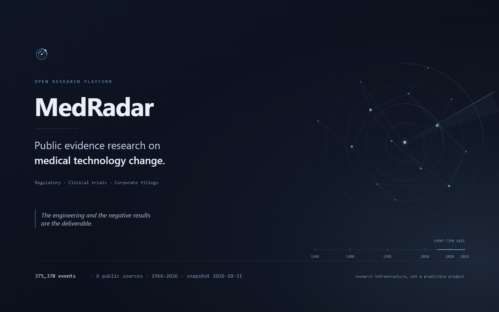
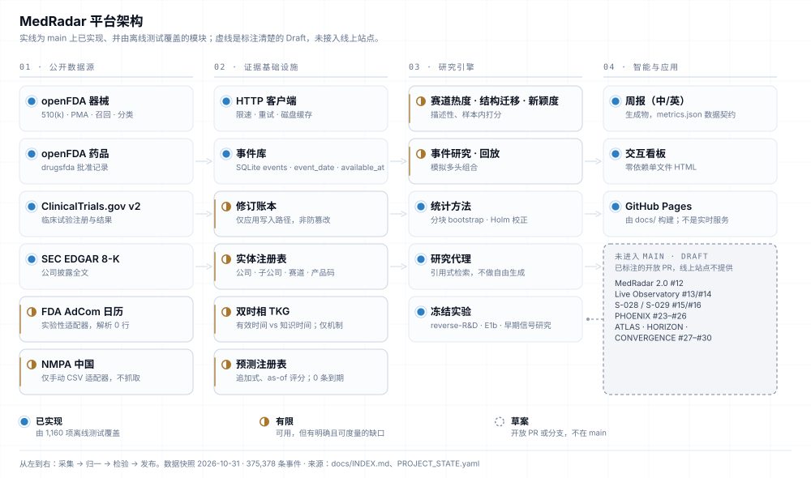
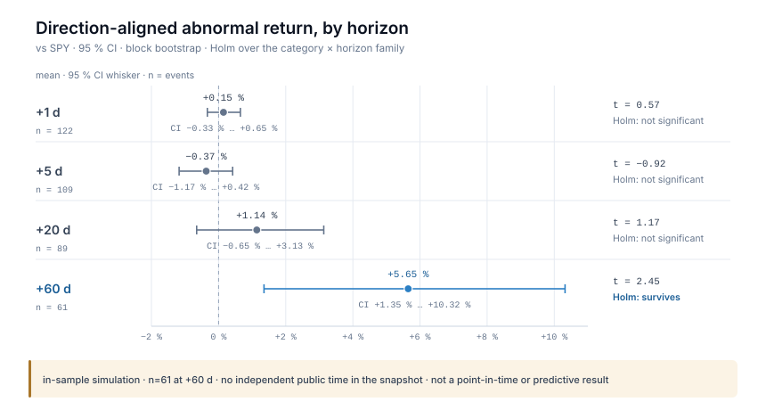
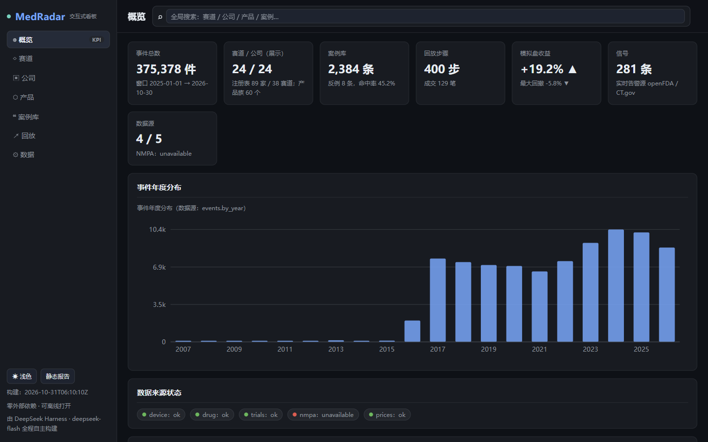
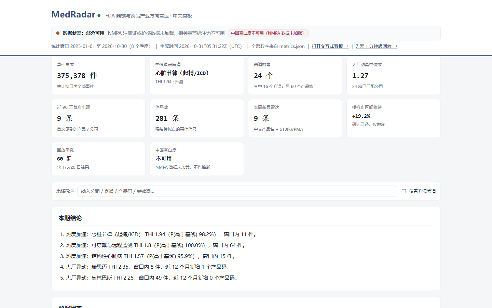

<p align="center">
  <a href="https://chazy11.github.io/medradar/">
    
  </a>
</p>

<p align="center">
  <a href="CHANGELOG.md"></a>
  <a href="https://github.com/ChazY11/medradar/actions/workflows/ci.yml"></a>
  <a href="docs/DATA.md"></a>
  <a href="pyproject.toml"></a>
  <a href="LICENSE"></a>
</p>

<p align="center">
  <a href="https://chazy11.github.io/medradar/"><b>项目主页</b></a> &nbsp;·&nbsp;
  <a href="#platform">平台</a> &nbsp;·&nbsp;
  <a href="#research">研究</a> &nbsp;·&nbsp;
  <a href="#start">快速开始</a> &nbsp;·&nbsp;
  <a href="docs/INDEX.md">文档</a> &nbsp;·&nbsp;
  <a href="README.md">English</a>
</p>

## 公开证据，能否提前看见医疗技术的变化？

MedRadar 把公开、免费的监管、临床试验与公司披露证据，收集进一个可审计的事件库；然后用冻结的实验、
具名的基线与明确公布的负结果，检验这些证据是否在市场察觉之前就携带信号。

> **研究基础设施，不是已验证的预测产品。** 本仓库没有任何方法展示出样本外预测能力，已发布的数据快照
> 也无法支撑真正的时点（point-in-time）声明。工程实现与负结果本身就是交付物。
> → [局限](#limitations) · [方法契约](docs/METHODS.md)

<p align="center">
  <sub><b>375,378</b> 条事件 · <b>6</b> 个免费公开数据源 · 事件日期 <b>1966–2026</b> · 快照 <b>2026-10-31</b> · <b>1,160</b> 项离线测试 · 包版本 <b>v0.5.0</b> · MIT</sub>
</p>

---

## 一张图看懂平台

<picture>
  <source media="(prefers-color-scheme: dark)" srcset="docs/assets/architecture/architecture-zh-dark.svg">
  
</picture>

<p align="center"><sub>来源：<a href="tools/homepage/build_architecture.py"><code>tools/homepage/build_architecture.py</code></a> —— 由仓库结构生成，不是示意图。浅色与深色版本同时提供；研究引擎与应用列的每一行都对应仓库中的实现路径。</sub></p>

**如何读这张图。** 实线表示该模块已在 `main` 上实现，并由离线测试覆盖；**有限**表示可用，但有明确且
已量化的缺口；右侧虚线框是**草案**：只存在于开放 PR 或分支，**不在** `main`，也**没有**接入线上站点。

- **已实现** —— 在 `main` 上，由 1,160 项离线测试覆盖。
- **有限** —— 可用，但有明确且可度量的缺口（例如实体解析 35.2 % / 52.4 %）。
- **草案** —— 开放 PR 或分支；未发布、未上线、不作声明。

平台细节、数据源清单与覆盖质量见 **[Platform 页面 ↗](https://chazy11.github.io/medradar/platform/)**，
仓库内导航见 [`docs/INDEX.md`](docs/INDEX.md)。

---

## 已实现什么，以及验证到什么程度

用词约定：**可用** = 已在 `main` 实现并由离线测试覆盖；**部分** = 可用，但有一个已量化的缺口；
**仅机制** = 机器部分正确，但其输入无法支撑它本应支撑的声明。

| 能力 | 做什么 | 验证状态 | 代码入口 |
|---|---|---|---|
| **多源采集** | openFDA 器械 510(k)/PMA/召回/分类、openFDA 药品批准、ClinicalTrials.gov v2、SEC EDGAR 8-K → 统一事件模式；计数可从公开源复现 | **可用** | [`medradar/collect_device.py`](medradar/collect_device.py) · [`collect_drug.py`](medradar/collect_drug.py) · [`clinical.py`](medradar/clinical.py) |
| **双时态事件库** | 每行都带 `event_date` / `available_at` / `timestamp_quality`，`events` 背后是追加式修订账本 —— 明确**不是**防篡改 | **可用** | [`medradar/db.py`](medradar/db.py) · [`medradar/evidence_core/`](medradar/evidence_core/) |
| **实体解析** | 公司/子公司、技术赛道与产品码；35.2 % 的事件带公司键，52.4 % 有技术赛道。未匹配事件如实计数、绝不猜测 | **部分** | [`config/`](config/) · [`docs/DATA.md`](docs/DATA.md) |
| **描述性分析** | 赛道热度（收缩后的速率）、结构位移（Jensen–Shannon）、新颖性（首次出现）—— 描述性、样本内得分，不是已验证的信号 | **仅描述性** | [`medradar/analyze.py`](medradar/analyze.py) |
| **事件研究、回放与模拟组合** | 方向对齐的超额收益、block bootstrap、Holm 校正、样本内仅多头的模拟组合 —— 不做样本外声明 | **可用，仅模拟** | [`medradar/eventstudy.py`](medradar/eventstudy.py) · [`replay.py`](medradar/replay.py) |
| **报告与零依赖看板** | 由同一份 `metrics.json` 生成中文报告、英文一页纸、CSV 与自包含 HTML 看板 —— 生成产物，不是在线服务 | **可用** | [`medradar/report.py`](medradar/report.py) · [`docs/dashboard.html`](docs/dashboard.html) |

`main` 上还有两项验证层级更低的能力：双时态知识库（[`medradar/tkg/`](medradar/tkg/)，**仅机制**）
与追加式预测注册表（[`medradar/forecast_registry.py`](medradar/forecast_registry.py)，**仅机制** ——
登记 25 条预测、0 条到期，校准状态为 `insufficient_matured_forecasts`）。

**不在 `main`、也不对外声明：** MedRadar 2.0（#12）、Live Observatory（#13/#14）、S-028 / S-029
（#15/#16）、PHOENIX（#23–#26）、DATA-EXPANSION / ATLAS / HORIZON / CONVERGENCE（#27–#30）。
每一项都是有标注的草稿，线上站点不会展示其中任何一个。见[路线图](#roadmap)。

---

## 研究发现了什么 —— 包括没发现什么

### 正结果，按它的真实大小陈述

模拟事件研究中方向对齐的超额收益（block bootstrap，在「类别 × 窗口」全家族内做 Holm 校正）。
只有 60 日窗口通过：

| 窗口 | n | 平均超额收益 | t | 95 % 置信区间 |
|---|---:|---:|---:|---|
| +1 日 | 122 | +0.15 % | 0.57 | [−0.33 %, +0.65 %] |
| +5 日 | 109 | −0.37 % | −0.92 | [−1.17 %, +0.42 %] |
| +20 日 | 89 | +1.14 % | 1.17 | [−0.65 %, +3.13 %] |
| **+60 日** | **61** | **+5.65 %** | **2.45** | **[+1.35 %, +10.32 %]** |

<p align="center">
  
</p>

<p align="center"><sub>数据来源：<code>docs/metrics.json</code> → <code>trading.event_study</code>，生成于 2026-10-30 · 窗口 2025-11-21 → 2026-10-30 · 图由 <a href="tools/site/make_figures.py"><code>tools/site/make_figures.py</code></a> 从已提交数据解析生成（图与数据漂移会使测试失败）。图内标注为英文。</sub></p>

**每个收益数字都必须携带的时间数据前提。** 快照没有独立的公开时间 —— 全部 375,378 行的
`published_at = available_at = event_date` —— 因此这个结果建立在「当日即公开」的假设上，
**不是时点结果**。它是样本内模拟，约 11 个月内 38 笔模拟交易，仅做多，不构成投资建议。

### 负结果，比正结果更重要

- **Market-to-R&D（12 个月窗口）。** 没有新增数据源带来可检测的排序增益：marginal PR-AUC 分别为
  金融 −0.0013、市场 −0.0015、论文 −0.0001、全源 −0.0068。模型仅略微超过逐对基准率 ——
  AP 0.7935 vs 0.7913，Δ +0.0022，95 % CI [−0.032, +0.037]。更多数据改善的是校准
  （ECE 0.0811 → 0.0628），不是排序。冻结产物：
  [`experiments/reverse_rd_v1/`](experiments/reverse_rd_v1/) · [`experiments/reverse_rd_v2/`](experiments/reverse_rd_v2/)。
- **早期信号研究（五家公司）。** 阶段 0 结论为 **CONDITIONAL-GO**，但领先后验门 ——
  *这个变化能否被更早发现？* —— 结论是 **NO-GO**。
  → [`research/studies/early_signal_5firms/PHASE0_REPORT.md`](research/studies/early_signal_5firms/PHASE0_REPORT.md)
- **S-028 / S-029 关系研究。** 两者均为 **NO-GO**：基于证据的关系网络在留出数据上没有跑赢零模型。
  它们只存在于草稿分支（PR #15/#16），**不**作为已发布能力展示。

### 缺失的公开时间戳能否找回？（E1b）

| 数据源 | 可回溯的公开时间 | 结论 |
|---|---|---|
| SEC EDGAR | **可以** —— `acceptanceDateTime`、不可变归档、修订作为新 accession | STRONG |
| ClinicalTrials.gov | **部分** —— 只有首次发布日、日期粒度、仅 `ACTUAL` 记录 | MEDIUM |
| openFDA 510(k)/PMA | **不可以** —— 不存在公开发布字段；`decision_date` 是事件日期 | 只能从观测时点开始 |

完整报告：[`docs/refoundation/phase2/E1B_SOURCE_RECOVERY.md`](docs/refoundation/phase2/E1B_SOURCE_RECOVERY.md)
（28 个请求、每个来源 5 条记录 —— 形状测试，不是总体估计）。

更多：**[Research 页面 ↗](https://chazy11.github.io/medradar/research/)** · [`docs/RESEARCH.md`](docs/RESEARCH.md)
· [`docs/CASES.md`](docs/CASES.md) · [`docs/CALIBRATION.md`](docs/CALIBRATION.md)。

---

## 生成产物，不是在线服务

下面的每张图，都是仓库从已提交快照生成的页面的真实截图。没有示意图，也没有任何 `main` 上不存在的功能。

<p align="center">
  
</p>

<p align="center"><sub><b>对应页面：</b><code>docs/dashboard.html</code>（交互式看板，零依赖单文件） · <b>数据快照：</b>2026-10-31（<code>docs/metrics.json</code>） · <b>包版本：</b>v0.5.0 · <b>离线演示：</b>是 —— 数据全部内联，无需服务器 · <b>是否在 main：</b>是 · <b>截图：</b>Chromium 1440×900，真实生成页面，未修改数据或界面。</sub></p>

<p align="center">
  
</p>

<p align="center"><sub><b>对应页面：</b><code>docs/report.html</code>（生成式中英文报告，十九章） · <b>数据快照：</b>2026-10-31 · <b>包版本：</b>v0.5.0 · <b>离线演示：</b>是 —— 自包含 HTML · <b>是否在 main：</b>是 · <b>说明：</b>报告目前以中文为主，站点与本 README 为英文。</sub></p>

看板、报告、回放、研究图与数据审计入口都在
**[Explore 页面 ↗](https://chazy11.github.io/medradar/explore/)**。

---

## 快速开始

```bash
git clone https://github.com/ChazY11/medradar.git && cd medradar
pip install -e .                      # 仅用标准库；无需 API key

python -m pytest -q -o addopts=""     # 1,160 项离线测试（已验证基线），不联网
medradar demo                         # 离线运行，使用已提交快照，< 60 秒 → out/demo/index.html
```

实时雷达需要联网（仍然不需要 API key），大约三分钟：

```bash
medradar run --months 24 --with-trade --with-dashboard
# → out/index.html · out/report_zh.md · docs/dashboard.html · docs/report.html · out/summary.csv
```

1.3 GiB 的 SQLite 快照刻意**不**入库，因此干净的 clone 复现的是**流程**，不是完全相同的数字。
冻结研究按记录的命重新构建：

```bash
python -m medradar.intelligence.pipeline collect --source fda --months 120   # 需要 `.[bulk]`
python experiments/reverse_rd_v2/run_v2.py --db data/medradar.sqlite --holdouts 3
```

<div id="start"></div>

- **首次运行：** [`medradar/onboarding.py`](medradar/onboarding.py) · `medradar --help`
- **数据契约：** [`docs/SCHEMA.md`](docs/SCHEMA.md) · **数据清单：** [`docs/DATA.md`](docs/DATA.md)
- **方法契约：** [`docs/METHODS.md`](docs/METHODS.md) · **假设登记：** [`docs/ASSUMPTIONS.md`](docs/ASSUMPTIONS.md)
- **复现指南：** **[Documentation 页面 ↗](https://chazy11.github.io/medradar/documentation/)** · [`docs/INDEX.md`](docs/INDEX.md)

---

## 局限

1. **只有事件时间。** 已提交快照中每一行都有 `published_at = available_at = event_date`
   （375,378 / 375,378），`timestamp_quality = 'date'`。**独立公开时间 = 0 行。** 收益研究因此建立在
   「当日即公开」的假设上。
2. **真正的时点声明尚不支持**，除非重新获取来源的发布时间戳 —— EDGAR 可回溯，ClinicalTrials.gov 只有
   日期粒度，openFDA 只能从观测时点开始。
3. **实体解析是部分的。** 35.2 % 的事件带公司键，52.4 % 有技术赛道。未映射事件保持未映射并被计数，
   绝不猜测。
4. **修订账本不是防篡改。** 它记录的是应用写入路径；数据库所有者仍可修改主表或替换文件。
5. **510(k)/PMA 行没有公开时间戳**，因此进入产业计数，但永远不进入收益研究 —— 这是真实的样本损失，
   刻意不用补丁掩盖。
6. **AdCom 采集器解析 0 行**（FDA 日历由客户端渲染），标记为实验性；它返回 `empty`/`source_changed`，
   绝不静默返回 `ok`。
7. **模拟组合是样本内、仅多头、约 11 个月 38 笔交易。** 做空只告警、不交易；费用、逼空与退市未建模。
8. **不做因果声明。** 双重差分与合成控制是路线图项，不是结果。
9. **NMPA 刻意不抓取**（有 WAF）。没有用户提供的 CSV 时，所有中国数值都是 `null`，绝不是 0。

完整论证与逐数字溯源：[`docs/METHODS.md`](docs/METHODS.md) ·
[`docs/CALIBRATION.md`](docs/CALIBRATION.md) · [`docs/ASSUMPTIONS.md`](docs/ASSUMPTIONS.md)。

---

## 路线图

已发布：`v0.3.0` 研究基础（双时态 TKG + 不可变预测注册表）、`v0.4.0` 更难目标 + 清洗式多窗口评估、
`v0.5.0` 持续预测周期与带引用的研究代理。完整记录：[`ROADMAP.md`](ROADMAP.md)。

接下来，且明确**尚未完成**：

1. **重新获取独立公开时间戳** —— 先做 EDGAR；它今天就能携带真实的公开时刻。没有这一步，不可能有
   时点声明。
2. **积累足够的预测窗口**，才谈得上任何校准声明。
3. **把关系图特征喂进模型**，而不只是喂给检索代理。
4. **在拿到 USPTO Open Data Portal key 后加入专利特征**；版本化的历史赛道分类。
5. **NMPA CSV 导入器、AdCom 解析**，以及 PR #12–#30 中记录的草稿通道。

---

## 项目状态

状态数字由 [`PROJECT_STATE.yaml`](PROJECT_STATE.yaml) 经 `python tools/governance/gen_views.py` 生成，
英文版 README 内嵌了同一份生成表格（不可手改）。当前关键事实：

| 项目 | 值 |
|---|---|
| 观测到的 main head | `b2a14c0`（2026-11-03，可能滞后于 main） |
| 已验证基线 | `b2a14c0`（1,157 通过，收集 1,160） |
| 发布版本 | 0.5.0（未发布） |
| 测试 | 1,157 通过、3 跳过、0 失败（收集 1,160，离线） |
| 能力 | 7 项可用 · 6 项草稿 · 1 项退役 |
| 研究 | 1 项研究（0 项有公开声明） |
| 数据快照 | 2026-10-31 —— 375,378 条事件（本地构建；`data/` 不入库） |
| 开放 PR | 28 个（27 个草稿），10 个已合并 |
| 分支保护 | 未启用 |

治理门见 [`docs/governance/GOVERNANCE.md`](docs/governance/GOVERNANCE.md)，生成的研究索引见
[`docs/RESEARCH_INDEX.md`](docs/RESEARCH_INDEX.md)。

---

## 贡献、引用与许可证

最高价值的贡献是整理知识文件，而不是写代码：公司/子公司别名、赛道词典、产品码映射。核心包保持仅用
标准库；每个新指标都必须先更新 [`docs/METHODS.md`](docs/METHODS.md) 与
[`docs/SCHEMA.md`](docs/SCHEMA.md)。从 [CONTRIBUTING.md](CONTRIBUTING.md) 与
[`docs/GOOD_FIRST_ISSUES.md`](docs/GOOD_FIRST_ISSUES.md) 开始。

如需引用本仓库，请把它作为研究基础设施来引用，并引用具体的带标签产物（某份报告、某个研究目录、
某个冻结实验），而不是作为预测结论。

MIT —— 见 [LICENSE](LICENSE)。原始数据归其发布方所有：openFDA 属公有领域；ClinicalTrials.gov 与
SEC EDGAR 各有自己的条款。本项目不构成投资建议，是研究与教育项目。

<p align="center"><sub>数据快照 2026-10-31 · 包版本 v0.5.0 · MIT · <a href="README.md">English</a> · <a href="docs/INDEX.md">文档索引</a></sub></p>
