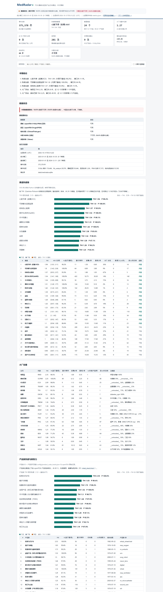

# MedRadar · FDA 产业方向雷达

[](https://github.com/ChazY11/medradar/blob/main/docs/ATTRIBUTION.md)


> 把美国 FDA 的器械获批、药品批准、临床试验变成 **可量化、可复现、每周自动更新** 的中文产业情报。
>
> `v0.2.2` 及此前的稳定核心由 DeepSeek Harness 智能体团队使用 `deepseek-flash` 构建。
> 独立的 Market-to-R&D 研究分支单独署名，详见 [docs/ATTRIBUTION.md](docs/ATTRIBUTION.md)。

> 英文版 → [README.md](README.md) · 方法论 → [docs/METHODS.md](docs/METHODS.md)



### 一次运行的实际产出（2026‑10‑31 快照）

| 指标 | 数值 |
|---|---|
| 入库事件 | **375,378** 件（510(k) 176,466 · PMA 57,372 · 召回 59,646 · 临床试验 55,592 · 药品批准 5,326 · EDGAR 催化剂 20,976） |
| 覆盖 | 89 家公司、60 个赛道、**204 个器械产品族**、7,097 个产品码、1.2 GiB SQLite |
| 当前最热赛道 | 心脏节律 THI 1.94（P=98.2%）· 可穿戴与远程监测 1.80 · 结构性心脏病 1.57 · 手术机器人 1.54 |
| 生成信号 | 281 条 |
| 案例库 | **2,384 个可追溯案例**（3,700+ 条逐字证据 + 1/5/20/60 日价格反应）：943 批准 · 379 CRL · 1,062 试验读出 |
| 回放 | **400 步、2019–2026 七年时间轴**，10/25/50bps 三档成本；最近 7 天用 1 分钟成交 |
| 事件研究（20 日，方向对齐 + 缩尾，**12 个检验全家族 Holm**） | 批准 +2.8%（CI 0.9–4.8，**Holm p=0.007 → 显著**）· CRL −3.8%（CI −6.7–−0.8，Holm p=0.060 → 临界，不显著）· 试验 −0.3%（不显著） |
| 测试 | **446 个离线测试**，不联网、不需要 API key |

> 数字每周都会变，价值在于每一个数字都能用 `python -m medradar run` 复现。

**一句话**：不猜大厂"想做什么"，只统计它"已经做了什么、往哪儿挪"。

---

## 60 秒试用

```bash
pip install -e .        # 或 git clone https://github.com/<你的用户名>/medradar.git && cd medradar
medradar demo           # 离线、用已提交快照、不需要 API key、<60 秒
# 打开 out/demo/index.html
```

真实数据运行：

```bash
medradar run --months 24 --with-trade    # 约 3 分钟，仅免费公开数据
medradar replay --days 30                # 事件→成交回放，含多档成本
```

## 这个项目回答什么问题

| 问题 | 指标 | 产物 |
|---|---|---|
| 哪些器械赛道在升温？ | `THI`＝收缩后的近期速率 ÷ 基线速率 | 赛道热度榜 |
| 某家公司在换方向吗？ | 产品码结构的 JS 散度 | 迁移表（"谁在重新分配"） |
| 什么是真正新的？ | 该公司历史上首次出现的产品码 | 每周"首次出现"清单 |
| 药企的治疗领域在往哪走？ | 试验启动速率 + 各期占比 | 药品雷达 |
| 中国缺什么？ | 美国活动份额 vs 已加载的 NMPA 注册证 | 中国空白度（无数据时诚实标 `unavailable`） |
| 这些信号对股价有信息含量吗？ | 事件研究：相对 SPY 的超额收益（+1/+5/+20/+60 交易日） | `out/trading.json`（**仅模拟**） |

## 实时层：事件告警 + 模拟交易（5–15 分钟）

批处理回答"行业在做什么"，实时层回答"刚刚发生了什么"。

```bash
python -m medradar live --once --since-hours 2              # 单轮（cron / DSH 自动化）
python -m medradar live --interval 600                      # 每 10 分钟循环
python -m medradar live --once --backfill-days 7 --no-trade # 回填近期催化剂（只告警不下单）
python -m medradar live --reset                             # 清空模拟账户
```

每一轮：SEC EDGAR 8-K 实时流（秒级）→ EDGAR 全文检索回填 → FDA 新闻 RSS →
ClinicalTrials.gov 状态变更 → 关键词分类 → **按 Yahoo 最新真实报价 + 10bps 滑点模拟成交** →
按市值重估 → 告警（终端 + `out/live_alerts.jsonl` + 可选 `MEDRADAR_WEBHOOK_URL`）。

实测延迟（2026‑10‑31）：

| 数据源 | 延迟 | 能否交易 |
|---|---|---|
| SEC 8-K 申报 | 秒级 | ✅ |
| FDA 新闻 RSS | 实测滞后约 8 天 | ❌ 仅参考 |
| ClinicalTrials.gov 更新 | 小时级 | 仅终止/暂停 |
| openFDA 510(k)/PMA | 12 天 | ❌ 只属于慢车道 |
| FDA 在审提交 | **不公开** | 物理上不可能 |

只做多、单票 ≤5%、单赛道 ≤25%、−20% 止损、60 个交易日离场。做空信号**只告警不下单**：
借券费和并购逼平会让模拟收益变成假的。这是模拟盘，不接券商、不下真单、不构成投资建议。

**执行护栏**（发布前评审后补上）：

* 只有实时 EDGAR 流可以开仓；回填、FDA RSS、试验状态变更只告警不成交；
* 报价超过 30 分钟一律不能成交（只能用于估值）；
* 仓位按**含滑点的成交价**计算，现金不会变负；
* `--no-trade` 同时冻结买入和卖出；
* 同一 `(ticker, 日期, 类型)` 的跨源重复告警会被合并。

**时间口径**：`signal_date = event_date + 1`，成交取其后第一个交易日开盘，即**事件后约 2 个交易日**。
这是保守口径，不是"当日成交"。只有日期级公开时间戳的事件不进入交易研究。

### 8-K 全文 LLM 判定（决定仓位大小）

关键词只能判断"像利好"，判断不了"这是公司首个 20 亿美元级适应症，还是一个小标签变更"——
而这恰恰决定仓位该给 1% 还是 5%。所以实时层把 8-K 全文交给 LLM，要求输出**结构化 + 带原文引用**的判定：

```json
{"direction": 1, "materiality": 0.82, "confidence": 0.9, "catalyst_type": "approval",
 "asset": "Keytruda", "indication": "一线非小细胞肺癌", "is_pivotal": true,
 "revenue_relevance": "high", "evidence_quotes": ["原文逐字引用"], "rationale_zh": "……"}
```

* **任意 OpenAI 兼容端点**：`MEDRADAR_LLM_BASE_URL`（默认 `https://api.deepseek.com`）、
  `MEDRADAR_LLM_API_KEY`、`MEDRADAR_LLM_MODEL`（默认 `deepseek-chat`）。
* **按内容哈希缓存**：同一份文件永不重复计费。
* **预算硬上限**：`--llm-budget 4`，超预算自动回退关键词判定。
* **证据优先**：没有逐字引用的判定，置信度直接砍半。
* **仓位映射**：`仓位 = 5% × clamp(materiality, 20%, 100%)`——常规财报约 1%，首创获批给满 5%。

```bash
# 没 key 时用确定性回退，并在结果里标注 "judge": "heuristic(no-llm-key)"
python -m medradar judge --file filing.txt --headline "Company 8-K"

# 有 key 时
export MEDRADAR_LLM_API_KEY=sk-...
python -m medradar judge --url https://www.sec.gov/Archives/... --headline "Company 8-K"
```

在 **25 份人工标注的真实 8‑K**（批准 / CRL / 试验读出 / 财报）上校准，完整报告见
[docs/CALIBRATION.md](docs/CALIBRATION.md)：

| 指标 | LLM 判定 | 关键词基线 |
|---|---|---|
| catalyst_type 准确率 | **1.00** | 0.60 |
| direction 准确率 | **0.92** | 0.72 |
| 材料性 Spearman ρ | **0.80** | 0.58 |
| 高材料性 F1（≥0.5） | **0.94** | 0.67 |
| 把 CRL 判成"买入" | **0** | 5 份里 2 份 |

基线把 4/9 试验读数和 5/5 财报都判成 `approval`——而 `earnings` 是"不交易"的开关，这个错误是
实盘级别的。材料性相对人工标签系统性偏高约 +0.15：建议按排序使用，或乘 0.85 收缩后再算仓位。

## 快速开始

```bash
git clone https://github.com/<你的用户名>/medradar.git
cd medradar

# 不需要 API key，除 Python 3.10+ 外无依赖
# 24 个月是快速体验（约 2-3 分钟）；完整十年历史用 --months 120
python -m medradar run --months 24 --with-trade

# 打开
#   out/index.html      自包含看板（同时复制到 docs/index.html 供 GitHub Pages）
#   out/report_zh.md    中文研究报告
#   out/summary.csv     Excel 友好平表
```

分步执行（可断点续跑，HTTP 响应全部缓存在 `data/cache/`）：

```bash
python -m medradar collect --sources device,drug,trials --months 120
python -m medradar analyze --window-quarters 8 --baseline-quarters 20
python -m medradar report
python -m medradar trade --capital 100000
python -m medradar status
python -m medradar selftest      # 离线单测，不联网
```

## 数据源（全部免费、无需凭证）

| 数据源 | 内容 | 新鲜度（2026‑10‑31 实测） |
|---|---|---|
| openFDA `device/510k` | 510(k) 清关，17.6 万条 | 更新至 2026‑10‑19（T−12 天） |
| openFDA `device/pma` | PMA 及补充申请，5.7 万条 | T−12 天 |
| openFDA `device/recall` | 器械召回，6 万条 | T−2 天 |
| openFDA `device/classification` | 约 6,500 个产品码定义 | 静态 |
| openFDA `drug/drugsfda` | NDA/BLA/ANDA 审评与批准，2.9 万条 | T−2 天 |
| ClinicalTrials.gov API v2 | 临床试验登记（**药品 + 器械都覆盖**） | 入组开始后 ≤21 天登记 |
| SEC EDGAR 全文检索 | 8-K / CRL 事件流（可选） | 近实时 |
| NMPA（中国） | 医疗器械注册证 | **不爬取**：官网有 JS WAF（HTTP 412/202），见下 |

### 关于 NMPA 的诚实说明

`www.nmpa.gov.cn` 返回 412、`www.cmde.org.cn` 返回 202（JavaScript 挑战），
**MedRadar 不做绕过 WAF 的抓取**。替代方案是适配器：

1. 从国家药监局"医疗器械注册证"查询页导出 CSV；
2. 放到 `data/nmpa_registrations.csv`（列名兼容中英文，见 `config/sources.json`）；
3. 重跑 `collect --sources nmpa`，中国空白度表即生效。

没有 CSV 时，`cn_count`/`gap_index` 全部为 `null`，报告显式写"不可用（NMPA 数据未加载）"，
**绝不用 0 冒充真实空白**。演示用途可设 `MEDRADAR_NMPA_DEMO=1` 加载明显标注为虚构的样例种子。

## 方法要点（完整版见 docs/METHODS.md）

* **先收缩再喊话**：某公司本季度 2 件获批、上季度 0 件，增长率无穷大但信息量为零。所有速率都做
  Gamma–Poisson 后验，先验收缩强度 = 3 个季度；`THI` 是后验均值 ÷ 基线速率，`prob_up` 是
  "真实速率高于基线"的后验概率。
* **方向看结构，不看总量**：公司可以获批数量下降，但产品结构决定性地转向新品类。用
  Jensen–Shannon 散度衡量结构迁移，只报告变动 ≥8 个百分点的赛道。
* **新颖性＝首次出现**：某公司首次出现的产品码，是新产品线最早的可见痕迹。
* **信号带明确时间戳**：`signal_date = event_date + 1 天`，确保回测不可能偷看未来。
* **公司口径是生死线**：实测按名称直接匹配，J&J 两年只有 2 件 510(k)（真实申报主体是 Ethicon /
  DePuy Synthes / Biosense Webster / Cerenovus），GE HealthCare 只有 6 件。子地图谱做不好，
  这个工具就是废的。

## 中文看板包含什么

数据状态条 → KPI → 赛道热度榜（SVG 热力条 + THI + 后验概率）→ 大厂动量 → 结构迁移 →
本期首次出现 → 召回与风险 → 药品侧（批准/治疗领域/试验各期结构）→ 中国空白度 →
信号清单与模拟盘净值 → 方法与局限 → 免责声明。

看板是**完全自包含**的 HTML（无 CDN、无外链字体），可离线打开、可托管在 GitHub Pages。

## Market-to-R&D 与 Horizon 预测

`feature/market-to-rd` 研究分支新增 SEC XBRL Company Facts、USAspending 合同授予、
按时间一致原则构造的公司—赛道样本、rolling-origin Reverse R&D 基线，以及可持续核验的
12 个月预测登记。预测对象是**未来公开可见的研发/监管里程碑**，不是股价，也不是无法公开观测的内部研发启动日。

```bash
python -m medradar.intelligence.pipeline collect --source sec
python -m medradar.intelligence.pipeline collect --source procurement --start-date 2016-01-01
python -m medradar.intelligence.pipeline research --horizon 12
```

SEC 营收始终保持公司合并口径，不会冒充产品或器械业务收入。USAspending 合同授予金额不等于营收，
其当前快照不参与历史增益结论。完整口径见 [Reverse R&D 方法](docs/REVERSE_RD.md)、
[仓库审计](docs/AUDIT_MARKET_TO_RD.md)，冻结实验配置与真实结果位于 `experiments/reverse_rd_v1/`。

## 模拟美股：定位与边界

`medradar trade` 在信号上跑一个**纯模拟**组合：次日开盘入场、持有 60 个交易日、−20% 止损、
单票 ≤5%、单赛道 ≤25%、每次成交 20bps + \$1、v1 仅做多。

它输出**事件研究**（相对 SPY 的超额收益、t 值、bootstrap 置信区间）而不只是一条好看的净值曲线，
因为"信号有没有信息含量"才是可证伪的问题。

v1 **不建模**：做空借券费、并购逼平、退市收益。所以做多口径会高估真实策略表现，报告每页都会写明。
**这不是投资建议。**

## 目录结构

```
config/         知识库：母公司→子公司别名、中文赛道词典、数据源说明
medradar/       纯标准库实现
  util.py       日期/文本/统计（Gamma-Poisson、bootstrap、JS 散度）
  http.py       限速、重试、响应缓存、离线回放
  db.py         统一 events 表 + 注册表 + 价格 + 信号 + 模拟盘表
  config.py     CompanyRegistry / TrackRegistry 模糊匹配
  collect_*     openFDA / ClinicalTrials.gov 采集器
  nmpa.py       诚实的中国数据适配器（CSV / demo / 关闭）
  analyze.py    指标引擎 → out/metrics.json（契约：docs/SCHEMA.md）
  report.py     中文报告 + 自包含 HTML 看板
  prices.py     Yahoo 日线（研究用途）
  eventstudy.py 事件研究
  paper.py      含摩擦成本的模拟盘
docs/           数据契约、方法论、GitHub Pages 演示
tests/          离线测试（合成 fixture，不联网）
```

## 如何扩展

* **加一家公司**：在 `config/companies_device.json` 里加 parent key + 子公司别名。
* **加一个赛道**：在 `config/tracks_device.json` 里加中文名 + 英文关键词，产品码映射会在下次采集时
  从 openFDA classification 自动生成。
* **加一个数据源**：只写 `collect_<name>(db, fetcher, months, limit)` 并往 `events` 表写，
  分析、报告、交易都不用改。

## 路线图

- [ ] NMPA CSV 导入向导 + 省级空白度
- [ ] FDA 统计审评 PDF 挖掘（直接从 FDA 统计师笔下提取"试验设计红旗"）
- [ ] 赛道 THI 变动的归因分析
- [ ] 有借券费数据后开做空侧事件研究

## 许可证与免责

MIT。源数据版权归各发布方（openFDA 属公共领域；ClinicalTrials.gov、SEC EDGAR 有各自条款）。
本项目不构成投资建议，是研究与教育项目。
