# MedRadar — Architecture AS-IS (REFOUNDATION-001)

> **Deliverable:** `ARCHITECTURE_AS_IS.md` · **Auditor:** architecture-auditor (task-2)
> **Subject:** the architecture that actually exists in git objects, as of `main` `b2a14c0` (2026-11-02) plus the branch-only stacks.
> **Companion:** [`TECHNICAL_DEBT_REGISTER.md`](TECHNICAL_DEBT_REGISTER.md)
> **Labels:** **[FACT]** verified from bytes/commands cited · **[INFERENCE]** reasoned from facts, chain stated · **[RECOMMENDATION]** proposed action · **[UNVERIFIED]** could not check, reason stated.

---

## 0. Scope / Method / Evidence base / Limits

| Item | Statement |
|---|---|
| **Scope** | Runtime architecture of `origin/main` (`b2a14c0`, PR #11) — entrypoints through storage, intelligence, TKG, studies, config, rendering, tests/CI — plus a separate survey of branch-only architectures (#12–#14 stack, ATLAS #28, HORIZON #29, CONVERGENCE #30, S-028/S-029, PHOENIX) and how each diverges. |
| **Method** | Every claim is read from the code object: `git show origin/<ref>:<path>` / `git ls-tree` / `git merge-base --is-ancestor` / `pytest --collect-only`. No README or PR text is used as evidence. Line numbers are from the cited blob at that ref. |
| **Evidence base** | This worktree at `b2a14c0` (working tree == main HEAD, only `docs/refoundation/` untracked); helper probes under [`_evidence/arch/`](_evidence/arch/) (`probe.py`, `dep_matrix.py`, `cmp.py`, `tables.py`); shared fact base [`../_FACTS.md`](_FACTS.md), [`../_evidence/repo_facts.json`](_evidence/repo_facts.json), [`../_evidence/ancestry.json`](_evidence/ancestry.json), [`../_evidence/blob_identity.json`](_evidence/blob_identity.json), [`../_evidence/collisions.json`](_evidence/collisions.json). |
| **Not read** | Runtime behaviour on live data (no network probes permitted). Whether `data/medradar.sqlite` in any operator's checkout matches the schema exactly — the migration path is code-inspected only. Whether branch CI is green (workflow *files* inspected, runs not verified). |
| **Authority rule** | Where `_FACTS.md` and the bytes disagree, the bytes win and the contradiction is stated in §9.8. One such case was found (`observatory.yml`, see §7.4). |
| **Doctrine** | `main` is the only shipped state. Anything else is written "on branch X". Read-only git; no fetch/checkout/merge. |

### Known limits of this document

- **[UNVERIFIED]** The `main` test suite executes in CI via `python -m medradar selftest`, not `pytest`; this audit verified *collection* (1,074 tests) and the Lead verified an exit-0 `pytest` run. Test *coverage* per module is not measured anywhere in the repo, so "untested seams" are judged structurally, not metrically.
- **[UNVERIFIED]** SQLite files are runtime artefacts and gitignored; all schema statements describe the `CREATE TABLE` code, not a shipped database file.
- **[INFERENCE]** Package-level dependency counts are derived by parsing import statements (`_evidence/arch/dep_matrix.py`); dynamic `importlib` usage in the CLI is resolved by reading the dict, not by static analysis of the importer.

---

## 1. Verdict in ten lines

1. **[FACT]** `main` is a **single-process, single-SQLite-file, stdlib-only** Python CLI (`dependencies = []`, `pyproject.toml:13`) that fetches public regulator data, normalises it into one `events` table, computes metrics JSON, and renders Markdown/HTML reports committed to `docs/` for GitHub Pages.
2. **[FACT]** Its centre of gravity is **`medradar/db.py` (625 lines, 17 tables)** and **`medradar/analyze.py` (1,142 lines)** feeding **`report.py` (4,520 lines)** — i.e. the architecture is *batch ETL → one flat fact table → one giant renderer*.
3. **[FACT]** Three further persistence designs already live on `main` **simultaneously**: the `events` table's four temporal columns, `intelligence/storage.py`'s seven bitemporal tables in the *same* file, and `tkg/` + `forecast_registry.py` in *separate* append-only SQLite files. They do not share a clock, a schema version, or an identity rule (§5, §6).
4. **[FACT]** The CLI is the integration point: `medradar/__main__.py` imports every layer lazily and wires them with no DI container; `COLLECTORS` is a 5-entry `importlib` dict (`__main__.py:39-45`).
5. **[FACT]** `run` executes `build_metrics` **twice per invocation** (`__main__.py:296` and `:349`) and renders once; `demo` is a genuinely offline path over a committed snapshot (`onboarding.py:105-214`).
6. **[FACT]** Config is flat JSON + two fuzzy in-memory registries (`CompanyRegistry`, `TrackRegistry`, `config.py:172-311`); `config/sources.json` — the nominal *data-source registry* — is **never used to drive a collector**; it is only listed as a required file in `onboarding.py:46-52`.
7. **[FACT]** Test/CI topology is a 3-OS/3-Python offline `unittest` run plus three bespoke workflows; **there is no lint, type-check, coverage, or dependency-lock job anywhere on `main`** (`ci.yml`).
8. **[FACT]** Branch-only work adds **four parallel platform stacks** — product+web (#12–#14), ATLAS (#28), HORIZON (#29), CONVERGENCE (#30) — each with its own store, identity model, source registry, and quality layer; CONVERGENCE is **80.1 % a byte-copy of HORIZON** and inherits ATLAS ([`ancestry.json`](_evidence/ancestry.json), §9).
9. **[FACT]** PR metadata contradicts ancestry: #21/#22 declare `main`/`integration/phase4-base` bases while their branches physically contain the unmerged #12–#14 stack, so their PR diffs re-present the whole product stack as new (§9.8).
10. **[INFERENCE]** The dominant architectural risk is **not** any single module; it is that every new capability has historically been built as a **new parallel store + new registry + new identity rule** rather than an extension of the `events` contract. The technology-debt register quantifies this across nine infrastructures.

---

## 2. Repository shape

| Aspect | AS-IS | Evidence |
|---|---|---|
| Package | `medradar` only (setuptools `include = ["medradar*"]`) | `pyproject.toml:36-37` |
| Console script | exactly one: `medradar = medradar.__main__:main` | `pyproject.toml:30-31` |
| Python | `>=3.10` | `pyproject.toml:9` |
| Runtime deps | **none**; extras `excel`, `pdf`, `dev`, `bulk` | `pyproject.toml:13-18` |
| Version | `0.5.0` | `pyproject.toml:3` |
| Module count / lines | 87 `.py` files under `medradar/`, ≈37.9 k lines; 47 test modules | §3, §7 |
| Tracked bytes | 1,135 files, **29.06 MiB** (experiments 15.05, docs 6.39, config 2.18, medradar 1.77) | `git ls-tree -r -l origin/main` |
| Git object store | 3 packs, **88.57 MiB** packed, 8,192 in-pack objects | `git count-objects -vH` |
| Deployable artefact | none (no releases, no container, no wheel publish job) | [`_FACTS.md` §1](_FACTS.md) |
| Entry surfaces | `python -m medradar` (20 subcommands), `python -m medradar.tkg` (4), `python -m medradar.intelligence.pipeline`, `python -m medradar.forecast_registry`, `python -m medradar.atlas` (branch only) | §4.1 |

---

## 3. AS-IS diagram (main only)

```mermaid
flowchart TB
    subgraph ENTRY["Entrypoints — medradar/__main__.py:761-956"]
        CLI["python -m medradar<br/>20 subcommands"]
        TKGCLI["python -m medradar.tkg<br/>demo|import|export|bench"]
        INTCLI["python -m medradar.intelligence.pipeline<br/>collect|research"]
        FRCLI["python -m medradar.forecast_registry<br/>register|resolve|evaluate|export|demo"]
        WF["GitHub Actions<br/>ci / weekly / forecast-cycle / live"]
    end

    subgraph CFG["Config — medradar/config.py"]
        CFGJ["config/*.json · *.csv<br/>MEDRADAR_CONFIG_DIR"]
        CR["CompanyRegistry.resolve()<br/>config.py:209-234"]
        TR["TrackRegistry<br/>config.py:237-311"]
    end

    subgraph COLLECT["Collectors / adapters"]
        COL["COLLECTORS dict + importlib<br/>__main__.py:39-45"]
        DEV["collect_device.py<br/>1,064 L"]
        DRUG["collect_drug.py<br/>323 L"]
        CLIN["clinical.py · adcom.py · nmpa.py"]
        HTTP["http.Fetcher<br/>cache · throttle · budget<br/>http.py:53-296"]
        PRICES["prices.py (Yahoo bars)"]
    end

    subgraph ANALYZE["Analysis / pipeline"]
        AN["analyze.build_metrics<br/>analyze.py:1006"]
        FAM["families.py (1,439 L)"]
        FRONT["frontier.build_frontier<br/>frontier.py:54"]
        CASES["cases.build_cases<br/>cases.py:64"]
        ES["eventstudy.run_event_study<br/>eventstudy.py:286"]
        PAPER["paper.run_paper<br/>paper.py:675"]
        REPLAY["replay.build_replay<br/>replay.py:2964"]
        STATS["stats_cmd.data_stats<br/>stats_cmd.py:441"]
        AUD["audit.run_audit<br/>audit.py:71"]
    end

    subgraph RENDER["Rendering / publishing"]
        REP["report.build_report<br/>report.py:4445 (4,520 L)"]
        DASH["dashboard.build_dashboard<br/>dashboard.py:114 (1,368 L)"]
        PUB["_publish_docs → docs/<br/>__main__.py:133-163"]
        PAGES["GitHub Pages<br/>main:/docs (legacy build)"]
    end

    subgraph STORE["Storage — medradar/db.py:19-231"]
        EVENTS[("events<br/>17 tables total<br/>PK event_id")]
        SIDE[("signals · prices · paper_*<br/>live_* · runs · llm_verdicts")]
        IS[("intelligence/storage.py<br/>+7 tables, same DB file")]
    end

    subgraph INTEL["intelligence/ (main)"]
        SRC["sources/ ×6 modules"]
        FEAT["features/ ×5"]
        MODELS["models/baseline.py"]
        EVAL["evaluation/{backtesting,metrics,leakage_audit}"]
        FC["forecasting/{cycle,horizon,registry_adapter,calibration}"]
        FCASTREG["forecast_registry.py<br/>append-only, 5 tables"]
    end

    subgraph TKG["tkg/ (main)"]
        TSTORE["store.TKGStore<br/>6 tables · 7 triggers"]
        TQUERY["query.TKGQuery<br/>as-of known_at / valid_at"]
        TEXPORT["export.export_snapshot"]
        TADAPT["adapter.import_events<br/>read-only source"]
    end

    CLI --> COL --> HTTP
    COL --> DEV & DRUG & CLIN
    COL --> EVENTS
    CLI --> AN --> EVENTS
    AN --> FAM & FRONT
    CLI --> CASES --> EVENTS
    CLI --> ES --> SIDE
    CLI --> PAPER --> SIDE
    CLI --> REPLAY --> HTTP
    CLI --> STATS --> EVENTS
    CLI --> AUD --> EVENTS
    CLI --> REP --> PUB --> PAGES
    CLI --> DASH --> PUB
    TKGCLI --> TSTORE --> TQUERY & TEXPORT
    TKGCLI --> TADAPT --> EVENTS
    INTCLI --> SRC --> IS
    INTCLI --> EVAL & FEAT & FC
    FC --> FCASTREG
    FRCLI --> FCASTREG
    CFGJ --> CR & TR
    CR --> AN
    TR --> AN
    WF --> CLI
    WF --> FRCLI
```



**[INFERENCE]** Reading the diagram as a layering claim: there *is* a clean acyclic core (config → http → collectors → db → analyze → report), but **five side systems attach directly to the CLI rather than to the core** (`tkg`, `forecast_registry`, `intelligence`, `live`, `products`). They are peers of the core, not layers above it. That is why the CLI is 972 lines and grows with every feature.

---

## 4. Layer inventory and real call flow

### 4.1 Entrypoints — what actually parses argv

**[FACT]** `main` has **five** distinct argument parsers, only one of which is a console script:

| Entry | Parser | Subcommands | Evidence |
|---|---|---|---|
| `medradar` | `build_parser()` | `collect analyze frontier report trade run status demo doctor watchlist live judge replay products cases corpus dashboard audit stats selftest` (**20**) | `__main__.py:761-956` |
| `python -m medradar.tkg` | `tkg/__main__.build_parser()` | `demo import export bench` (**4**) | `tkg/__main__.py:216-247` |
| `python -m medradar.intelligence.pipeline` | `intelligence/pipeline.main()` | `collect research` | `intelligence/pipeline.py:128` |
| `python -m medradar.forecast_registry` | `build_parser()` | `register resolve evaluate export demo` | `forecast_registry.py:1227` |
| `python -m medradar.atlas` (**branch #28/#30 only**) | `atlas/cli.build_parser()` | atlas verbs | `atlas/cli.py:60` |

**[FACT] Correction to the brief's framing:** there is **no `tkg` or `forecast` subcommand inside `medradar/__main__.py`**. Both are separate `-m` module entrypoints with their own parsers. `medradar --help` does not advertise them. This is a real discoverability defect, not a documentation gap (see TD-023).

**[FACT]** `main()` is 10 lines: parse → `getattr(args, "offline")` alias → `args.func(args)`; every failure mode is caught only for `KeyboardInterrupt` (`__main__.py:959-968`). Uncaught exceptions exit with a traceback; there is no global error envelope even though most other commands return `int` exit codes.

### 4.2 `medradar run` — the full pipeline

`cmd_run` (`__main__.py:286-355`) is the orchestrator; it mutates the namespace and calls sibling commands:

| Step | Call | Effect | Evidence |
|---|---|---|---|
| 0 | `args.sources = "device,drug,trials,adcom,nmpa"`; `args.metrics = args.out` | hard-coded source set; `--out` doubles as `--metrics` | `:287-289` |
| 1 | `cmd_collect` (unless `--skip-collect`) | per-source collector; continue on individual failure | `:290-293` → `:48-84` |
| 2 | `cmd_analyze` | `build_metrics` → write `out/metrics.json` | `:295-296` → `:88-111` |
| 3 | `--with-trade`: `_ensure_prices` → `_ingest_signals` → `cmd_trade` | network price bars; `metrics["signals"]` persisted to `signals`; paper engine | `:299-303` → `:258-283`, `:203-222`, `:225-236` |
| 4 | `--with-replay`: `_replay_payload` | event→fill timeline, artefact files | `:305-320` → `:474-501` |
| 5 | `--with-cases`: `build_cases`/`write_cases` | case library | `:322-332` |
| 6 | `--with-dashboard`: `build_dashboard` → `docs/dashboard.html` | 3.3 MB single-file SPA | `:334-346` |
| 7 | `cmd_analyze` **again** + `cmd_frontier` | metrics recomputed; frontier feed | `:348-351` |
| 8 | `cmd_report` | render + publish to `docs/` | `:353-354` → `:191-199` |

**[FACT]** Step 2 and step 7 both call `build_metrics`. The second call exists so `metrics.json` can embed trade/replay output; the price is that the most expensive pure function runs twice per weekly run. **[INFERENCE]** On the 550 k-event panel recorded in `research/STATE.json` this doubles the dominant CPU cost of the job for no new information; a two-phase `build → enrich` would be equivalent. (TD-020)

**[FACT]** One `run --with-trade --with-replay --with-cases` invocation opens the same SQLite file **at least six separate times** — `cmd_collect` (`:56`), `_ensure_prices` (`:276`), `_ingest_signals` (`:217`), `run_paper` (`:229`, opens by path), `_replay_payload` (`:485`), `build_cases` (`:327`), plus two `cmd_analyze` opens (`:93`) — because each stage constructs its own `DB(...)`. No single transaction spans the pipeline; SQLite WAL mode (`db.py:281`) is what makes that survivable.

### 4.3 `medradar demo` — the only offline-with-no-DB path

**[FACT]** `cmd_demo` (`__main__.py:432-437`) → `onboarding.run_demo` (`onboarding.py:105-214`):

1. `find_demo_metrics` searches, in priority order: explicit `--metrics` / `MEDRADAR_DEMO_METRICS`, then `ROOT/docs/metrics.json`, `SOURCE_ROOT/docs/metrics.json`, `<prefix>/share/medradar/docs/metrics.json`, `medradar/_data/metrics.json` (`onboarding.py:67-102`).
2. Writes `cases.json`/`replay.json` extracted **from the metrics snapshot itself** (`:155-158`).
3. `build_dashboard(...)` into `out/demo/dashboard.html`, failures swallowed (`:159-171`).
4. `build_report(metrics_path=snapshot, out_dir=target, docs_dir=target)` (`:173-175`).
5. Ships `ASSUMPTIONS.md`, fabricating a 5-line placeholder if absent (`:180-191`).
6. Returns a result dict with `elapsed_seconds` vs `DEMO_BUDGET_SECONDS = 60.0` (`:40`, `:192-214`).

**[FACT]** No network and no SQLite: `demo` is a *renderer self-test*, which is why CI can run `medradar demo` on a bare runner (`ci.yml` step "Offline demo smoke test").

**[INFERENCE]** Because `docs/metrics.json` is simultaneously (a) demo input and (b) an output of `report`/`run` publishing (`_publish_docs` copies `metrics.json` into `docs/`, `__main__.py:154-157`), the demo is anchored to the *committed generated artefact*. A stale or corrupted `docs/metrics.json` silently becomes the demo's ground truth; there is no hash pin.

### 4.4 `medradar replay`

`cmd_replay` (`__main__.py:504-519`) resolves `start/end` from `--start/--end/--days` then calls `_replay_payload` (`:474-501`), which constructs 12 keyword arguments into `replay.build_replay` (`replay.py:2964`). Notable:

- **[FACT]** `--source {auto,signals,events}` selects the event source; `--offline` and `--budget` gate bar fetching; `--costs` is parsed as a comma list into `costs_bps` (`:478`).
- **[FACT]** Output directory is redirected into `out_dir/replay` unless it is already named `replay` (`:479-484`).
- **[FACT]** `replay.py` is 3,088 lines and reaches directly into `prices`/`signals` tables and `http.Fetcher`; it is the second-largest module in the package and has no service boundary.

### 4.5 `medradar dashboard`

`cmd_dashboard` (`__main__.py:658-669`) → `build_dashboard(metrics, cases, replay, out, audit)` (`dashboard.py:114`). **[FACT]** The module embeds CSS (`:177`), JS (`:367`) and HTML (`:1238`) as Python string constants and serialises payloads with `_json_for_script` (`:53`); there is no template engine and no escaping library. `_audit_guess` (`:87`) *guesses* an audit JSON path by walking up from the metrics path — a heuristic dependency, not a declared input.

### 4.6 `medradar tkg` (separate module)

| Verb | Path | Semantics |
|---|---|---|
| `demo` | `tkg/__main__.py:89-123` | builds an in-memory store with an injected step clock, exports early/final snapshots |
| `import` | `:126-133` → `adapter.import_events` (`adapter.py:64-187`) | opens source `mode=ro` + `PRAGMA query_only`, reads `events`, emits node/edge specs |
| `export` | `:136-152` → `export.export_snapshot` (`export.py:34`) | deterministic PIT snapshot + manifest hash |
| `bench` | `:155-213` | synthetic write/export timing; labelled `SYNTHETIC BENCH - not a real-data result` (`:200`) |

**[FACT]** The store is genuinely append-only at the SQL layer: `UPDATE`/`DELETE` raise via triggers (`store.py:146-153`) and `INSERT OR REPLACE` is defeated by resubmit guards (`:160-187`). `recorded_at` is assigned by the store clock, never by the caller (`store.py:365-383`); a caller-injected clock is rejected for file-backed stores (`:304-305`). Schema version is `tkg-schema-2` and a mismatched file fails loudly with **no migration** (`:322-362`) — a deliberate rebuild-only policy.

**[INFERENCE]** This is the highest-quality storage design in the repository and the only one with a real invariant statement. It is also the least connected: nothing on `main` writes to a TKG store during `run`; import is a manual `python -m medradar.tkg import` and `intelligence/graph_context.py` reads the *events*-derived graph instead (§5.3).

### 4.7 `medradar forecast` — no CLI; a cycle of five modules

**[FACT]** There is no `forecast` command. Forecasting on `main` is assembled from:

```
intelligence/pipeline.py (collect)
  → intelligence/features/research_features.build_examples          (research_features.py:128)
  → IntelligenceStore.replace_examples                              (storage.py:228-241)   [forecast_examples]
  → intelligence/forecasting/horizon.build_forecasts                (horizon.py:22)
  → IntelligenceStore.upsert_forecast                               (storage.py:243-257)   [horizon_forecasts]
  → intelligence/forecasting/registry_adapter.to_registry_spec      (registry_adapter.py:129)
  → forecast_registry.ForecastRegistry.register                     (forecast_registry.py:611)
  → .resolve / .evaluate / .build_artifact                          (:678 / :837 / :1014)
```

Automation: `.github/workflows/forecast-cycle.yml` runs `python scripts/forecast_cycle.py --db data/research.sqlite --registry data/registry.sqlite`. **[FACT]** That workflow's own header says it "was **not executed** in the development environment" and depends on a **276 MB gitignored** `data/research.sqlite`; the registry SQLite is likewise gitignored. So the forecast lane is **not reproducible from a clean clone** (TD-014).

**[FACT]** `forecast_registry.py` mirrors the TKG design: 5 tables, 10 immutability triggers, `SCHEMA_VERSION = "forecast-registry-2"`, store-clock `generated_at`, `resolutions` versioned by `(prediction_id, resolution_version)` (`:100-224`). It is a *second* independent implementation of the same invariants as `tkg/store.py`, written separately (different code, different table names, same trigger strategy).

### 4.8 Cross-cutting: `live` lane

`cmd_live` (`__main__.py:392-428`) builds a 18-field `LiveParams` and either loops `run_once` or runs once. **[FACT]** The live lane is the only writer of `live_alerts/paper_orders/positions/live_equity/live_pending/live_skips/llm_verdicts` (7 of the 17 tables in `db.py`) and reuses `http.Fetcher` plus `llm.make_judge`. `--no-trade` and `--llm-budget` are the operator safety valves. CI only runs it by dispatch; the schedule is commented out (`live.yml`).

---

## 5. Storage layer (the real core)

### 5.1 `medradar/db.py` — 17 tables, 4 clocks, 1 hash identity

**[FACT]** Schema is one `SCHEMA` string (`db.py:19-231`) executed on every open (`:283`), then forward-migrated by `_migrate` (`:287-316`). Tables:

| Group | Tables | Key structure |
|---|---|---|
| Registries | `companies`, `tracks`, `product_codes` | natural-text PKs (`key`, `id`, `product_code`); each has `updated_at` |
| Facts | **`events`** | `event_id TEXT PRIMARY KEY` = `sha1(source\|kind\|*parts)[:32]` (`make_event_id`, `:268-272`) |
| Market | `prices` | `PRIMARY KEY (ticker, date)` |
| Trading | `signals`, `paper_trades`, `paper_equity` | `signal_id`/`trade_id`; equity PK = `date` |
| Ops | `runs` | `run_id`; carries `stage`, `stats` JSON, `started_at`/`finished_at` |
| Live | `live_alerts`, `paper_orders`, `positions`, `live_equity`, `live_pending`, `live_skips` | PK per row; `live_skips` uses `INTEGER PRIMARY KEY AUTOINCREMENT` |
| LLM cache | `llm_verdicts` | `content_hash PRIMARY KEY` |
| Meta | `meta` | `key`/`value` (JSON) |

**Temporal model of `events` [FACT]** (`db.py:57-80`, `:233-265`):

| Column | Meaning | Filled by |
|---|---|---|
| `event_date` | when it happened | collector |
| `as_of` | snapshot date of the source | collector / falls back to `utc_now_iso()[:10]` (`:498`) |
| `published_at` | when the source published it | collector, else backfilled |
| `first_seen_at` | when MedRadar first ingested it | store, else `stamp` (`:502`) |
| `available_at` | the timestamp a backtest may use | `iso_moment(...) or published_at` (`:503`) |
| `timestamp_quality` | `datetime / date / estimated / unknown` | derived from `"T" in raw_public_time` (`:505-512`) |
| `fetched_at` | HTTP fetch time | collector, else `stamp` |

The trading gate is explicit: `trading_timestamp_ok()` requires a parseable moment **and** quality ∈ `{datetime, date}` (`:259-265`). `estimated` is deliberately excluded.

**Migration/versioning [FACT]** — this is the weakest part of the storage layer:
- There is **no schema version row**, no `PRAGMA user_version`, no migration table, no ordered migration scripts. `_migrate` runs `PRAGMA table_info(events)` and issues `ALTER TABLE ... ADD COLUMN` for 4 columns, then a blanket `UPDATE` backfill (`:294-316`).
- `CREATE TABLE IF NOT EXISTS` means a *changed* column definition is silently ignored forever on existing databases.
- Backfill uses `COALESCE` chains that mark rows `estimated` (`:305-312`) — honest, but it rewrites legacy semantics in place with no audit trail.
- `table_count()` has a hard-coded 12-table whitelist that **omits** `live_pending`, `live_skips`, `llm_verdicts` (`:333-347`) even though they are in `SCHEMA` — so `status`/`collect` summaries cannot count them (TD-022).

**Concurrency [FACT]** `sqlite3.connect(timeout=60)`, `journal_mode=WAL`, `synchronous=NORMAL` (`:279-282`); an explicit `BEGIN IMMEDIATE` context manager exists for multi-write atomicity (`:384-405`) used by the paper engine. **[INFERENCE]** WAL + one process + no busy-retry helper means two concurrent `medradar` processes (e.g. `live` loop + weekly job) can hit `database is locked` after 60 s; nothing in the code backs off or queues.

**Identity rule [FACT]** `event_id` is content-addressed from `(source, kind, *parts)`. In practice the third part is a source record id (`accession`, `application_number`, …), so the id is **stable per source record**. `upsert_events` uses `INSERT OR REPLACE` (`:537`), i.e. **an event can be silently overwritten** — the opposite of the TKG/forecast-registry policy (TD-004).

### 5.2 `intelligence/storage.py` — 7 more tables in the *same* SQLite file

**[FACT]** `IntelligenceStore` takes a `DB` and `executescript`s a **second, independent schema** into it (`storage.py:17-147`, `:154-158`):

| Table | PK | Temporal columns | Identity |
|---|---|---|---|
| `company_identifiers` | `(company_key, scheme, identifier, source)` | `valid_from`, `valid_to`, `available_at` | scheme-scoped identifier (`:18-29`) |
| `financial_facts` | `fact_id` | `valid_time`, `available_at`, `retrieved_at`, `period_start/end` | `fact_id` supplied by collector |
| `procurement_awards` | `procurement_id` | `available_at`, `retrieved_at`, `award_date`, `announcement_date`, `period_*`, `pit_usable` | `procurement_id` |
| `temporal_edges` | `edge_id` = `sha1(subject\|relation\|object\|source\|evidence_id)[:32]` | `valid_time`, `available_at`, `created_at` | hash (`:217-226`) |
| `forecast_examples` | `example_id` | `cutoff`, `feature_available_at`, `dataset_version` | `example_id` + dataset version |
| `horizon_forecasts` | `forecast_id` | `forecast_creation_time`, `historical_information_cutoff`, `horizon_end`, `verified_at` | `forecast_id`; `status`/`outcome` mutable |
| `market_bars` | `(ticker, date)` | `retrieved_at` | ticker+date |

**[FACT] Duplicate table definition:** `market_bars` is also declared in `intelligence/sources/market_data.py:69-84` with the *same name for two indexes but different columns* (`idx_market_bars_date` on `(date)` vs `(date, ticker)`). Because both use `IF NOT EXISTS`, the first module executed wins and the second silently no-ops — a latent index-shape divergence (TD-021).

**[INFERENCE]** `IntelligenceStore` is not a store in the architectural sense: it is a *namespace* of tables bolted onto `DB`, with no migration path, no version stamp, and `INSERT OR REPLACE` everywhere (`:175`, `:186`, `:202`, `:222`, `:244`). That is a third mutability policy in the same file.

### 5.3 `tkg/` and `forecast_registry.py` — the append-only islands

Covered in §4.6/§4.7. For architecture purposes the essential facts are:

- **[FACT]** They use **separate SQLite files**, configured only by CLI argument — there is no `MEDRADAR_TKG_DB` / config entry (`tkg/__main__.py:228-241`, `forecast_registry.py:1227-1260`).
- **[FACT]** They carry **their own clock guard tables** (`clock_guard`) and their own canonical-moment renderer; `tkg/_time.py` and `forecast_registry.normalize_moment` (`:239-277`) are two implementations of the same fixed-width-UTC rendering requirement.
- **[FACT]** `intelligence/graph_context.py` reads a **third** graph representation — nodes/edges derived on the fly from `events` via `RELATION_TYPES = ("company_event","event_in_track","event_has_code")` (`graph_context.py:48-52`) — with its own as-of semantics (`:269-300`). So `main` has three temporal-graph answers to the same question (TD-002).

---

## 6. `intelligence/` sub-architecture

| Sub-package | Files / lines | Role | Key facts |
|---|---|---|---|
| `sources/` | 6 modules, ~1.2 k L | collector adapters writing **into `IntelligenceStore` tables**, not `events` | `openfda_bulk.py:63`, `sec_financials.py:80`, `patents.py:94`, `procurement_us.py:65`, `publications.py:136`, `market_data.py:209` |
| `features/` | 5 modules | pure feature builders over `events`/`market_bars` | `research_features.build_examples` (`:128`), `market_features` reads `market_bars` (`:91`) |
| `models/` | `baseline.py` | logistic baseline | used by `forecasting/horizon.py:17` |
| `evaluation/` | `backtesting.py` (518 L), `metrics.py`, `leakage_audit.py` (408 L) | replay/leak checks | `audit_examples` (`leakage_audit.py:298`) |
| `forecasting/` | `cycle.py` (301), `horizon.py` (159), `registry_adapter.py` (395), `calibration.py` (22) | orchestration | `CYCLE_VERSION = "forecast-cycle-1"` (`cycle.py:44`), `MODEL_VERSION = "reverse-rd-logistic-v1"` (`horizon.py:14`) |
| `pipeline.py` | 167 L | CLI for collect/research | imports collectors, storage, features |
| `evalstats.py`, `profile.py`, `changepoint.py`, `graph_context.py`, `promotion.py`, `universe.py`, `taxonomy.py` | ~4.5 k L | analysis helpers | `universe.py` 849 L; `changepoint.py` 536 L; `evalstats.py` 1,455 L |

**[FACT]** `intelligence/` is the only package that imports *across* every other layer: it reaches collectors (6 import edges), lib (25), render (1) and storage (6) — see matrix §8. That makes it a de-facto second application core.

**[FACT]** `intelligence/promotion.py` encodes an explicit statistical policy (`POLICY_VERSION = "promotion_policy_v2"`, `RATE_FLOOR = 1.5`, `CONFIRMATION_QUARTERS = 2`) and a disclaimer constant (`:46-48`) — the only place in the codebase where a *decision rule* is versioned as policy.

---

## 7. Rendering, config, tests and CI

### 7.1 Config system

**[FACT]** Two environment variables and a three-step fallback define the whole configuration model (`config.py:42-154`):

| Concern | Resolution | Evidence |
|---|---|---|
| Config dir | `MEDRADAR_CONFIG_DIR` → `<repo>/config` → `<prefix>/share/medradar/config` → in-package `_config` | `config.py:100-121` |
| Writable home | `MEDRADAR_HOME` → repo root if checkout → `~/.medradar` | `:124-138` |
| Derived | `ROOT`, `DATA_DIR`, `OUT_DIR`, `DOCS_DIR`, `CACHE_DIR`, `DEFAULT_DB`, `DEFAULT_METRICS` | `:142-154` |
| Loading | `load_config(name)` = `read_json(CONFIG_DIR/<name>.json)` then bundled fallback | `:157-169` |

**[FACT]** `config` files are *knowledge*, not validated config: `config/universe_v1.json` alone is **1.71 MB** and is loaded through the same untyped `load_config`; there is no JSON-schema validation, no version field enforcement, and `watchlist_add` **rewrites** `companies_device.json` in place (`onboarding.py:418-469`).

**[FACT]** The two fuzzy registries:

- `CompanyRegistry.resolve(applicant)` scores exact alias = 1.0, token containment = `0.95 + min(0.04, 0.001*len(tokens))`, else token Jaccard; returns match only at `>= 0.82`, and deliberately leaves the rest unmatched (`config.py:209-234`).
- `TrackRegistry` does longest-keyword containment over `keywords` and `frontier_keywords`, plus a generated product-code map merged from `product_code_tracks.json` (`:237-337`).

**[INFERENCE]** These are the *real* entity-resolution layer of `main`, and they are stateless, per-process, and re-derived from JSON on every command. They are also the layer every branch replaced with something else (§9.7).

### 7.2 Report and dashboard generation

| Aspect | `report.py` | `dashboard.py` |
|---|---|---|
| Size | 4,520 lines / 176 KB | 1,368 lines / 74 KB |
| Entry | `build_report(metrics_path, out_dir, docs_dir)` (`report.py:4445`) | `build_dashboard(metrics, cases, replay, out, audit)` (`:114`) |
| Technique | Python string building + `_md_table` helpers (`:385`), bilingual `report_zh.md`/`report_en.md` | embedded `_CSS`/`_JS`/`_HTML` constants (`:177/:367/:1238`) |
| Input contract | untyped `metrics.json` dict; `MAX_*_ROWS` caps (`:35-44`) | untyped metrics/cases/replay JSON; `_audit_guess` heuristic (`:87`) |
| Publish | `_publish_docs` copies 6 artefacts + `metrics.json` + `replay.html` into `docs/` and rewrites links (`__main__.py:133-163`) | written straight to `docs/dashboard.html` (`:342`) |

**[FACT]** There is no template engine, no HTML escaping library, and no snapshot/hash test of rendered output on `main`. **[INFERENCE]** The renderers therefore act as an undocumented schema consumer: any key rename in `analyze.py` degrades a table silently to `暂无数据` (`report.py:35`) rather than failing a test.

### 7.3 Test topology

**[FACT]** 47 test modules, **1,074 tests collected** on `main` (`pytest --collect-only`, evidence: `_evidence/arch/pytest_collect.txt`). Suite is offline by design; fixtures live under `tests/fixtures/` (device pages, openFDA pages, price bars, calibration filings, a mini stats DB, dashboard JSON).

**[FACT]** CI runs `python -m medradar selftest` (`__main__.py:751-757`), which is `unittest.TestLoader().discover(...)` — **not** `pytest`. `pyproject` configures `[tool.pytest.ini_options]` but CI never invokes it. **[INFERENCE]** The two runners can disagree on collection ordering/plugins; only the `unittest` path is contractually tested in CI.

### 7.4 CI topology (main)

| Workflow | Trigger | What it actually does | Gaps |
|---|---|---|---|
| `ci.yml` | push `main`, every PR | 3×3 matrix (`ubuntu`, 3.10/3.11/3.12) installs `.` then `selftest` + CLI smoke + installed-wheel config assertions + `medradar demo`; separate `data-stats` job; `windows-install` job incl. a PowerShell dry-run | **no lint, no type check, no coverage, no dependency pinning/lockfile, no vulnerability scan** |
| `forecast-cycle.yml` | cron Mon 02:00 UTC, dispatch | collect openFDA bulk + SEC CF, build examples, `scripts/forecast_cycle.py`, upload artefacts | header states **not executed**; needs 276 MB gitignored DB; needs `SEC_USER_AGENT` secret |
| `live.yml` | `workflow_dispatch` only (schedule commented out) | one `medradar live --once` cycle; cache-restore/save of `data/medradar.sqlite` | not a scheduler by design; cache is best-effort state |
| `weekly.yml` | cron Sun 21:00 UTC, dispatch | `medradar run --months 60 --with-trade --with-replay --with-dashboard`, upload Pages artifact, deploy | single job does data + render + deploy; no test gate before deploy |

**[FACT]** `.github/workflows/` on `main` contains exactly 4 workflows (`ci`, `forecast-cycle`, `live`, `weekly`) + 4 templates. **[FACT]** `_FACTS.md` §7 lists `observatory.yml` as a `main` workflow; it does not exist on `main` — it is added only on `feat/observatory-reliability-v1` and descendants (`git diff --name-status origin/main...origin/feat/observatory-reliability-v1 -- .github/workflows`). The bytes win: `observatory.yml` is **branch-only**.

### 7.5 Architectural seams (where the design actually leaks)

| # | Seam | Why it matters |
|---|---|---|
| S1 | **`events.payload` is untyped `TEXT` JSON** (`db.py:71`) with per-collector shape; each consumer re-parses (`analyze.py:60`, `products.py`, `families.py`, `report.py`) | any schema drift is invisible until a renderer prints `暂无数据` |
| S2 | **CLI as integration bus** — 20 subcommands, each constructing `DB`/`Fetcher` locally | no transaction, no shared session, no back-pressure across stages |
| S3 | **`docs/` is both generated output and input** (`docs/metrics.json` is demo source, `_publish_docs` writes it) | feedback loop makes "what the demo shows" non-reproducible from source |
| S4 | **Separate stores with separate clocks** (`events` / `IntelligenceStore` / `tkg` / `forecast_registry`) | cross-store consistency is manual; no foreign keys across files |
| S5 | **Identity resolved three ways** (`CompanyRegistry`, `company_identifiers`, `event_id` hashing) | the same company can be three keys; no canonical id service |
| S6 | **`report.py` / `replay.py` / `evalstats.py` are mega-modules** (4.5 k / 3.1 k / 1.5 k lines) | single-responsibility is violated; diffs collide, review cost is high |
| S7 | **Lazy imports in `__main__`** hide the real dependency graph from static tools | import-time cycles are avoided by convention only |
| S8 | **`config/sources.json` is decorative** — only referenced as a required-file name (`onboarding.py:51`) | the nominal "source registry" does not govern collectors |

---

## 8. Module dependency matrix (main)

**[FACT]** Derived by parsing imports in all 87 `medradar/*.py` files (`_evidence/arch/dep_matrix.py`; relative imports resolved against package position). Rows = importer package, cells = number of import statements.

| from ↓ / to → | analysis | cli | collectors | intelligence | lib | render | storage |
|---|---|---|---|---|---|---|---|
| **analysis** | — | 0 | 8 | 13 | 26 | 3 | 8 |
| **cli** | 13 | — | 5 | 0 | 15 | 6 | 14 |
| **collectors** | 0 | 0 | — | 0 | 12 | 0 | 6 |
| **intelligence** | 3 | 0 | 6 | — | 25 | 1 | 6 |
| **lib** (`config`,`util`) | 0 | 0 | 0 | 0 | — | 0 | 0 |
| **render** | 0 | 0 | 0 | 0 | 5 | — | 2 |
| **storage** (`db`,`tkg`,`forecast_registry`) | 0 | 0 | 0 | 0 | 5 | 0 | 0 |

Package grouping used: `analysis` = analyze/eventstudy/paper/replay/cases/corpus/families/products/frontier/live/research_agent/llm/calibration/audit; `collectors` = collect_*/clinical/adcom/nmpa/prices/http; `lib` = config/util; `storage` = db/tkg/forecast_registry; `intelligence` = the sub-package; `render` = report/dashboard/stats_cmd/stats; `cli` = `__main__`/onboarding.

**Reading of the matrix [INFERENCE]:**

- `lib` has **zero outward edges** — a clean leaf. Good.
- `storage` depends only on `lib` — a clean persistence layer *as a package*. Good.
- `cli` is the most coupled node (13→analysis, 14→storage, 6→render, 5→collectors) — expected for a CLI, but it means **no service layer owns orchestration**.
- `intelligence → analysis` (3) and `analysis → intelligence` (13) form an **import cycle at package granularity**. The 13 are almost entirely `research_agent.py`; it is the one module that makes the analysis package depend on the ML package.
- `collectors → storage` (6) means collectors write tables directly; there is no repository abstraction, so swapping storage for any other backend requires touching every collector.

---

## 9. Branch-only architecture and divergence

**[FACT] Ground rule:** ancestry was verified with `git merge-base --is-ancestor` (read-only). "Inherited" below always means *the base branch is an ancestor*, i.e. the files are legitimate stack inheritance, not copy-paste. Only one genuine cross-branch copy was found (§9.4).

### 9.1 Product stack #12 → #13 → #14

| Branch | Adds (package paths) | Volume | What it is |
|---|---|---|---|
| `feat/medradar-2.0-mvp` (#12) | `medradar/product/` (9 files — 6 modules incl. `store.py` 3,152 L, plus `entity_aliases.json` and 2 artefacts), `medradar/web/` (5 modules + FastAPI app), new `web` extra = `fastapi>=0.110`, `uvicorn>=0.27` | +17,646 | read-only product/measurement layer + SPA |
| `feat/live-observatory-v1` (#13) | `medradar/observatory/` (13 modules: `ledger`, `adapter`, `adapters/{sec_edgar,ctgov,europepmc}`, `mapping`, `records`, `runner`, `scheduler`, `lag`, `prospective`), 1 new route module | +31,301 | append-only observation ledger + 3 source adapters |
| `feat/observatory-reliability-v1` (#14) | +6 modules: `audit.py` (2,683 L), `backup.py`, `restore.py`, `health.py`, `lock.py`, `validation.py`; `.github/workflows/observatory.yml`; 17 SQLite triggers | +22,899 | immutability, backup/restore, health, validation protocol |

**[FACT]** The product layer is **not a new store**: `product/store.py:51` sets `DB_FILE = Path(DEFAULT_DB)` and `:185` opens it read-only-ish; it *queries the main `events` table* and adds a small `entity_map(event_id, company_key, matched_alias)` table (`:155`). **[INFERENCE]** This is the only branch stack that extends `main` rather than re-implementing it — its debt is size (`store.py` 3,152 lines of SQL assembly) and a second alias registry (`entity_aliases.json` + `product/entities.py`), not a parallel platform.

**[FACT]** `observatory/ledger.py` (1,802 L) defines **13 tables / 17 triggers** with `SCHEMA_VERSION`, immutable `first_seen_at`/identity triggers, `observation_version` payload history, `source_state`/`sync_run`/`sync_checkpoint`/`source_failure` operational tables, `observation_mapping` with `mapping_version/entity_method/entity_confidence`, and `ops_metric` (`ledger.py:78-280`). It is a **third full observation store**, self-describing and versioned.

### 9.2 ATLAS #28 (`foundation/atlas-001`)

**[FACT]** 31 files under `medradar/atlas/` + `config/atlas_{firms,sources}.json` + `.github/workflows/atlas.yml`, +18,648 lines. Structure:

| Sub-package | Modules | Role |
|---|---|---|
| `db/` | `migrations.py` (465 L) | **versioned** migrations: `schema_migrations(version,name,applied_at)` + **21 tables** incl. `evidence`(20 cols), `evidence_head`, `evidence_identifiers`, `evidence_entity_refs`, `companies/company_names/manufacturers/devices/device_identifiers`, `entity_relations`(19 cols)+`relation_events`, `quality_findings`, `observations`, `source_status`, `collection_runs`, `raw_objects`, `request_log` |
| `evidence/` | `schema.py` (338 L), `timeq.py` (224 L), `http.py` | evidence record contract `medradar.atlas.evidence.v1`, 4 clocks, quality flags, `canonical_key()` priority chain (`schema.py:116-146`) |
| `identity/` | `normalize.py` (243 L), `resolver.py` (401 L), `models.py`, `companies.py`, `pilot.py` | 15 identifier schemes; device-identity match decisions; `DeviceView`/`MatchDecision` |
| `graph/` | `build.py` (124 L), `query.py` (248 L) | source-declared relations only (`MANUFACTURED_BY/REGISTERED_AS/BELONGS_TO_FAMILY`) |
| `quality/` | `checks.py` (298 L) | 8 checks incl. `check_licence_restrictions` |
| `research/` | `asof.py` (167 L), `prospective.py` | as-of queries with `observed/public_inferred/unprovable` bases |
| `store.py` | 619 L | `AtlasStore` wrapper over migrations; append-only evidence keyed `(evidence_id, version)` |

**[FACT]** ATLAS is the **only stack with real schema migrations** in the entire repository (TD-007 is the contrast). Its `store.py` docstring states it "has no knowledge of, and no write path into, the legacy MedRadar databases under `data/`" (`store.py:20-23`) — i.e. it is designed as a **replacement**, not an extension.

**[FACT]** `atlas/identity/normalize.py:8-11` states: *"Ported from `medradar.external_sources.identity` (DATA-EXPANSION-001, `origin/research/data-expansion-001`)"*. This is the clearest in-repo evidence of fork-by-copy between research branches (TD-001).

### 9.3 HORIZON #29 (`research/horizon-001`)

**[FACT]** +692,975 lines and **zero changes outside `research/horizon/`** — `git diff --name-only origin/main...origin/research/horizon-001` yields 691 paths, all under that directory (688 + 3 quoted names). No `medradar/`, `docs/`, `config/`, or `tests/` change. It is a self-contained research workspace:

- `research/horizon/CONNECTORS/{industry,patents,regulatory,scholarly}/` — **44 files**, one script per public source plus per-family `_util.py`.
- `research/horizon/registry/sources/*.json` — **51 source-registry records** (one JSON per source).
- `research/horizon/DATASETS/**` — **459 files** (raw captures + `PROVENANCE.json` + `summary.json` per source).
- `research/horizon/DATASETS/industry/LICENCE_EVIDENCE.json` + `CONNECTORS/industry/_licence.py` — a **licence-evidence collector** that fetches the terms page, stores the bytes, extracts candidate sentences, and records the sha256 (`_licence.py:1-20`).
- `_util.py` per family (custom HTTP client with budgets) instead of `medradar/http.Fetcher`.

**[INFERENCE]** HORIZON is the most *complete* data-source estate in the repo and also the most disconnected: it imports nothing from `medradar`, so none of it is reachable from the shipped CLI.

### 9.4 CONVERGENCE #30 (`integration/convergence-001`) — and the one real copy-paste

**[FACT]** +690,079 lines. Adds `medradar/atlas/**` (byte-identical to #28 — inherited, #28 **is** an ancestor), plus:

- `medradar/integration/` 11 modules: `contract.py` (477 L), `adapter.py` (451 L), `dedupe.py` (262 L), `staging.py` (544 L, 6 `conv_*` tables), `graph.py` (319 L), `clock.py` (180 L), `licence.py` (265 L), `demo.py`, `cli.py`, `adapter`, `__main__`.
- `config/atlas_firms.json`, `config/atlas_sources.json`, `config/convergence/licence_policy.json`.
- `research/horizon/**` — **80.1 % of its added files are byte-identical to HORIZON**.
- `research/convergence/h2/_recovered/blob_*.py` — literal recovered source blobs committed as evidence.

**[FACT] The genuine duplication:** `research/horizon-001` is **NOT** an ancestor of `integration/convergence-001` (`git merge-base --is-ancestor` → false), yet 651 of 813 added files (80.1 %) are byte-identical to HORIZON, and 67 (8.2 %) to ATLAS (ATLAS case is inheritance). So CONVERGENCE **copied** HORIZON's workspace rather than merging it. This is the single copy-paste case in the repository (TD-005).

**[FACT]** CONVERGENCE's own contract declares the boundary explicitly: `SOURCE_SCHEMA = "horizon.evidence.v1"`, `TARGET_SCHEMA = "medradar.atlas.evidence.v1"` (`integration/contract.py:50-51`), with four dedupe layers `record_identity / entity_identity / event_identity / relation_identity` (`:414-420`). **[INFERENCE]** In other words, the author *knew* two incompatible evidence models existed and built a conversion layer rather than one model. That conversion layer is now a fourth identity implementation.

### 9.5 S-028 / S-029 — studies stacked on unmerged product code

**[FACT]** Both branches add **no new product modules**: their `medradar/` diff is the inherited #12–#14 stack (ancestry verified: `feat/observatory-reliability-v1` is an ancestor of both). Their own content is study material:

- S-028: `research/studies/graph_early_signal_s028/**` — 22 protocol/result docs + `artifacts/correction_round_1/**` (correction reports, comparison tables, audit logs), including `TEMPORAL_LEAKAGE_AUDIT_CORRECTION.md` and `RANDOMISATION_DEFECT_ANALYSIS.md`.
- S-029: `research/studies/relation_network_s029/**` — ontology, entity-resolution docs, `artifacts/{claims_summary,clock_audit,company_entity_register,entity_resolution_metrics,independent_review}.json`.

**[FACT]** S-028's `GRAPH_SCHEMA.md` defines a minimal bipartite graph (`Company`/`TechnologyTrack`, one edge type `ACTIVITY_IN`, 12-month rolling windows, per-cutoff snapshots constrained by `available_at ≤ t`). S-029's `RELATION_ONTOLOGY.md` explicitly rejects that model: *"a triple is not evidence… S-029 therefore stores claims, not edges"*, with `ent:<type>:<slug>` ids, alias provenance, 4 clocks, and deterministic identity confidence.

**[INFERENCE]** This is architecture-relevant, not just research writing: **the two studies argue for two incompatible graph models**, and both ship as documents over the same unmerged ledger. Whatever the refoundation decides about "graph", it must pick one of these or explicitly reject both — they are the best-specified contenders (higher quality than `tkg/`'s MVP in the relational dimension, though not in the storage-invariant dimension).

### 9.6 PHOENIX #23 / #24 / #25 / #26 — experiments-only stack

**[FACT]** The four PHOENIX branches change **no `medradar/` file at all**. Their entire diff is `experiments/phoenix*` + `docs/phoenix*`, with one exception: #26 also edits `.github/workflows/ci.yml`. Measured scopes:

| PR | Branch | Files | Content |
|---|---|---|---|
| #23 | `research/phoenix-001-external-methods` | 40 | `experiments/phoenix_001/` (24), `verifier/v2/` (2), `tests/test_phoenix_001.py`, `docs/PHOENIX_{SUMMARY,CANDIDATE_MODULES}.md` |
| #24 | `research/phoenix-001-round2` | 166 | `experiments/phoenix/` (141), `docs/phoenix/` (22), `docs/PHOENIX_{EXTERNAL_PROJECT_REGISTER,LICENSE_AUDIT,REPRODUCTION_REPORT}.md` |
| #25 | `research/phoenix-002-h8-validation` | 225 | `experiments/phoenix/` (196), `docs/phoenix/` (26) — stacked on #24 |
| #26 | `research/phoenix-003-early-evidence` | 104 | `experiments/phoenix003/` (97), `docs/phoenix003/` (6), modifies `.github/workflows/ci.yml` |

**[INFERENCE]** This is the **only branch family that respects a product/research boundary**: it adds no package code, no schema, no store, no registry. The price is that it has **no integration path**: if a PHOENIX method is ever promoted, it must be re-implemented inside `medradar/` (there is no `medradar/phoenix` and no adapter). The `tests/test_phoenix_001.py` added by #23 is the only PHOENIX test that would exist in the suite.

**[FACT]** #24/#25 are the PHOENIX protocol round-2 and the H8 re-validation; `_FACTS.md` records #25 as a **NO-GO** result, and `docs/phoenix/PHOENIX_FROZEN_PROTOCOL.md` exists on #24. **[RECOMMENDATION]** keep PHOENIX out of the refoundation code path, but preserve its protocol docs as the reference for "how to do a pre-registered experiment in this repo".

### 9.7 How the branches diverge from `main` (consolidated)

| Axis | `main` | #12–#14 | ATLAS #28 | HORIZON #29 | CONVERGENCE #30 |
|---|---|---|---|---|---|
| Fact store | `events` (17 tables) | + `entity_map`; read-only over `events` | **own DB**, 21 tables, versioned migrations | none in `medradar`; raw files | ATLAS store + `conv_*` staging (6 tables) |
| Evidence model | inline `payload` + 4 clocks | claims + `claim_evidence` | `evidence` v1 with content/normalized hashes, versions | `PROVENANCE.json` per source | converts HORIZON → ATLAS (`contract.py`) |
| Identity | `CompanyRegistry` fuzzy 0.82 | `entities.py` + `entity_aliases.json` | `identity/` 15 schemes + device matcher | none | reuses ATLAS + `dedupe.py` 4 layers |
| Source registry | `config/sources.json` (unused) | same | `config/atlas_sources.json` + `source_status` | **51 JSON records** | both |
| Quality layer | `audit.py` | `observatory/audit.py` 2,683 L | `quality/checks.py` 8 checks | per-source probes | ATLAS checks + licence policy |
| Licence | none (free/public only) | none | `licence_status` field + `check_licence_restrictions` | `_licence.py` + `LICENCE_EVIDENCE.json` | `LicencePolicy` class + policy JSON |
| Render | `report.py` 4,520 L | FastAPI + SPA `web/js` | JSON dumps | markdown research docs | CLIs |
| Runtime deps | **none** | `fastapi`, `uvicorn` | none added | none added (scripts) | same as ATLAS |
| Migrations | none (`ALTER` guards) | none | **versioned** | n/a | inherits ATLAS |

### 9.8 PR-base metadata vs ancestry (reviewability failure)

**[FACT]** From `_FACTS.md` §3 (GitHub API) and my ancestry checks:

| PR | Declared base | Physical ancestry (verified) | Consequence |
|---|---|---|---|
| #12 | `main` | — | honest |
| #13 | `feat/medradar-2.0-mvp` | ✓ | honest stack |
| #14 | `feat/live-observatory-v1` | ✓ | honest stack |
| #15 / #16 | `feat/observatory-reliability-v1` | ✓ | honest stack |
| **#21** | `integration/phase4-base` | phase4-base has **no PR** and is itself built on #12→#14 | review target is invisible |
| **#22** | `main` | contains #12→#14 **and** phase4-base ancestry | PR diff re-presents the whole unmerged product stack (600 files, +303,926) as if new |
| #28, #29 | `main` | independent | honest |
| #30 | `main` | ATLAS ancestor ✓; HORIZON **not** ancestor yet 80 % copied | honest base, dishonest *content* provenance |

**[INFERENCE]** #21/#22 are effectively **hidden stack merges**. A reviewer reading the GitHub diff of #22 sees 600 "new" files, most of which are #12–#14 content already under review elsewhere; conversely the genuinely new S-031 material is a minority. This is the highest-severity *process* finding of the architecture audit because it makes the branch landscape unreviewable regardless of code quality (TD-008).

---

## 10. Open questions for the owner

1. **Which store is the system of record after refoundation?** `main` currently has four persistence designs (`events`, `IntelligenceStore`, `tkg`, `forecast_registry`) and every branch adds another. Is the target one append-only evidence store with derived views, or "events + specialised stores"?
2. **Are `tkg/` and `forecast_registry.py` prototypes to be promoted or retired?** They are the only components with explicit invariants + triggers + schema stamps, but nothing in `run` uses them. Neither is reachable from `medradar --help`.
3. **Is `products/`+`web/` (#12) the intended product surface, and may `main` take a `fastapi`/`uvicorn` dependency?** `main` is deliberately dependency-free; #12 breaks that on purpose.
4. **Which graph model is canonical — S-028's bipartite co-activity graph, S-029's claim/evidence graph, ATLAS's source-declared relations, or `tkg/`'s assertion revisions?** The four disagree on whether a triple is evidence.
5. **Does the weekly job need `--with-replay/--with-trade`, or is it deploying an unvalidated trading narrative to Pages?** This is a product-governance question with architecture consequences (renderer inputs).
6. **What is the acceptable commit payload for generated artefacts?** `docs/dashboard.html` is 3.3 MB and committed on every weekly run; `docs/metrics.json` is both input and output.
7. **Who owns `config/sources.json`?** If it is the intended registry, collectors must read it; if not, it should be deleted to stop implying governance that does not exist.
8. **May migration history be squashed?** `main` has no migration mechanism at all and `_migrate` rewrites legacy rows in place; a refoundation needs a one-time baseline decision.
