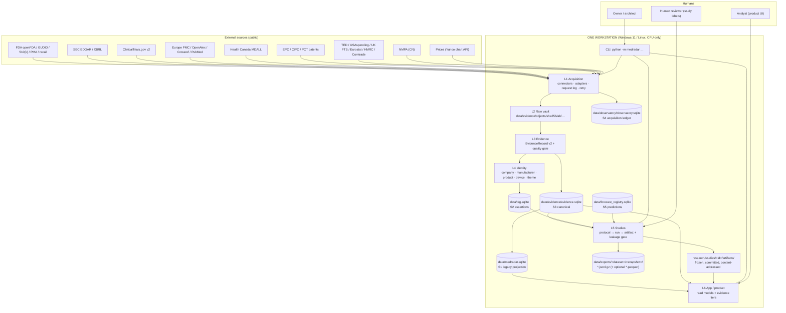
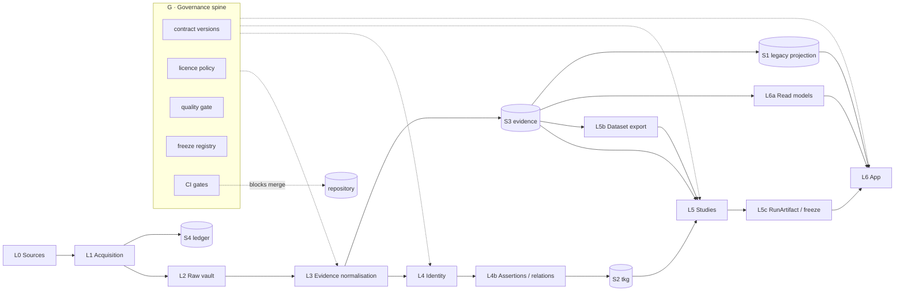
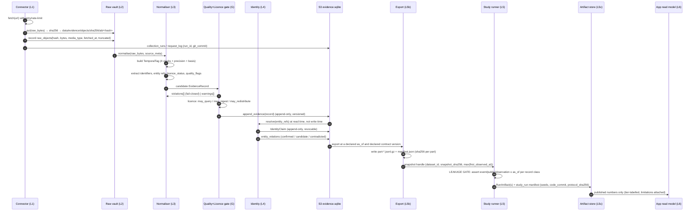

# ARCHITECTURE_TO_BE — MedRadar unified target architecture (REFOUNDATION-001 / A5)

**Scope.** This document defines the *target* ("TO-BE") architecture for MedRadar: one evidence contract,
one identity model, one acquisition path, one validation gate, one study/freeze model, one app data
boundary — running on **one ordinary workstation**, with a seam for bigger compute. It also states which
existing code is promoted, adapted, frozen or retired. It does **not** restate the audit of the current
state; that is `ARCHITECTURE_AS_IS.md` / `TECHNICAL_DEBT_REGISTER.md` (sibling deliverables, not yet
present in this worktree when this document was written — see Limits). The executable companion is
`MIGRATION_PLAN.md`.

**Method.** Read-only inspection of the git object store of `<REDACTED_LOCAL_PATH> via
`git show origin/<ref>:<path>`, `git ls-tree`, `git diff --stat origin/A...origin/B`, `git rev-parse` of
blobs. Ten legacy modules on `main` and nine branch-only infrastructures were read directly (filenames
cited inline). Every claim carries a label; nothing was executed, no branch was mutated, no network probe
was made. Where the only support is a PR/commit message, the claim is either omitted or labelled
`[UNVERIFIED]`.

**Evidence base.** `docs/refoundation/_FACTS.md` (verified fact base); `docs/refoundation/_evidence/repo_facts.json`;
direct reads of `origin/main` (`medradar/db.py`, `medradar/tkg/store.py`, `medradar/forecast_registry.py`,
`medradar/config.py`, `medradar/intelligence/evaluation/leakage_audit.py`, `research/LAYERS.md`,
`research/STATE.json`, `docs/SCHEMA.md`, `.github/workflows/ci.yml`, `.gitignore`, `pyproject.toml`);
`origin/foundation/atlas-001` (`medradar/atlas/**`, `docs/atlas/**`); `origin/integration/convergence-001`
(`medradar/integration/{contract,clock,licence,dedupe,staging}.py`); `origin/research/horizon-001`
(`research/horizon/**`); `origin/feat/live-observatory-v1` (`medradar/observatory/{ledger,records,adapter}.py`);
`origin/feat/medradar-2.0-mvp` (`medradar/product/{store,catalog,entities}.py`, `medradar/web/**`);
`origin/research/s028-temporal-graph-early-signal` (`research/studies/graph_early_signal_s028/**`);
`origin/research/s029-evidence-based-relations` (`research/studies/relation_network_s029/**`);
and `docs/refoundation/_evidence/tobe/verified_invariants.json` (blob hashes, incremental-scope counts and
the explicit not-verified list produced for this document).

**Limits.** (1) The sibling auditors' documents did not exist when I started and appeared mid-write;
§14.3 records exactly which of their findings forced a correction here and which reconciliation is still
open (`TECHNICAL_DEBT_REGISTER.md` and `DATA_GOVERNANCE_AUDIT.md` were still absent at finish). (2) Branch
content was read at the commits currently fetched; if a
branch moves, the file citations may drift. (3) `main`'s 1,074-test green state and the byte-identity
claims in §14.2 come from the Lead's evidence bundle; the blob identities I re-verified myself are marked
as such. (4) No large-data run was performed: statements about 375k events, 1.2 GiB SQLite and 289 MB
`research.sqlite` are quoted from committed documents/artifacts, not re-measured. (5) `pyproject.toml`
declares `dependencies = []`; every recommendation that needs a third-party package is marked and kept
behind an optional extra. (6) This document proposes no distributed system and no new framework; if a
recommendation appears to need one, it is a defect in the recommendation.

**Labels.** `[FACT]` observed in git/files. `[INFERENCE]` reasoned from facts, chain stated.
`[RECOMMENDATION]` a proposal. `[UNVERIFIED]` could not be checked; reason stated.

---

## 1. The TO-BE in one page

### 1.1 Position statement

> MedRadar becomes **one instrument with five separable parts**: (1) acquisition that only observes,
> (2) an evidence store that only records, (3) an identity layer that only resolves, (4) studies that only
> analyse a frozen snapshot under a declared `as_of`, and (5) an app that only *shows* what a study or an
> aggregate already proved — all on one machine, all traceable to bytes.

The single most important architectural sentence in this document:

> **There is exactly one evidence contract, and it is a *shape*, not a database.**
> Five physical stores already exist in this repository and each has a legitimate, distinct role. Rewriting
> them into one database would be a multi-month rewrite with no scientific gain. Instead the contract
> (`EvidenceRecord`) is defined once, every store declares which part of it it owns, and data flows in one
> direction only: raw bytes → evidence → identity → assertions → analysis → presentation.

`[FACT]` Five stores exist today, each with real code and tests:
| # | Store | File | Owns | TO-BE status |
|---|---|---|---|---|
| S1 | Legacy event table | `medradar/db.py` (`events`, 22 columns incl. 4 time columns) | flat, denormalised event projection | keep as projection |
| S2 | Bitemporal spine | `medradar/tkg/store.py` (`nodes`/`edges`, append-only triggers, `recorded_at` clock) | **revisions of every versioned object** | **canonical history** |
| S3 | Evidence index | `medradar/atlas/store.py` + `medradar/atlas/db/migrations.py` | typed evidence + identifiers + identity links | **rebuildable read model over S2** |
| S4 | Observation ledger | `medradar/observatory/ledger.py` (`observation`, own SQLite file) | what a source said, and when we saw it | keep, separate file |
| S5 | Prediction ledger | `medradar/forecast_registry.py` (append-only, trigger-guarded) | forecasts/nowcasts + outcome resolutions | keep, untouched |

**Reconciliation with `DECISION_REGISTER.md` D-09** (BLOCKING, recommended answer: "`main`'s `tkg/` wins;
ATLAS's duplicate store/graph is retired behind an adapter"). `[RECOMMENDATION]` Adopt that answer, and read
it as a *two-layer* composition rather than a loss of the typed evidence schema:

```
write path:  EvidenceRecord ──▶ S2 tkg (node_type='evidence', node_id=evidence_id,
                                    attrs = canonical record JSON, recorded_at = store clock,
                                    evidence_sha256 = raw bytes, confidence, public_time)
                              ──▶ S3 evidence index (typed columns, indexes, FKs)   ← derived, rebuildable
read  path:  queries use S3 (fast, typed); history/as_of proofs use S2 (append-only, clocked)
```

Why this is the right reading: `[FACT]` `tkg/store.py` already owns exactly the properties a record of
revisions needs — server-assigned `recorded_at`, trigger-rejected `UPDATE`/`DELETE` (including
`INSERT OR REPLACE`), idempotency keys, `schema_version` stamping, and 31+ tests. `[FACT]` It does **not**
own typed evidence columns, identifier schemes, licence status or quality flags — those live in
`medradar/atlas/evidence/schema.py`. Putting the *shape* in `tkg` and the *validator* in ATLAS gives one
history and keeps the contract typed. Cost: `medradar/atlas/store.py` becomes a write-through adapter plus a
projection builder (~250 lines + test adaptation), with the projection marked `rebuildable: true` in its
`schema_migrations`. Benefit: evidence and relation assertions share one clock and one append-only history,
which is the property that makes `as_of` provable rather than asserted.

`[RECOMMENDATION]` If the owner instead means "delete ATLAS's store and query `attrs` JSON directly", the
cost is real: every typed query in S3 loses its index, and `tests/test_atlas_db.py` (~156 assertions) must be
rewritten. That is the one interpretation of D-09 that this architecture does **not** recommend, and it is
listed as a fork in §21 Q2.

### 1.2 The seven layers and their single responsibility

| L | Layer | Owns | Must never |
|---|---|---|---|
| L0 | **Sources** | external systems (FDA, SEC, CT.gov, EPO, TED, Eurostat, …) | be trusted without a byte hash |
| L1 | **Acquisition** | fetch, retry, rate-limit, raw-byte persistence, request log | interpret, normalise, resolve identity |
| L2 | **Raw vault** | content-addressed original bytes (`raw_objects` + CAS dirs) | be garbage-collected while any evidence points at it |
| L3 | **Evidence normalisation** | one `EvidenceRecord` per documented external fact, dual hash, quality flags | merge two sources into one record |
| L4 | **Identity** | `EntityRef` → `IdentityClaim` ladder; alias tables; taxonomy version stamp | raise a candidate to `confirmed` without authoritative basis |
| L5 | **Analysis / studies** | `StudyProtocol` → `StudyRun` → `RunArtifact`; leakage gate; statistics | read anything not visible at its `as_of` |
| L6 | **Product / app** | read models, evidence tiers, limitations, API | compute a new number at request time |
| G | **Governance (cross-cutting)** | contract versions, licence policy, quality gate, freeze registry, CI gates | live in one layer only |

### 1.3 Non-goals (binding — see §19)

No distributed system. No microservices. No message broker. No Kubernetes. No new web framework beyond the
already-optional `web` extra. No ORM. No graph database. No rewrite of `medradar/tkg`, `medradar/db.py`,
`medradar/intelligence/`. No second frontend. No new storage engine.

---

## 2. Context diagram



`[FACT]` Every box in `L1`–`L5` has existing code: `medradar/atlas/connectors/*.py`,
`medradar/observatory/adapters/{ctgov,europepmc,sec_edgar}.py`, `research/horizon/CONNECTORS/{regulatory,patents,scholarly,industry}/*.py`,
`medradar/intelligence/sources/*.py`, `medradar/collect_*.py`, `medradar/clinical.py`, `medradar/adcom.py`,
`medradar/nmpa.py`, `medradar/prices.py`, `medradar/corpus.py`.
`[RECOMMENDATION]` `L4` is the only layer that is *incomplete* today; it is also the layer with the most
existing parts (§6).

---

## 3. Layer diagram (what may call what)



**Import-direction rule (binding).** Dependencies point *downward* only:

```
L6 app      →  L5 studies  →  L4 identity  →  L3 evidence  →  L2 raw  →  L1 acquisition
                   ↓               ↓               ↓
              S5 predictions   S2 assertions    S3 evidence
```

- `L1` may import **nothing** from `L3+`. (Today: `medradar/atlas/connectors/*.py` imports
  `medradar/atlas/evidence/http.py` — legal, that is still L1/L2.)
- `L3` may import `L2` only. It may **not** import `L4` (identity is applied after normalisation, so a
  re-resolution never rewrites evidence).
- `L6` may import `L5` read-model builders and `S3` read queries. It may **not** import `L1` or `L2`
  (no fetching from the app), and may **not** import `L5` statistics functions to compute a new number at
  request time — it may only re-expand a number a `RunArtifact` already produced.
- `G` is imported by everyone; nobody imports `L6`.

`[FACT]` This rule is *already violated* in three places today and those violations are the reason for
duplicated infrastructure: `medradar/product/store.py` recomputes aggregates straight from
`data/medradar.sqlite` (L6 reads S1 directly, bypassing L5); `medradar/observatory/adapter.py` carries
entity mapping inside the collector (L1 touching L4); `medradar/atlas/graph/build.py` reads evidence and
writes edges in one pass (L3/L4 coupling inside one module). `[RECOMMENDATION]` the violations stay *allowed
as declared exceptions* (§13) rather than being refactored away — see the "no rewrite" non-goal.

---

## 4. Target data flow (with the four clocks and the two gates)



**The two gates.** Gate 1 (`Q`) is *record-level* and fail-closed: an invalid record is never appended.
Gate 2 (leakage) is *snapshot-level* and fail-closed: a study run aborts if any consumed record has a
clock that could not have been known at `as_of`. Gate 2 is where the science is won or lost, so it is
specified in §8 rather than left to a convention.

`[FACT]` Both gates have existing implementations to promote, not invent:
`medradar/atlas/evidence/schema.py::validate_evidence` (Gate 1, 40+ assertions) and
`medradar/intelligence/evaluation/leakage_audit.py` + `medradar/integration/clock.py::build_time_block`
(Gate 2 machinery). `medradar/atlas/research/asof.py::as_of(store, timestamp, basis=OBSERVED)` is the
existing read-side counterpart.

---

## 5. Q1 — One unified evidence data contract

### 5.1 Which implementation wins, and why

`[FACT]` Three independent "evidence record" shapes exist in this repository:

| Shape | File | Clocks | Hash model | Identity | Licence | Quality |
|---|---|---|---|---|---|---|
| ATLAS `medradar.atlas.evidence.v1` | `medradar/atlas/evidence/schema.py` | 4 | **dual** (raw + normalised) | 5-value ladder | 5 statuses | 12 closed flags |
| Observatory `obs-ledger-v1` | `medradar/observatory/records.py` | 4 | payload hash per version | MAPPED / PENDING_REVIEW / UNMAPPED / AMBIGUOUS | none | none |
| Legacy `events` row | `medradar/db.py` (documented in `docs/SCHEMA.md` §6) | 4 + `timestamp_quality` | no hash | `company_key` or NULL | none | none |
| HORIZON `horizon.evidence.v1` | `research/horizon/**` mapped by `medradar/integration/contract.py` | 4 + `clock_class` / `temporal_note` | per-record | `identity_status` (**different meaning**) | 6+ statuses | rich |

**Winner: ATLAS `medradar.atlas.evidence.v1`.** `[INFERENCE]` Four reasons, each code-visible:

1. It is the only shape with a **dual hash** — `source_content_hash` (raw bytes) *and*
   `normalized_content_hash` recomputed from the payload at validation time
   (`schema.py::validate_evidence` re-hashes `normalized` and fails if it does not match). That single
   property makes "the record did not change" *checkable* instead of asserted.
2. It is the only shape whose **evidence id is content-independent**
   (`schema.py::make_evidence_id(source_id, evidence_type, source_record_id)`), so a re-fetch of changed
   content creates a *version* rather than a new record.
3. It already carries a **canonical-key priority ladder** (`schema.py::canonical_key`: DI > licence >
   510(k) > PMA > De Novo > recall > NCT > DOI > PMID > patent > OCID) and an `is_independent()` predicate
   — the only existing defence against counting an aggregator republication as a second observation.
4. `medradar/atlas/store.py` already versions it append-only (`evidence` PK `(evidence_id, version)` +
   `evidence_head` pointer; `first_observed_at` preserved across re-fetches, which is the only defensible
   basis for `as_of`).

**Adopted name: `medradar.evidence.v2`.** `[RECOMMENDATION]` v2 is a *superset* of
`medradar.atlas.evidence.v1` and lives in the same module after promotion to `main`; the module path stays
`medradar/atlas/evidence/schema.py` so no import churn is needed and `tests/test_atlas_evidence.py` keeps
working. The `schema` string changes; the *shape* mostly does not.

### 5.2 `EvidenceRecord` — canonical schema (field level)

One record = **one documented external fact, bound to immutable raw bytes.** JSON round-trips unchanged.
Canonical serialisation is `json.dumps(sort_keys=True, separators=(",",":"), ensure_ascii=False,
allow_nan=False)`. `[FACT]` That serialiser is already implemented twice — `atlas/evidence/schema.py::canonical_json`
and `tkg/store.py::canonical_json`; the evidence one wins because it also hashes.

```json
{
  "schema": "medradar.evidence.v2",
  "schema_version": "2.0.0",
  "evidence_id": "ev_<32 hex>",
  "evidence_type": "regulatory_clearance",
  "source": {
    "source_id": "openfda_510k",
    "source_record_id": "K123456",
    "source_url": "https://api.fda.gov/device/510k.json?...",
    "upstream_authority": "US FDA CDRH",
    "attribution": "U.S. Food and Drug Administration"
  },
  "payload": {
    "raw_sha256": "<64 hex>",
    "raw_bytes": 4096,
    "media_type": "application/json",
    "cas_path": "data/evidence/objects/sha256/ab/abcdef...",
    "truncated": false,
    "normalized": {"k_number": "K123456", "decision_code": "SESE"},
    "normalized_sha256": "<64 hex>"
  },
  "time": {
    "event_at": "2023-04-11",
    "event_precision": "day",
    "source_public_at": "2023-04-11",
    "source_public_quality": "day",
    "first_observed_at": "2023-05-02T08:14:09Z",
    "ingested_at": "2023-05-02T08:14:09Z",
    "observation_basis": "source_recorded_observation_log",
    "ingestion_basis": "fetch_clock"
  },
  "identifiers": [
    {"scheme": "510k", "value": "K123456", "issuer": "FDA", "scope": "US", "is_primary": true}
  ],
  "entity_refs": [
    {"entity_type": "manufacturer", "name_raw": "MEDTRONIC MINIMED",
     "firm_key": null, "method": "candidate", "confidence": 0.0, "matched_alias": null}
  ],
  "canonical_entity_id": "",
  "identity_resolution_status": "not_attempted",
  "relation_status": "none",
  "licence": {"status": "public_domain", "policy_id": "medradar.licence.v1",
              "attribution_required": false, "redistribution_condition": null},
  "quality": {"flags": ["missing_company"], "score": 0.82},
  "canonical_key": "510k:K123456",
  "provenance": {
    "collection_run_id": "run_20261112T021500Z_openfda_510k",
    "git_commit": "<40 hex or empty>",
    "contract_version": "medradar.evidence.v2",
    "taxonomy_version": "tracks-2026-11-12"
  }
}
```

**Field definitions.**

| Field | Type | Req | Definition | Invariant enforced |
|---|---|---|---|---|
| `schema` | str const | yes | `"medradar.evidence.v2"` | exact match, else `EvidenceError` |
| `schema_version` | str | yes | semver of *this* shape | exact match within a major |
| `evidence_id` | `ev_`+32 hex | yes | `sha256(source_id \| evidence_type \| source_record_id)[:32]` | independent of content and of fetch time |
| `evidence_type` | enum(13) | yes | `device_registration, regulatory_clearance, regulatory_approval, postmarket_event, recall, patent, publication, clinical_trial, procurement_event, grant, trade_statistic, company_registry, product_identifier` | must be in vocabulary |
| `source.source_id` | str | yes | connector identity, stable forever | non-empty; known to the licence policy |
| `source.source_record_id` | str | yes | the source's own primary key, **verbatim** | non-empty |
| `source.source_url` | str | yes | exact URL that returned the bytes | non-empty; stored truncated at 2000 chars |
| `payload.raw_sha256` | 64 lower hex | yes | sha256 of bytes as received (post-decompression, pre-parse) | `^[0-9a-f]{64}$` |
| `payload.raw_bytes` | int | yes | byte count of those bytes | > 0 unless `truncated` |
| `payload.cas_path` | str | yes | relative path under `data/evidence/objects/` | file must exist at Gate 1 |
| `payload.normalized` | object | yes | the projection actually used downstream | JSON-serialisable, no NaN/Inf |
| `payload.normalized_sha256` | 64 lower hex | yes | sha256 of canonical JSON of `normalized` | **recomputed at validation**; mismatch ⇒ invalid record |
| `time.*` | 4 clocks | keys yes, values may be `""` | see §8 | ordering + precision rules §8.4 |
| `identifiers[]` | array (may be empty) | yes | `{scheme, value, issuer, scope, is_primary, note}` | `scheme` in `atlas/identity/normalize.py::SCHEMES` |
| `entity_refs[]` | array (may be empty) | yes | what the source *claimed* about who this is about | `method` in `{official_id, exact_alias, multi_field, candidate, none}`; `candidate` ⇒ confidence < 0.9 |
| `canonical_entity_id` | str (may be `""`) | yes | confirmed entity id after resolution — deliberately **beside**, not inside, `entity_refs` | empty unless status is `confirmed` |
| `identity_resolution_status` | enum(5) | yes | `confirmed, candidate, none, not_attempted, ambiguous` | ladder §6.4 |
| `relation_status` | enum(5) | yes | `asserted_by_source, candidate, none, contradicted, unknown` | never implies causality |
| `licence.status` | enum(6) | yes | `public_domain, open_licence, open_no_explicit_licence, terms_restricted, restricted, unknown` | must satisfy `may_ingest` at Gate 1 |
| `quality.flags` | array of enum(12) | yes | closed vocabulary (§8.5) | unknown flag ⇒ invalid |
| `quality.score` | float [0,1] | no | derived, never hand-set | recorded; never used to drop a record silently |
| `canonical_key` | str or null | yes | `scheme:value` from the priority ladder | equal keys ⇒ **not independent** |
| `provenance.collection_run_id` | str | yes | FK to `collection_runs.run_id` | must exist |
| `provenance.git_commit` | str | no | code commit that produced the record | 40 hex or empty |
| `provenance.taxonomy_version` | str | yes | version of the theme/product-code taxonomy used at collection time | see §6.6 |

**Changes from v1 — all additive.** (a) `source` and `payload` become nested objects (v1 was flat; the v1
reader keeps v1 field names as aliases); (b) `time` gains `event_precision` and `ingestion_basis` so every
clock carries its precision *and* its reason; (c) `licence` gains `policy_id` and
`redistribution_condition` so the rights decision is reproducible after the policy file changes;
(d) `quality.score`; (e) `provenance.taxonomy_version`.

### 5.3 `EntityRef`

The *claim* a source makes about identity, before resolution. Deliberately weak, never overwritten.

```python
{"entity_type": "manufacturer",      # company | manufacturer | device | product | theme
 "name_raw": "MEDTRONIC MINIMED",    # verbatim from the source; never normalised in place
 "firm_key": None,                   # populated only for exact_alias / official_id matches
 "method": "candidate",              # official_id | exact_alias | multi_field | candidate | none
 "confidence": 0.0,                  # [0,1]
 "matched_alias": None,              # the alias string that matched, for audit
 "note": ""}
```

**Invariant (already enforced).** `[FACT]` `schema.py::validate_evidence` requires `matched_alias` or
`firm_key` for `official_id`/`exact_alias`/`multi_field`, and forbids `confidence >= 0.9` on `candidate`.

### 5.4 `IdentityClaim`

Append-only, revocable. `[FACT]` Storage already exists as `entity_relations` + `relation_events` in
`medradar/atlas/db/migrations.py`: rows are never deleted, revocation sets `revoked_at`/`revoked_reason`
and appends an event.

```json
{
  "claim_id": "ic_<32 hex>",
  "subject": {"entity_type": "manufacturer", "entity_id": "mfr_medtronic_minimed"},
  "object":  {"entity_type": "company", "entity_id": "co_medtronic"},
  "relation": "subsidiary_of",
  "basis": {"method": "official_id", "evidence_ids": ["ev_..."],
            "matched_alias": "MEDTRONIC MINIMED", "confidence": 0.97},
  "valid_from": "2019-01-01", "valid_to": "",
  "recorded_at": "2026-11-12T02:00:00Z",
  "revoked_at": null, "revoked_reason": null,
  "supersedes": null
}
```

Rules: (1) `basis.method == "official_id"` is the only route to a *confirmed* company↔manufacturer link;
(2) a claim is never mutated — a correction is a new claim with `supersedes` plus a revocation of the old;
(3) a `candidate` claim may never populate `canonical_entity_id` (candidates live in
`evidence_entity_refs`, separate from confirmed links — `[FACT]` that separation exists).

### 5.5 `ProductRef`

`[FACT]` **No `Product` entity exists anywhere in the repository today.** What exists is: FDA product codes
(`config/product_code_tracks.json`, 7,097 codes, 27.6% mapped per `docs/DATA.md`), "product families"
(`medradar/products.py`, `config/product_families.json`, `config/product_catalog_zh.json`), product domains
(`medradar/product/catalog.py::RADAR_DOMAINS`, `TRACK_TO_DOMAIN`), and regulatory `Device` rows
(`medradar/atlas/identity/models.py::Device`). The distinction the brief asks for cannot be honoured
without `Product` as a first-class, *thin* reference.

`[RECOMMENDATION]` `ProductRef` is a **reference, not a measurement table**: a commercial product is a
namespace over devices, owned by `medradar/products.py` (the existing product-family home), stamped with
the taxonomy version, carrying no measurements.

```json
{"product_id": "prd_<32 hex>",
 "canonical_name": "Respironics Trilogy Evo",
 "brand": "Trilogy",
 "company_id": "co_philips",
 "manufacturer_ids": ["mfr_respironics"],
 "device_ids": ["dev_di_00812345678901"],
 "theme_ids": ["thm_respiratory_support"],
 "taxonomy_version": "tracks-2026-11-12",
 "valid_from": "2019-04-01", "valid_to": ""}
```

**Hard rule.** A `ProductRef` may never be the subject of a measurement. Every count in the app counts
*records* attributed to a company / theme / device — never "products sold". `[FACT]` This is already the
stated product policy in `medradar/product/catalog.py::LIMITATIONS` (`record_not_product`).

### 5.6 `ObservationEvent`

The acquisition-layer record. `[FACT]` Already implemented as `observation` + version + change tables in
`medradar/observatory/ledger.py`, with triggers making `first_seen_at` immutable. In the TO-BE it keeps
**its own database** and is *not* folded into the evidence store: an observation is "the source showed me
this string at this moment", which is deliberately not yet a fact.

| Field | Meaning | Note |
|---|---|---|
| `observation_id` | identity of `(source, source_record_id)` | `[FACT]` `records.py::observation_id` |
| `first_seen_at` | first moment this source record was seen | immutable via trigger |
| `ingested_at` | this copy's commit time | |
| `observation_origin` | `LIVE` \| `BACKFILLED` (+ `backfill_reason`) | stops a 2016 backfill looking like a 2016 observation |
| `event_at` / `published_at` / `source_updated_at` (+ `_precision`) | as published, with precision | never defaulted |
| `source_payload_hash` | hash of this version's raw payload | |
| `observation_status` | `ACTIVE` \| `REMOVED_OR_UNAVAILABLE` | removal recorded, never inferred from absence |
| `current_change_state` | `NEW`/`UPDATED`/`REMOVED`/`FETCH_FAILED` | `UNCHANGED` deliberately not a change row |
| `last_checked_at` | freshness | |

`EvidenceRecord`s are produced *from* `ObservationEvent`s; the two join on `(source_id, source_record_id)`.

### 5.7 `TemporalTag` and `LicenseTag`

`TemporalTag` is the structured form of `EvidenceRecord.time` — four clocks + precision + basis (§8).
`LicenseTag` is the structured form of `EvidenceRecord.licence` **plus the three rights**
(query / analyse / redistribute) resolved by `medradar/integration/licence.py::LicencePolicy` (§9.2).
Both are embedded objects, not side tables, so one exported JSON line is self-describing.

### 5.8 `StudyProtocol`, `StudyRun`, `RunArtifact`

Defined in §10. One line each: `StudyProtocol` = frozen intent (hashes recorded before any fit);
`StudyRun` = one deterministic execution over one snapshot; `RunArtifact` = immutable output the app may
show.

### 5.9 One contract, five stores — the ownership matrix

| Contract part | S1 legacy `events` | S2 `tkg` | S3 ATLAS evidence | S4 observatory ledger | S5 forecast registry |
|---|---|---|---|---|---|
| raw bytes / dual hash | no | no | **owner** | payload hash only | no |
| 4 clocks | 4 columns, no per-clock precision | `valid_from/valid_to` + `recorded_at` | **owner** | **owner** of acquisition time | `generated_at` + window |
| identifiers | `product_code` only | no | **owner** | no | no |
| identity | `company_key` | node ids | **owner** | mapping decision only | no |
| licence | no | no | **owner** | no | no |
| derived assertions | no | **owner** | no | no | no |
| predictions / outcomes | no | no | no | no | **owner** |
| app-facing aggregates | read model | no | no | no | evaluated scores |

`[RECOMMENDATION]` Enforce the contract with a **single validator** used by every writer:
`medradar/atlas/evidence/schema.py::validate_evidence` (promoted). The legacy `events` writer is exempt
because it is a *projection*, not an evidence writer — but it must be fed only from S3, never directly from
a connector. That one rule removes the whole class of "two rows for the same FDA clearance" defects.

`[RECOMMENDATION]` One row of that matrix is now split by D-09 (§1.1): **revision history moves to S2
(`tkg`)**, and S3 becomes the typed projection holding `raw_sha256`/`normalized_sha256`, identifiers,
licence and quality columns for query. So "who owns the dual hash" = S3 (it is a typed field), while "who
owns the immutable version chain" = S2. Both are append-only; only S3 is rebuildable.

---

## 6. Q2 — Identity model: company / manufacturer / product / device / technology-theme

### 6.1 Five entity types, five different jobs

`[RECOMMENDATION]` The TO-BE keeps exactly five entity types and refuses to collapse any pair of them.
The distinction is already argued in code (`medradar/atlas/identity/models.py` docstring) and is the single
largest correctness asset of ATLAS.

| Entity | Definition | Identity anchor | Real-world example |
|---|---|---|---|
| **Company** | a legal / business group as an accounting and ownership unit | ticker, CIK, DUNS, SAM UEI, parent link | Medtronic plc |
| **Manufacturer** | the entity that legally made or registered *this* record | the source's own manufacturer string + FDA registration / establishment id | Medtronic MiniMed (a subsidiary) |
| **Device** | one **regulatory product record** (a DI/model as a registry knows it) | DI (GTIN-14), 510(k), PMA, De Novo, Health Canada licence / MDALL id | MiniMed 780G, DI 00812345678901 |
| **Product** | a **commercial** namespace over devices (brand/family as sold) | curated `ProductRef` + device set | MiniMed 700-series |
| **TechnologyTheme** | a curated analytical category (what the radar measures) | `track_id` / domain id from a **versioned** taxonomy | 呼吸支持 / respiratory support |

`[FACT]` First three types exist as dataclasses: `Company`, `Manufacturer`, `Device` in
`medradar/atlas/identity/models.py`; `Identifier` with scheme/issuer/scope; `ENTITY_TYPES` includes
`product_family` and `identifier` but **not** `product` and **not** `theme`.
`[RECOMMENDATION]` Extend `ENTITY_TYPES` to `{"company","manufacturer","device","product","theme","identifier"}`
and retire `product_family` as an entity type (it becomes `Product`). That is a 2-line change plus a
migration note, not a new module.

### 6.2 Identifier schemes are the contract

`[FACT]` `medradar/atlas/identity/normalize.py::SCHEMES` already declares each scheme with issuer and
jurisdiction scope; `models.py::OFFICIAL_SCHEMES` lists the ones that may create a *confirmed* link
(`di, basic_udi_di, 510k, pma, denovo, licence_no, mdall_device_id, mdall_company_id, duns, nct, doi, pmid,
patent_no, ocid`). It deliberately excludes **model number** with a stated reason ("a manufacturer-assigned
display attribute, not a registry identifier").

`[FACT]` CONVERGENCE already had to solve the hardest case and solved it correctly: in
`medradar/integration/contract.py`, Health Canada MDALL `device_identifier` is *usually* a catalogue token
but *sometimes* a real GTIN-14, so the scheme is decided **per value** by GS1 Mod-10 check digit
(`classify_identifier`), never per field name. `[RECOMMENDATION]` Promote that function verbatim into
`medradar/atlas/identity/normalize.py` — it is the reference implementation of "never promote on a name".

**Classification is not identity.** `[FACT]` `contract.py::CLASSIFICATION_SCHEMES` explicitly marks
`hs_code`, `fda_product_code`, `cfr_regulation`, `eurostat_comext_cell`, `hmrc_ots_series` as
classifications that may **never** back a `canonical_key` or a confirmed relation. `[RECOMMENDATION]` keep
that rule and add it to the validator: a classification scheme in `identifiers[].is_primary: true` is a
Gate-1 failure.

### 6.3 Where each identity layer lives (no new modules)

| Concern | Owner file (existing) | Action |
|---|---|---|
| scheme registry | `medradar/atlas/identity/normalize.py` | promote from #28 |
| entity dataclasses | `medradar/atlas/identity/models.py` | promote; add `Product`, `Theme` |
| name normalisation / alias matching | `medradar/atlas/identity/companies.py`, `medradar/atlas/identity/resolver.py` (`DeviceView`, `compare_devices`, `name_similarity`, `baseline_name_match`, `view_from_evidence`) | promote |
| curated roster (legacy) | `config/companies_device.json`, `config/companies_drug.json`, `medradar/config.py::CompanyRegistry` | **keep**; becomes one alias *source* feeding the resolver |
| deterministic universe | `medradar/intelligence/universe.py`, `config/universe_v1.json` | **keep**; becomes the `company` population |
| product-side aliases + featured keys | `medradar/product/entities.py`, `medradar/product/entity_aliases.json` | **demote** to an alias source; remove as an identity authority |
| theme taxonomy | `config/tracks_device.json`, `config/product_code_tracks.json`, `medradar/intelligence/taxonomy.py`, `medradar/families.py` | **keep, version it** (§6.6) |
| theme → domain derivation | `medradar/product/catalog.py::TRACK_TO_DOMAIN`, `RADAR_DOMAINS` | **keep** as a *view* of the theme taxonomy |
| technology mapping | `medradar/intelligence/entities/technology_mapping.py` | **keep** |
| legacy event attribution | `medradar/db.py` `events.company_key` | **freeze** (still read, never written by new code) |

`[FACT]` There are currently **four** places that can answer "which company is this?":
`config.py::CompanyRegistry`, `intelligence/universe.py`, `product/entities.py`, and
`atlas/identity/companies.py`. `[INFERENCE]` This is the root cause of the product/ATLAS disagreement the
Lead flagged (product pages and ATLAS graph can attribute the same 510(k) differently). The TO-BE keeps
**one resolver** (`atlas/identity/resolver.py`) and demotes the other three to *alias sources*: each
contributes `(name, entity_id, basis, evidence_id)` rows; none may create an entity id of its own.

### 6.4 The resolution ladder (the only legal path upward)

```
                        official_id  (DI / 510k / PMA / licence / DUNS / CIK / NCT / DOI / patent)
                              │  → status = confirmed,  confidence 0.90–1.00
                     exact_alias (a curated alias, exact after normalisation)
                              │  → status = confirmed,  confidence 0.85–0.95
                   multi_field (2+ independent fields agree: country + name + product code)
                              │  → status = confirmed,  confidence 0.75–0.90
                          candidate (fuzzy / token containment)
                              │  → status = candidate,  confidence < 0.90  (NEVER confirms)
                             none / ambiguous
                              │  → status = none | ambiguous, canonical_entity_id = ""
```

`[FACT]` `schema.py::CONFIRMED_METHODS = {"official_id","exact_alias","multi_field"}` and
`schema.py::validate_evidence` reject `candidate` at ≥0.9 confidence — the ladder is already enforced for
evidence. `[FACT]` `resolver.py::compare_devices` returns a `MatchDecision` from a device-pair comparison,
and `medradar/atlas/identity/pilot.py` + `research/atlas/samples/identity_pilot_pairs.json` +
`research/atlas/reports/identity_baseline_eval.json` already contain a measured baseline evaluation.
`[RECOMMENDATION]` That baseline evaluation is the acceptance test for any future resolver change: a new
matcher must be reported against the same pairs, and `[UNVERIFIED]` the pilot labels must be re-checked as
*genuinely human-adjudicated* before being cited as ground truth (the sibling `RESEARCH_ASSET_REGISTER.md`
owns that judgement).

### 6.5 Ambiguity is a state, not an error

`[RECOMMENDATION]` Three states are first-class and must be *displayable*: `not_attempted` (never
resolved), `candidate` (a guess exists, gated off), `ambiguous` (two or more confirmed-grade matches
disagree). `[FACT]` The observatory already models an analogous ladder
(`ENTITY_MAPPED / PENDING_REVIEW / UNMAPPED / AMBIGUOUS` in `observatory/records.py`), so the vocabulary is
not new to the codebase. The app layer must show unmapped records as *unmapped*, never as zero
(`[FACT]` this is already product policy: `medradar/product/store.py` docstring, "records without a track
are reported as *unmapped*, not as zero activity").

### 6.6 Technology theme is the taxonomy-leakage channel — version it

`[FACT]` `research/LAYERS.md` names the product-code taxonomy as "**CORE but unversioned — a known
semantic-leakage channel**". `[INFERENCE]` The mechanism: `config/product_code_tracks.json` can be edited at
any time; a study that mapped a 2019 recall to "respiratory" under the 2026 taxonomy can silently differ
from what a 2019 analyst could have known. That is leakage through the *schema*, not through the data, and
no timestamp audit catches it.

`[RECOMMENDATION]` Every taxonomy file gets a content hash and a date-stamped version id, and every
evidence record and study run carries `taxonomy_version`. Concretely:

```
config/tracks_device.json            ┐
config/tracks_drug.json              ├──→ sha256 over all files, sorted by path
config/product_code_tracks.json      │    → taxonomy_version = "tracks-<YYYY-MM-DD>"
config/product_families.json         │    → recorded in provenance.taxonomy_version
config/product_catalog_zh.json       ┘    → a study run pins the version it used
```

`[RECOMMENDATION]` A CI gate (`Phase 1`) fails if a taxonomy file changed without the version id being
updated in the same commit. This is the cheapest single fix in the whole programme: ~40 lines of code and
one workflow step.

---

## 7. Q3 — Decouple acquisition from evidence normalisation

### 7.1 The rule

> A connector may only turn a URL into bytes plus fetch metadata. It may not know an evidence type, an
> entity, a licence status, or what the bytes mean.

`[FACT]` The repository already has both the good and the bad pattern, side by side:
- **Good:** `medradar/atlas/connectors/base.py` + `medradar/atlas/evidence/http.py` — connectors fetch,
  `evidence/schema.py` builds records, `store.py` appends.
- **Bad:** `medradar/observatory/adapter.py` (525 lines) performs fetch + parse + entity mapping +
  track mapping + ledger write in one object, and `medradar/observatory/adapters/*.py` are 631–715 lines
  each because they mix transport with interpretation.
- **Bad:** `medradar/collect_device.py`, `collect_drug.py`, `clinical.py`, `adcom.py` write straight into
  `medradar/db.py`'s `events` table (the legacy S1), so transport, semantics and storage are one function.

`[RECOMMENDATION]` Do **not** rewrite the legacy collectors. Instead define the seam and require new
sources to use it; migrate a legacy collector only when it must change anyway.

### 7.2 The four interfaces

```python
# L1 — acquisition. Pure transport. No interpretation.
class Connector(Protocol):
    connector_id: str
    source_id: str

    def plan(self) -> list[Request]: ...
    def fetch(self, request: Request) -> RawPayload: ...      # bytes + status + headers + timing
    def record(self, run_id: str) -> list[dict]: ...          # request_log rows

@dataclass(frozen=True)
class RawPayload:
    source_id: str
    source_record_id: str
    url: str
    body: bytes                    # exact bytes, pre-parse
    media_type: str
    fetched_at: str                # ISO-8601 UTC with Z
    status: int
    truncated: bool = False

# L2 — raw vault. Content addressed. Idempotent.
class RawVault(Protocol):
    def put(self, payload: RawPayload) -> str: ...            # returns sha256
    def get(self, sha256: str) -> bytes: ...
    def path(self, sha256: str) -> Path: ...

# L3 — normalisation. The ONLY place that knows what bytes mean.
class Normaliser(Protocol):
    source_id: str
    evidence_type: str                                        # may be per-record

    def matches(self, payload: RawPayload) -> bool: ...
    def normalise(self, payload: RawPayload, ctx: NormaliseContext) -> EvidenceRecord: ...

@dataclass(frozen=True)
class NormaliseContext:
    collection_run_id: str
    git_commit: str
    taxonomy_version: str
    observed_at: str                # when the acquisition first saw this record
    observation_basis: str          # BASIS_SOURCE_RECORDED | BASIS_UNKNOWN | BASIS_FETCH_CLOCK

# L4 — identity. Applied AFTER normalisation, at write or at read; never rewrites evidence.
class IdentityResolver(Protocol):
    def resolve(self, ref: EntityRef, kind: str) -> IdentityClaim: ...
```

`[FACT]` These shapes are not invented: `medradar/atlas/connectors/base.py` already defines a connector
base, `medradar/atlas/store.py::record_raw` already does `put`-by-hash into `raw_objects`,
`medradar/integration/clock.py::build_time_block(record, import_run_started_at=...)` already produces the
`(time_block, warnings)` pair a `NormaliseContext` needs, and `medradar/atlas/identity/resolver.py` already
has the resolver entry points.

### 7.3 Why this decoupling is worth doing at all

Three concrete consequences, not abstractions:

1. **Re-normalisation becomes a local operation.** Changing a parser does not require re-fetching: L2 keeps
   the bytes, so `EvidenceRecord` v2 can be rebuilt for every historical record offline. `[FACT]` The raw
   vault table (`raw_objects`) already exists precisely for this; today nothing re-reads it.
2. **A source outage cannot corrupt evidence.** A failed fetch is an `ObservationEvent` with
   `FETCH_FAILED` or a `request_log` row with a non-200 status — never a deleted or emptied evidence record.
   `[FACT]` The observatory already encodes exactly this (`CHANGE_FETCH_FAILED`, `REMOVED_OR_UNAVAILABLE`).
3. **The licence decision has one place to live.** Today licence status is decided inside individual
   connectors or not at all; after the seam it is decided by the Gate (§9) from `source_id` + payload,
   which is the only place it can be audited.

### 7.4 The staging boundary

`[FACT]` CONVERGENCE already implements a staging area (`medradar/integration/staging.py`) and a
de-duplicator (`medradar/integration/dedupe.py`) for bulk imports. `[RECOMMENDATION]` Keep both as the
**bulk import path** (L1→L3 for large offline dumps such as GUDID or Comtrade, where per-record
`EvidenceRecord` construction is wasteful), and keep the distinction explicit:

| Path | When | Writes |
|---|---|---|
| streaming | live / incremental API collection | `ObservationEvent` → `EvidenceRecord` |
| bulk staging | multi-GB dumps, one-shot backfills | staging table → batched `EvidenceRecord` |
| import | a foreign evidence schema (HORIZON) | mapping contract → `EvidenceRecord` |

---

## 8. Q4 — The four time axes, and how leakage is prevented

### 8.1 Four clocks, four owners

The brief names them **event / public / observation / ingestion**. The codebase names them
**event / public / observation / fetch**. `[RECOMMENDATION]` Adopt the brief's names with the codebase's
names as aliases so no existing column has to be renamed:

| Brief axis | Field in `EvidenceRecord.time` | Alias in `db.py` / `observatory` | Owner | Answers |
|---|---|---|---|---|
| **event** | `event_at` (+ `event_precision`) | `event_date` / `event_at` | the source | when did the thing happen? |
| **public** | `source_public_at` (+ `source_public_quality`) | `published_at` | the source | when could a third party first have known? |
| **observation** | `first_observed_at` (+ `observation_basis`) | `first_seen_at` | **us, once** | when did *we* first see it? |
| **ingestion** | `ingested_at` (+ `ingestion_basis`) | `fetched_at` / `as_of` | **us, every time** | when was *this copy* committed? |

`[FACT]` The distinction already exists in three places and is documented as a research-grade requirement:
`medradar/db.py` schema comment ("`event_date` is the date the event happened; these four columns state
*when the information became usable*, which is what a backtest must consume"),
`docs/SCHEMA.md` §6.1 ("who may read which column"), and `medradar/atlas/evidence/timeq.py` (four-clock
doctrine, including "for a patent this is the **publication** date, never the filing date").

`[FACT]` `medradar/db.py` also has `available_at` — the *only* column a backtest may read
(`docs/SCHEMA.md`: "只有交易/回放"). `[RECOMMENDATION]` In v2 `available_at` is **derived, not stored**:
`available_at = max(source_public_at, first_observed_at)` when both exist, else `""`; storing it invites
the exact drift the `docs/SCHEMA.md` comment is trying to prevent. Existing readers keep the stored column
until they are migrated.

### 8.2 `TemporalTag` — the canonical time block

```python
@dataclass(frozen=True)
class TemporalTag:
    event_at: str                 # "" | "YYYY" | "YYYY-MM" | "YYYY-MM-DD" | ISO-8601 Z
    event_precision: str          # "datetime" | "day" | "month" | "year" | "unknown"
    source_public_at: str
    source_public_quality: str    # "exact" | "day" | "coarse" | "derived" | "unknown"
    first_observed_at: str        # "" allowed and MEANINGFUL: see 8.3
    observation_basis: str        # source_recorded_observation_log | fetch_clock_only | unknown_no_observation_log
    ingested_at: str
    ingestion_basis: str          # fetch_clock | import_run | reconstructed
```

`[FACT]` `medradar/atlas/evidence/timeq.py` defines `TIME_QUALITIES = {"exact","day","coarse","derived",
"unknown"}` and `PUBLIC_TIME_BASES = {"observed","inferred","unknown"}`; `observatory/records.py` defines
`PRECISIONS = {datetime,date,year,unknown}`. `[RECOMMENDATION]` v2 unifies to the ATLAS set (it is strictly
richer) and keeps the observatory's `year` as a UI-level display of `coarse`.

### 8.3 The three rules that make the clocks honest

These are the *behavioural* rules, each already broken somewhere in the current repository:

1. **Never default a missing clock.** `[FACT]` ATLAS's own `timeq.build_time` defaults a missing
   `first_observed_at` to `fetched_at`; CONVERGENCE's `clock.py` explicitly refuses that ("stamping the
   import time as the first observation would fabricate an observation history and silently break every
   `as_of` query") and keeps it empty with a basis string. **TO-BE adopts the CONVERGENCE behaviour for all
   foreign evidence and the ATLAS behaviour only for connectors that genuinely are the first observer.**
   The basis string records which case it is, so a reader never has to guess.
2. **Never derive one clock from another.** A 1999 Health Canada licence date says nothing about when the
   record became public, and nothing about when we saw it. `[FACT]` `clock.py` names this
   (`BASIS_DERIVED_NOT_ALLOWED = "rejected_derivation_attempted"`).
3. **Never treat a *refresh* stamp as a *publication* date.** `[FACT]` `contract.py` carries
   `NON_PUBLICATION_HINTS` and per-source `temporal_note`/`clock_class` for exactly this.

### 8.4 Ordering invariants (checked at Gate 1)

```
if source_public_at and event_at:        event_at        <= source_public_at   (+ precision tolerance)
if first_observed_at and source_public_at: source_public_at <= first_observed_at
if ingested_at and first_observed_at:    first_observed_at <= ingested_at
always:                                  ingested_at <= now + skew
```

`[RECOMMENDATION]` Violations are **not** auto-corrected; they raise `TIME_ORDER_VIOLATION` and the record
is rejected with a typed reason (`[FACT]` `timeq.py` already exposes `check_ordering`). The precision
tolerance is one period of the coarser unit — a `coarse` (year) public date may precede a `day` event date
within the same year.

### 8.5 The three leakage classes and the gate for each

`[RECOMMENDATION]` Every study run must declare which classes it has ruled out. This is the research
contract, and it is what makes a negative result publishable rather than embarrassing.

| Class | What leaks | Gate | Existing machinery |
|---|---|---|---|
| **L-A label leakage** | the outcome became known before the prediction window | `as_of` gate on labels: `first_observed_at(label_record) <= as_of` | `intelligence/evaluation/leakage_audit.py`; `forecast_registry.py` outcome ledger |
| **L-B feature leakage** | a feature is computed from data not public at `as_of` | `as_of` gate on every consumed record: `source_public_at <= as_of` (and `first_observed_at <= as_of` when the study claims *observable* rather than *public*) | `atlas/research/asof.py::as_of(store, timestamp, basis=OBSERVED)`; `tkg/store.py` `recorded_at` knowledge clock |
| **L-C selection leakage** | the universe was chosen using knowledge of which entities later mattered | universe snapshot must be a *protocol input* with its own hash, not a query | `intelligence/universe.py` + `config/universe_v1.json` (deterministic, no fuzzy matching — `[FACT]` LAYERS.md) |

```python
# Gate 2 — the leakage gate. Called by every study runner, before any model fit.
def assert_no_leakage(
    *,
    records: Iterable[EvidenceRecord],
    as_of: str,                       # the study's declared cutoff
    basis: str = "public",           # "public" | "observed"
    label_evidence_ids: Iterable[str] = (),
) -> None:
    """Raise LeakageError listing every offending evidence_id and which clock broke."""
```

`[INFERENCE]` Today this function does not exist as one callable. Its three inputs exist
(`as_of`, the four clocks, `is_independent`), its output discipline exists (`leakage_audit.py` reports),
but the *enforcement* is per-study convention — and that is why two studies on this repository had to
publish leakage-correction documents (`research/studies/graph_early_signal_s028/TEMPORAL_LEAKAGE_AUDIT.md`
and `…_CORRECTION.md`; `…/STATISTICAL_REVIEW_CORRECTION.md`). A gate that cannot be forgotten is cheaper
than a correction report.

### 8.6 `as_of` is a query parameter, never a column

`[RECOMMENDATION]` `as_of` must never be materialised into evidence. It belongs to (a) each study run and
(b) each export snapshot. `[FACT]` The legacy database violates this by storing `as_of` per event row
(`db.py`), which makes "the same data at two cutoffs" unrepresentable without duplicating rows.
`[RECOMMENDATION]` Keep the column (compatibility) but stop writing it in new code; new readers take
`as_of` as an argument, exactly as `atlas/research/asof.py` already does.

---

## 9. Q5 — Unified data-quality and licence validation

### 9.1 One gate, two verdicts

`[RECOMMENDATION]` Quality and licence are **separate verdicts** on the same record, produced by one
function, because they fail differently:

- a **quality** problem is a warning: the record is storable, it is *labelled* (12 closed flags), and every
  aggregate that consumes it must report the flag counts;
- a **licence** problem is fatal: the record is not storable at all (fail-closed), except in the one
  legitimate case (`open_no_explicit_licence` — ingest for local analysis, never redistribute).

```python
def validate(record: EvidenceRecord, *,
             policy: LicencePolicy,
             now: str | None = None) -> ValidationResult: ...

@dataclass(frozen=True)
class ValidationResult:
    errors: list[Problem]        # any error ⇒ do not append
    warnings: list[Problem]      # store, but propagate the flags
    licence: LicenceTag          # query / analyse / redistribute + reason
```

`[FACT]` Both halves exist: `atlas/evidence/schema.py::validate_evidence` returns `list[str]` of contract
violations (structural, ordering, identity, flag vocabulary), and
`integration/licence.py::LicencePolicy` exposes `may_ingest`, `may_redistribute`, `may_analyse_locally`,
`attribution_required`, `redistribution_condition`, `quarantined_sources`, `is_known_source`.
`[RECOMMENDATION]` Merge them behind one call; keep both implementations unchanged.

### 9.2 The three rights, not one

`[FACT]` `integration/licence.py` models exactly the right three rights and its docstring states the reason
("conflating them is how a project ends up redistributing data it was only allowed to query"):

| Right | Question | Consequence if false |
|---|---|---|
| `may_query` | may we call the API? | source is quarantined; connector disabled |
| `may_analyse_locally` (= `may_ingest`) | may we compute over the records? | record is not stored at all |
| `may_redistribute` | may the records or a derived export be published? | record is stored but excluded from every public artefact |

Status → rights table (`[FACT]`, from `DEFAULT_POLICY` in `licence.py`):

| `licence.status` | query | ingest | redistribute | attribution |
|---|---|---|---|---|
| `public_domain` | ✔ | ✔ | ✔ | not required |
| `open_licence` | ✔ | ✔ | ✔ | required |
| `open_no_explicit_licence` | ✔ | ✔ | **✘** | required |
| `terms_restricted` | ✔ | **✘** | ✘ | required |
| `restricted` | **✘** | ✘ | ✘ | required |
| `unknown` | **✘** | ✘ | ✘ | required |

`[FACT]` `quarantined_sources = ["un_comtrade"]` in the fallback policy. `[RECOMMENDATION]` The
authoritative policy file is `config/convergence/licence_policy.json`
(schema `medradar.licence_policy.v1`, per-source table + `quarantine.source_ids`); the fallback must stay
fail-closed and must be *tested* (a test that deletes the policy file and asserts every source becomes
non-ingestible).

### 9.3 Where the gate sits, and the one place it must also sit

Gate 1 sits at **append to S3**. `[RECOMMENDATION]` It must *also* sit at **export to a public artefact and
at every API response that echoes a record**, because redistribution is a property of the artefact, not of
the store. Concretely: `medradar/product/store.py` (which serves the app) and any `docs/` publishing step
must filter on `may_redistribute`, and the filter must be visible in the response (`licence_summary`).

`[INFERENCE]` Today nothing enforces redistribution at the app boundary: `product/store.py` reads
`data/medradar.sqlite` directly (no licence column exists there), and the product pages are published to
GitHub Pages from `main:/docs`. The exposure is bounded because the legacy sources are US public-domain
registries, but the moment Phase 5 imports non-redistributable trade data into the same database, an
unfiltered read model becomes a licence breach. This is why §15 gives the app a **read-model contract**
rather than letting it query the evidence store.

### 9.4 Quality flags — the closed vocabulary

`[FACT]` `schema.py::QUALITY_FLAGS` (12, unchanged in v2):
`missing_primary_identifier, missing_company, missing_time, coarse_time, derived_time,
duplicate_across_sources, identifier_conflict, schema_drift, truncated_payload, unverified_identity,
licence_restricted, source_unavailable`.

`[RECOMMENDATION]` Add exactly one flag, `time_order_violation`, and one `taxonomy_unmapped`; both are
reportable conditions that currently have no vocabulary. Any aggregate that consumes flagged records must
report the counts (`[FACT]` `atlas/quality/checks.py` already produces a quality report and
`research/atlas/reports/quality_report.json` is a committed example of the shape).

### 9.5 A quality *score* is allowed; a silent filter is not

`[RECOMMENDATION]` `quality.score` is a declared, versioned function of the flags (e.g. 1.0 minus fixed
weights), recorded per record. It may be used to *rank* or *exclude-with-reporting*. It may never be used
to make a record silently disappear: exclusion must be an explicit, logged filter in the study run manifest
so a reader can re-run with the filter off.

---

## 10. Q6 — Old and new experiments share infrastructure without breaking frozen results

### 10.1 The problem, stated precisely

`[FACT]` There are 657 files under `experiments/` on `main` (dominated by `experiments/b027`, 391 files),
plus whole study trees that exist only on branches: `research/studies/graph_early_signal_s028/**` (#15) and
`research/studies/relation_network_s029/**` (#16). These studies carry **published negative results** and
**preregistration freezes**. Any architecture that "re-homes" them by rewriting their code destroys the
only thing they have: the claim that the numbers came from that exact code over that exact input.

`[FACT]` S-028 already contains a correct, minimal freeze mechanism (`code/s028_freeze.py`):
- `artifacts/prereg_freeze.json` = `{study, frozen_at_utc, note, files: {PRE_REGISTRATION.md: {sha256, size_bytes}, HYPOTHESIS_REGISTRY.md: {...}}, input_database: {path, sha256, size_bytes}}`
- `code/s028_lib.py::verify_frozen_db` refuses to run if the input DB's size or SHA-256 differ
- the DB is opened `file:...?mode=ro` everywhere
- a second `--suffix _amendment1` freeze keeps the original intact when the protocol is amended
- `REPRODUCE.md` lists the exact command order and the seeds

`[INFERENCE]` This is better than most published research code and it is the pattern to generalise — not
to replace.

### 10.2 Three contracts

**`StudyProtocol`** — frozen intent, committed to git, small.

```json
{
  "schema": "medradar.study.protocol.v1",
  "study_id": "S-028",
  "title": "Temporal company-technology graph early-signal study",
  "hypotheses": [{"id": "H2q", "text": "...", "primary": false}, {"id": "H4q", "text": "...", "primary": true}],
  "decision_rules": {"primary": "H4q", "alpha": 0.05, "correction": "benjamini-hochberg", "mde_reported": true},
  "protocol_files": [
    {"path": "PRE_REGISTRATION.md", "sha256": "<64 hex>", "bytes": 15998},
    {"path": "HYPOTHESIS_REGISTRY.md", "sha256": "<64 hex>", "bytes": 3766}
  ],
  "evidence_contract": "medradar.evidence.v2",
  "required_clocks": {"basis": "public", "note": "study claims public-knowability, not observation"},
  "leakage_classes_ruled_out": ["L-A", "L-B", "L-C"],
  "inputs": {
    "dataset_snapshot": "ds_2026-11-03_<16 hex>",
    "dataset_manifest_sha256": "<64 hex>",
    "universe_version": "universe_v1",
    "taxonomy_version": "tracks-2026-11-03"
  },
  "frozen_at_utc": "2026-11-03T17:07:43+00:00",
  "amendments": [{"file": "prereg_freeze_amendment1.json", "reason": "..., recorded before re-analysis"}]
}
```

**`StudyRun`** — one deterministic execution over one snapshot.

```json
{
  "schema": "medradar.study.run.v1",
  "run_id": "run_S-028_2026-11-04T02:11Z",
  "study_id": "S-028",
  "protocol_sha256": "<64 hex>",
  "evidence_contract": "medradar.evidence.v2",
  "snapshot": {"dataset_id": "ds_2026-11-03_<16 hex>", "manifest_sha256": "<64 hex>", "as_of": "2026-11-03"},
  "code": {"git_commit": "<40 hex>", "dirty": false, "python": "3.12.10", "numpy": "2.5.1"},
  "seeds": {"randomisation_base": 20261104, "bootstrap": 7, "model_random_state": 20261104},
  "filters": [{"name": "exclude_time_order_violation", "count_dropped": 0}],
  "leakage_gate": {"checked_records": 41003, "violations": 0, "classes": ["L-A","L-B","L-C"]},
  "started_at": "...", "finished_at": "...", "status": "OK"
}
```

**`RunArtifact`** — immutable output, content addressed, referenced by the app.

```json
{"artifact_id": "art_<32 hex>", "run_id": "run_...", "kind": "table|figure|metric|report|prediction_dump",
 "path": "research/studies/S-028/artifacts/experiment_summary.json",
 "sha256": "<64 hex>", "bytes": 128944, "media_type": "application/json",
 "redistribution": "allowed|excluded", "licence_summary": "public_domain:100%", "tier": "detected"}
```

### 10.3 What "frozen" means operationally

`[RECOMMENDATION]` A `RunArtifact` is frozen when all five are true, and the CI gate checks all five:

1. its `sha256` is recorded in the study's `RUNS.json` (append-only index, one line per run);
2. the `StudyRun` records the five version axes of §16.2 (contract, taxonomy, dataset, code, protocol);
3. the artifact file lives under `research/studies/<id>/artifacts/` and is **committed to git** (small
   files only — `[FACT]` S-028 does exactly this: 100 KB summaries are committed, 886 KB–907 KB
   prediction dumps are committed as `.json.gz`, and the 289 MB input database is *not* committed, only
   its hash);
4. re-running the recorded command with the recorded seeds reproduces the artifact byte-identically except
   for timestamps (`[FACT]` S-028 `REPRODUCE.md` states this and `s028_verify.py` checks 71 numbers);
5. the artifact is referenced by a study index that the app reads, so no manual path reaches production.

`[RECOMMENDATION]` **Frozen results are never migrated.** The migration moves the *directory*, keeps the
files byte-identical, and adds a `RUNS.json` alongside. `git mv` preserves blob identity, so the sha256
recorded inside the old artifacts stays valid. This is the whole trick: relocation is provably
non-destructive when the file bytes do not change, and `git rev-parse old:path` = `git rev-parse
new:path` is the proof.

`[RECOMMENDATION]` **A negative verdict is part of the artifact.** `[FACT]` `RESEARCH_ASSET_REGISTER.md` §3.1
lists six studies as explicit NO-GO / negative verdicts and states they "can never be upgraded" (early-signal
five firms, S-029, PHOENIX-002, PHOENIX-003, DATA-EXPANSION, and S-028 sealed as *exploratory*, not
confirmatory). A later analysis that reuses the same data is a **new study id** with its own protocol; it may
not edit, re-seal or re-label the frozen one. The freeze registry's `status` field therefore has two legal
values — `frozen-negative` and `frozen-inconclusive` — and no `upgrade` transition exists.

### 10.4 New experiments get infrastructure, not a template to copy

`[RECOMMENDATION]` New studies must consume:
- `medradar/atlas/research/asof.py` for cutoff reads (instead of hand-rolled date filters);
- the dataset exporter (§16.3) for inputs (instead of reading `data/medradar.sqlite` directly);
- `assert_no_leakage` (§8.5) before any fit;
- `medradar/intelligence/evalstats.py` for cluster bootstrap / MDE / matched-FAR lead time
  (`[FACT]` LAYERS.md: "pure stdlib; 37 tests; reusable");
- `medradar/forecast_registry.py` if the study produces forward claims (`[FACT]` it already separates
  `forecast` / `nowcast` / `retrospective_fixture` — the honest labelling the brief's leakage question
  demands).

`[FACT]` Old studies cannot be forced onto this. S-028/S-029 read a 289 MB SQLite file by absolute path
(`<REDACTED_LOCAL_PATH>) and will keep doing so. `[RECOMMENDATION]` The
TO-BE therefore provides a **compatibility guarantee**: the dataset exporter can produce a
`dataset_snapshot` whose content hash *equals* an existing study's `input_database.sha256`, so old and new
studies can be shown to have read the same bytes. That is the shared-infrastructure proof, and it needs no
code change in the old study.

### 10.5 The registry: one index, not five competing ones

`[FACT]` Competing state sources on `main`: `research/STATE.json` (schema
`medradar.foresight.state.v2`, updated by `tools/update_state_*.py`), `research/AUDIT.json`,
`research/FINAL_AUDIT.json`, `research/BACKLOG.yaml` (schema `medradar.foresight.backlog.v2`),
`tools/round_end.json`. `_FACTS.md` C8 flags this.

`[RECOMMENDATION]` Keep **`research/STATE.json` authoritative** (it is the one that tooling writes and it
already carries `layer_status`, `last_verified`, `working_tree`), keep `research/BACKLOG.yaml` as the task
ledger (it has acceptance criteria per task — a real asset), and convert `AUDIT.json` / `FINAL_AUDIT.json` /
`round_end.json` into **append-only logs referenced from STATE.json**, not independent state. Add one new
machine-readable file, `research/studies/INDEX.json`, that maps `study_id → {protocol, runs[], status,
branch, paper}`. `[RECOMMENDATION]` That file is the *only* new data file this architecture introduces, and
it is 0 lines of code.

---

## 11. Q7 — The app layer shares data but not unverified conclusions

### 11.1 The boundary rule

> The app may **re-expand** a number, never **derive** one.

`[FACT]` This is already the design intent: `medradar/product/store.py` docstring — "every aggregate keeps
enough parameters to be re-expanded into the underlying event rows", read-only (`mode=ro`), no synthesis.
`[FACT]` The tier vocabulary already exists in `medradar/product/catalog.py::EVIDENCE_TIERS`:

| Tier | Label (zh / en) | Meaning |
|---|---|---|
| `observed` | 观察到的事实 / Observed | counted directly from records, expandable to each row |
| `detected` | 统计探测信号 / Detected Signal | anomaly from a fixed statistical rule (z vs historical baseline); **not causal, not a prediction** |
| `hypothesis` | 研究假设 / Research Hypothesis | an inference from a research project not yet independently validated |

`[FACT]` `catalog.py::LIMITATIONS` already encodes five hard limitations (`us_only`, `no_global_rank`,
`record_not_product`, `recall_not_tech`, `entity_mapping`), and `product/store.py` states that every
aggregate endpoint returns the subset that applies.

### 11.2 The API contract that enforces it

`[RECOMMENDATION]` Every numeric field in an API response carries an envelope; a bare number is a
contract violation caught by a test:

```json
{
  "value": 1234,
  "tier": "observed",
  "source_records": {"kind": "510k", "window": "2019-01-01..2024-12-31"},
  "coverage": {"sources": ["openfda_510k"], "start": "2019-01-01", "unmapped_records": 41},
  "limitations": ["us_only", "record_not_product"],
  "artifact_id": "art_<32 hex>|null",
  "run_id": "run_...|null"
}
```

Rules: `tier == "observed"` ⇒ `source_records` required. `tier == "detected"` ⇒ `run_id` + `artifact_id`
required (a detector output must come from a frozen run). `tier == "hypothesis"` ⇒ `limitations` must
include at least one named unresolved question. `null` is not `0`: an unmapped/absent value must render as
"unmapped", never zero. `[FACT]` The product layer already applies this last rule for tracks.

### 11.3 What the app must never receive

`[RECOMMENDATION]` Deny-list: raw `EvidenceRecord`s with `licence.may_redistribute == false`; any
`candidate` identity rendered as fact; any number whose `run_id` is not in `research/studies/INDEX.json`;
any artifact whose `sha256` does not match its file; any study whose `leakage_gate.violations > 0`.
`[FACT]` Today's app is a read-only SPA served by `medradar/web/app.py` with routes
`routes_{analyst,lab,observatory}.py` and a static bundle under `web/`; it has no licence filter because
the underlying legacy DB has no licence column — see §9.3.

`[RECOMMENDATION]` The deny-list also inherits the **claim-level** ban, not only the licence ban:
`[FACT]` `RESEARCH_ASSET_REGISTER.md` §5 enumerates "claims that must NOT be made publicly" and §6 insists
"implemented feature ≠ validated method ≠ demonstrated predictive power". Encode that as a *content* rule in
the same place as the licence filter: a tile whose backing artifact carries `verdict: NO-GO` may render the
verdict text and nothing that reads as a positive result. This is a one-screen policy, not a framework.

### 11.4 One app, two surfaces

`[RECOMMENDATION]` Keep exactly two presentation surfaces and no more:
- **the SPA** (`web/` + `medradar/web/**`, optional `web` extra: `fastapi` + `uvicorn`) — interactive;
- **the static Pages site** (`docs/`, built by a CI job) — public, read-only, licence-filtered, and
  *generated*, not hand-edited.

`[FACT]` GitHub Pages builds from `main:/docs` (legacy build, last build commit `b2a14c0`) — so anything
placed in `docs/` on a branch is invisible until merged, and anything generated into `docs/` is committed
as a 3.35 MB `docs/dashboard.html` blob. `[RECOMMENDATION]` Generated HTML leaves git in Phase 1 (§MIGRATION_PLAN)
and Pages is built from the export instead.

---

## 12. Q8 — Local-first on one workstation, with a seam for bigger compute

### 12.1 The local-first commitments

| Commitment | Requirement | Current status |
|---|---|---|
| runs on one ordinary machine | Windows 11 / Linux, CPU-only, no GPU needed for the core | `[FACT]` S-028 `REPRODUCE.md`: "CPU-only, no GPU used anywhere in this study"; `[FACT]` `dependencies = []` |
| offline-capable | core pipeline + tests need no network | `[FACT]` CI: "offline test suite (no network)", `python -m medradar selftest` |
| one-command verification | a single command proves the install | `[FACT]` `python -m medradar selftest`, `scripts/check_install.py`, `medradar doctor` |
| no server required | SQLite, files, CLI | `[FACT]` every store is a SQLite file; the web layer is an *optional extra* |
| bounded disk | raw bytes are the biggest cost; CAS de-duplicates by definition | `[RECOMMENDATION]` budget ~1.2 GB legacy DB + ~0.3 GB study DB + CAS; pruning policy in §16.5 |
| single writer | one process may write a store at a time | `[FACT]` observatory has an explicit single-writer lease (`medradar observatory lock status/release`) |
| reproducible | seeds + hashes + versions recorded | `[FACT]` S-028; forecast_registry `generated_at` server clock |

`[FACT]` From `pyproject.toml`: core `dependencies = []`; extras `excel` (openpyxl), `pdf` (pypdf),
`dev` (pytest, httpx), `bulk` (ijson), `web` (fastapi, uvicorn). `[RECOMMENDATION]` Keep that shape
exactly: **a new dependency must be justified as an optional extra and must not be needed by
`selftest`.** This single rule is what keeps the project installable on an arbitrary workstation in 2027.

### 12.2 The seam (and what it deliberately is not)

`[RECOMMENDATION]` The extension seam is **three file-level contracts**, not a distributed system:

1. **A dataset snapshot is a file.** `data/exports/<dataset_id>/manifest.json` lists parts, hashes, row
   counts, the contract version, the `as_of` and the max clock observed. Anything that can read files can
   be the compute.
2. **A study run is a CLI entry point with declared inputs and outputs.**
   `python -m medradar study run --protocol <path> --snapshot <dataset_id> --out <dir>`. Bigger compute =
   copy the snapshot (or mount it), run the same command, bring back `RunArtifact`s. No queue, no worker
   pool, no scheduler service.
3. **A run is reproducible from its manifest alone.** If it is not, the seam is broken — that is the test.

What the seam is **not**: no Celery/RQ/Kafka, no "job table", no distributed locks (the single-writer lease
already exists and is correct for one machine), no service-to-service HTTP, no container orchestration.
`[RECOMMENDATION]` If a future workload genuinely outgrows one machine, the first move is *a bigger
machine*; the second is *split the dataset snapshot by entity*, each part independently runnable with the
same command. Both are file-level operations that need no new architecture.

### 12.3 The one place concurrency already exists, and its rule

`[FACT]` `medradar/observatory/scheduler.py` + `runner.py` implement a local polling loop, and
`observatory lock` implements a single-writer lease; `medradar/observatory/ledger.py` opens SQLite in WAL
mode and uses a threading lock. `[RECOMMENDATION]` That is the ceiling: **one collector process at a time**,
enforced by lease, with the lease recorded in the ledger so a stale lease is diagnosable. Do not add
parallel collectors before the lease has been exercised on a real multi-day run (`[FACT]` #14 already
ships a seven-day continuous validation protocol: `docs/CONTINUOUS_VALIDATION_PROTOCOL.md`,
`docs/RELIABILITY_ACCEPTANCE.md`).

---

## 13. Q9 — Keep, adapt, freeze or retire

### 13.1 The five verdicts

| Verdict | Meaning |
|---|---|
| **KEEP** | promoted to `main` and used as-is; tests are the acceptance |
| **KEEP-BEHIND-ADAPTER** | stays, but only through a declared interface; its internals are not called directly |
| **ADAPT** | promoted with a small, named change (≤ ~200 lines) |
| **FREEZE** | committed, never modified again; read-only historical artifact |
| **RETIRE** | removed from the runtime path; content preserved in git history + a tag |

### 13.2 `main` modules

`[FACT]` Verdicts in the middle column reuse `research/LAYERS.md` (an existing, argued capability map) rather
than being re-derived; the right-hand column is this document's TO-BE role.

| Module / artifact (real path) | LAYERS verdict | TO-BE verdict | Role in TO-BE |
|---|---|---|---|
| `medradar/db.py` | CORE (observe) | **KEEP-BEHIND-ADAPTER** | S1 projection only; new code writes it *from* S3, never from a connector |
| `medradar/tkg/store.py` | CORE | **KEEP** | S2 bitemporal assertions of *derived* relations; untouched |
| `medradar/tkg/{query,export,adapter}.py` | CORE | **KEEP** | point-in-time exports; `tkg/export.py` is the prototype of the dataset exporter |
| `medradar/forecast_registry.py` | KEEP (P3) | **KEEP** | S5 prediction ledger; already append-only + as-of scoring |
| `medradar/intelligence/evaluation/leakage_audit.py` | CORE | **KEEP** | Gate-2 implementation |
| `medradar/intelligence/evalstats.py` | CORE | **KEEP** | study statistics (cluster bootstrap, MDE, matched FAR) |
| `medradar/intelligence/{pipeline,features,forecasting,models}/*` | CORE/KEEP | **KEEP** | analysis layer; consumes exports, not live DBs |
| `medradar/intelligence/universe.py` + `config/universe_v1.json` | CORE | **KEEP** | deterministic company population (L-C defence) |
| `medradar/intelligence/changepoint.py` | P1 current work | **KEEP** | detector; must emit `detected`-tier artifacts with run ids |
| `medradar/config.py` | CORE | **ADAPT** | add taxonomy version resolution (§6.6); path resolution stays |
| `medradar/collect_{device,drug}.py`, `clinical.py`, `adcom.py` | CORE | **KEEP-BEHIND-ADAPTER** | legacy collectors keep writing S1; new sources must use §7.2 |
| `medradar/{corpus,products,families,taxonomy,nmpa,prices,products}.py` | CORE/KEEP | **KEEP** | unchanged |
| `medradar/{live,paper,eventstudy,analyze,report,dashboard,replay,cases}.py` | DEPRIORITISED | **KEEP, no extension** | maintain only; not on the critical path |
| `medradar/{llm,research_agent}.py` | KEEP (P2) | **KEEP** with hard rule | may organise; may never generate a fact, a citation or a probability |
| `medradar/studies/*.py` (9 modules) | not in LAYERS | **KEEP** | study helpers for the early-signal programme |
| `docs/dashboard.html` (3.35 MB) + `docs/{report_zh,report_en,summary.csv,metrics.json}` | DEPRIORITISED | **RETIRE from git** in Phase 1 | generated; Pages build must produce them |
| `research/{AUDIT.json,FINAL_AUDIT.json}`, `tools/round_end.json` | not in LAYERS | **FREEZE** | append-only logs referenced from `STATE.json` |
| `experiments/**` (657 files) | P3 fixtures | **FREEZE** | historical; new studies go to `research/studies/` |
| `verifier/**` | not in LAYERS | **ADAPT** | becomes one CI gate among several; `verifier/v1/verify.py` is a real acceptance harness |
| `scripts/nightly.ps1` | not in LAYERS | **ADAPT** | stays the local nightly; must call the new gates |

### 13.3 Branch-only infrastructures (the actual merge decisions)

| Branch infrastructure | Real files | Verdict | Why |
|---|---|---|---|
| **ATLAS** (#28) | `medradar/atlas/**` (33 modules), `config/atlas_*.json`, `docs/atlas/**`, `tests/test_atlas_*.py` | **ADAPT → promote** as the evidence+identity core (L3/L4) | only implementation with dual hash, 4 clocks, id ladder, append-only evidence |
| **CONVERGENCE** (#30) | `medradar/integration/{contract,clock,licence,dedupe,staging,adapter,graph}.py`, `config/convergence/**`, `docs/convergence/**` | **SPLIT**: `licence.py` → Gate-1 rights authority; `clock.py` → four-clock strictness; `contract.py` → the *foreign-schema import registry*; `dedupe.py`/`staging.py` → bulk-import tooling; its `medradar/atlas/**` **needs no action** (inherited, not copied) | `[FACT]` `medradar/atlas/evidence/schema.py`, `atlas/store.py`, `atlas/identity/resolver.py` are byte-identical between `foundation/atlas-001` and `integration/convergence-001` (blobs `6ed1297c…`, `02819f9f…`, `3b48c3ac…`) **because #28 is an ancestor of #30** — I verified `git merge-base --is-ancestor origin/foundation/atlas-001 origin/integration/convergence-001` exits 0. Inheritance, not duplication: merging #28 first makes #30's ATLAS surface a no-op. |
| **HORIZON** (#29) | `research/horizon/**` (connectors, DATASETS, provenance, licence evidence) | **KEEP as data + connector source** | it is a *dataset corpus* with per-dataset `PROVENANCE.json` and `LICENCE_EVIDENCE.json`; the code is research-grade, not package-grade |
| **Live Observatory** (#13) | `medradar/observatory/{ledger,records,adapter,runner,scheduler,lag,mapping,prospective}.py`, `adapters/*` | **KEEP → S4 owner** | the only append-only, immutable-`first_seen_at` acquisition record; separate DB by design |
| **Observatory Reliability** (#14) | `deploy/**`, `docs/{DEPLOYMENT,BACKUP_AND_RECOVERY,HEALTH_AND_VALIDATION,CONTINUOUS_VALIDATION_PROTOCOL}.md`, backup/restore/lease code | **KEEP** | backup/restore/lease/7-day validation are exactly the local-first guarantees §12 needs |
| **Product stack** (#12) | `medradar/product/{store,catalog,entities,analyst,lab}.py`, `medradar/web/**`, `web/**` | **KEEP → L6** | read-only measurement + SPA; `[FACT]` `product/store.py` is byte-identical across 5 branches I checked (blob `3c603e4a…`) |
| **Product stack** (#12) `product/entities.py` | `entity_aliases.json` | **DEMOTE** | may contribute aliases; may not be an identity authority (§6.3) |
| **S-028 / S-029** (#15/#16) | `research/studies/{graph_early_signal_s028,relation_network_s029}/**` | **FREEZE + relocate** | frozen protocols and negative results; `git mv` only, bytes unchanged (§10.3) |
| **PHOENIX** (#23/#24/#25/#26) | `research/**` on those branches | **FREEZE** | negative results with protocols; same rule |
| **DATA-EXPANSION** (#27) | `research/**` | **KEEP as data** (Phase 5) | global source inventory; feeds the licence policy |
| **#1 frontier-device-radar** | `medradar/frontier.py` (also on main!) | **RETIRE the branch**, keep main's `frontier.py` | `[FACT]` `main` already ships `medradar/frontier.py`; #1 is 154 commits behind and `DIRTY` |
| **#17 repository-consolidation** | docs only | **ADOPT selectively** in Phase 1 | documentation consolidation is a governance item, not code |
| **#18 AI evidence review** | `research/**` | **FREEZE** | machine review, explicitly not human truth |
| **#19/#20 local-LLM, QLoRA** | `research/**` | **FREEZE / outside mission** | bounded experiment; `[FACT]` #20's title says "Draft, do not merge" |
| **#21 innovation-signals observatory** | `research/**` targeting `integration/phase4-base` (no PR) | **RETIRE the base branch**; evaluate studies individually | `[FACT]` `integration/phase4-base` is 39 commits ahead of main with no PR — an unreviewable target |
| **#22 S-031 hiring** | `research/**` (600 files, +303,926) | **FREEZE then Phase 4 relocate** | study, subject to the same freeze rule |

**Inheritance vs copy-paste — the distinction that changes the merge plan.** `[FACT]` Two different things
look identical from a blob hash:
- **Inheritance:** `git merge-base --is-ancestor origin/<base> origin/<head>` exits 0. The "duplicate" files
  are simply the base's files, unchanged. This covers `#12→#14`, `#14→#15/#16`, and `#28→#30` — all verified
  by me. Merging the base first makes the head's copy a no-op; nothing needs to be "dropped".
- **Copy-paste:** the base is *not* an ancestor, yet the content is identical. `[FACT]` `#29 HORIZON` is **not**
  an ancestor of `#30` (`merge-base --is-ancestor` exits 1), yet 1,787 paths exist in both tips with **equal
  blobs** and only **6** differ. Merging #29 first is still safe (equal content merges cleanly), but the two
  branches have genuinely diverged histories and the 6 paths are real conflicts.
This distinction is the reason the architecture does not propose an ownership surgery on `medradar/atlas/**`:
there is nothing to remove. It also matches the sibling audit: `ARCHITECTURE_AS_IS.md` §9.4 identifies
HORIZON→CONVERGENCE as "the one real copy-paste" and assigns the debt id TD-001.

---

## 14. Q10 — Module boundaries and ownership

### 14.1 Target module map (only packages that will exist)

```
medradar/
  evidence/            [NEW PACKAGE, thin]  ← re-exports the contract; the code lives in atlas/evidence/
  atlas/               L3+L4  evidence · identity · graph · quality · research/asof · store
  observatory/         L1+L2  acquisition ledger, adapters, runner, scheduler, lag, backup
  integration/         G     licence policy · foreign-schema import registry · staging · dedupe
  product/             L6a   read models, catalog, entities(aliases), analyst, lab
  web/                 L6b   optional HTTP surface (extras: web)
  intelligence/        L5a   features, models, evaluation, forecasting, changepoint, universe, sources
  studies/             L5b   study helpers (existing 9 modules)
  tkg/                 L4b   bitemporal assertion store
  forecast_registry.py L5c   prediction + outcome ledger (module, stays a module)
  db.py                S1    legacy projection (frozen writer, live reader)
  config.py            G     paths, registries, taxonomy version
  cli (__main__.py)    G     command surface
research/
  studies/<id>/        L5d   protocol · code/ · artifacts/ · runs
  registry  → studies/INDEX.json
config/                G     sources, licence policy, taxonomies (versioned), rosters
data/                  (gitignored) evidence/ observatory/ exports/ medradar.sqlite tkg.sqlite
docs/                  generated site only (from Phase 1: no hand-edited generated blobs)
```

`[RECOMMENDATION]` The only **new package** is `medradar/evidence/`, and it is a *re-export shim*
(~40 lines: `from medradar.atlas.evidence.schema import *` + the v1 reader). Rationale: it gives the
contract a stable import path that is not owned by the ATLAS implementation, so a future re-implementation
does not force a rename. `[RECOMMENDATION]` If the owner dislikes a new package, the same result is achieved
by importing `medradar.atlas.evidence.schema` everywhere — the architecture is unchanged.

### 14.2 Ownership: one module, one owner, one interface

| Layer | Module(s) | Owner role | May import | Must not import |
|---|---|---|---|---|
| L1 acquisition | `medradar/observatory/**`, `medradar/atlas/connectors/**`, `medradar/intelligence/sources/**`, `medradar/collect_*.py` | acquisitions | L2, stdlib, `http.py` | L3, L4, L5, L6 |
| L2 raw vault | `medradar/atlas/store.py::record_raw`, `data/evidence/objects/**` | acquisitions | — | anything |
| L3 evidence | `medradar/atlas/evidence/**`, `medradar/atlas/quality/**` | evidence | L2, G | L1, L4, L6 |
| L4 identity | `medradar/atlas/identity/**`, `medradar/atlas/graph/**` | identity | L3, G | L1, L5, L6 |
| L5 studies | `medradar/intelligence/**`, `medradar/studies/**`, `research/studies/**`, `medradar/tkg/**`, `medradar/forecast_registry.py` | research | L3, L4, G | L1, L6 |
| L6 app | `medradar/product/**`, `medradar/web/**`, `web/**` | product | L5 read models, L3 reads, G | L1, L2 |
| G governance | `medradar/config.py`, `medradar/integration/**`, `.github/workflows/**`, `verifier/**`, `tools/**` | architect | everything except L6 | — |
| S1 legacy | `medradar/db.py`, `medradar/{analyze,report,dashboard,live,paper,eventstop,replay,cases}.py` | legacy-quant | L3 (read) | L1 (must not collect), L6 |

`[FACT]` The current `medradar/observatory/` package violates the L1 rule in one file —
`adapter.py` performs entity and track mapping (`mapping.py` is the module that should own it, and does).
`[RECOMMENDATION]` Declare that a *permitted exception for 12 months*: `observatory/adapter.py` may call
`observatory/mapping.py`, but may not call `atlas/identity/*`. Anything new goes through L3/L4.

### 14.3 Reconciliation with the sibling audits

**Status.** `[FACT]` At the time I began writing this document, `docs/refoundation/` contained only
`_FACTS.md` and `_evidence/`. By the time I finished, `ARCHITECTURE_AS_IS.md` (553 lines),
`RESEARCH_ASSET_REGISTER.md` (1,224 lines), `REPOSITORY_INVENTORY.md`, `DECISION_REGISTER.md`,
`EXECUTIVE_SUMMARY_ZH.md`, `README_REDESIGN_PROPOSAL.md`, `AGENT_COLLABORATION_PROTOCOL.md` and the
`_evidence/{ancestry,blob_identity,collisions,copy_volume}.json` probe outputs were present;
`TECHNICAL_DEBT_REGISTER.md` and `DATA_GOVERNANCE_AUDIT.md` were still **absent**, although
`ARCHITECTURE_AS_IS.md` already cites debt ids (`TD-001`, `TD-011`) from the former. This section records the
reconciliation I actually performed, and what remains.

**Corrections this reconciliation forced on the TO-BE (all applied above):**

| # | What the sibling audit established | What I had written | Correction applied |
|---|---|---|---|
| C-1 | `ARCHITECTURE_AS_IS.md` §9.4: `#28` **is** an ancestor of `#30`; the ATLAS files are inherited, not copied. Their real finding is that `#29 HORIZON` is **not** an ancestor of `#30` (TD-001, the one genuine copy-paste) | I called the ATLAS byte-identity "duplication" and proposed retiring #30's ATLAS copy | §13.3 rewritten: inheritance vs copy-paste is now distinguished with the `merge-base --is-ancestor` test; nothing is retired |
| C-2 | `ARCHITECTURE_AS_IS.md` §9.4: CONVERGENCE's `contract.py`/`adapter.py` make the integration layer "a **fourth** identity implementation" | I treated `medradar/integration/**` as neutral glue | §5.1/§13.3 now frame it as an *import* layer whose only durable outputs are the licence policy, the strict clock and the foreign-schema registry — not a second resolver |
| C-3 | `RESEARCH_ASSET_REGISTER.md` §3.1: six studies are explicit NO-GO / negative verdicts that "can never be upgraded"; S-028 is sealed as *exploratory*, not confirmatory | §10 described frozen results generically | §10.3 and §19 add the rule: a NO-GO verdict is part of the frozen artifact; re-analysis is a new study id, never an upgrade |
| C-4 | `RESEARCH_ASSET_REGISTER.md` §5 ("claims that must NOT be made publicly") and §6 | §11.3's app deny-list was inferred from code policy | §11.3 now also inherits the register's claim-level ban, not just the licence ban |
| C-5 | `_evidence/research/frozen_artifact_hashes.json` exists (Path/Branch/Bytes/Sha256 per artifact) | I proposed building an artifact index from scratch | §10.3/§17 now name that file as the seed of the freeze registry instead of a new list |
| C-6 | `DECISION_REGISTER.md` **D-09** (BLOCKING): "`main`'s `tkg/` + `forecast_registry.py` win; ATLAS's duplicate store/graph retired behind an adapter" | I made S3 (`atlas/store.py`) the canonical evidence store and called `tkg` the assertion store | §1.1/§5.9/§16.1 rewritten: **S2 `tkg` is the canon of revisions; S3 is a rebuildable typed projection over it.** The alternative (opaque `attrs` queries) is priced in §21 Q2 and not recommended |
| C-7 | `DECISION_REGISTER.md` **D-06** (BLOCKING): 3 RED branches (#29, #27, #26) and 4 AMBER-conditional (#16, #22, #21, #30) are **not merge-ready**; raw third-party data must not enter git | My Phase 5 merged #27 and #29 as corpora | Phase 5 rewritten to a *redaction-then-merge* phase (see `MIGRATION_PLAN.md` §9); `[FACT]` 130 of S-029's 205 files are `data/raw/**` and #15 has none |
| C-8 | `DECISION_REGISTER.md` **D-15** (BLOCKING): `PROJECT_STATE.yaml` is the only hand-edited state | I reuse `research/STATE.json` as authoritative | Phase 1.1 now creates `PROJECT_STATE.yaml` and *generates* the legacy state files from it |
| C-9 | `DECISION_REGISTER.md` **D-10**: do not merge #30 as-is; re-derive the integration after D-09 | I planned a merge with six conflict resolutions | Phase 6 now offers both, with the re-derive path as the default and the measured 6-path merge as the cheap alternative |
| C-10 | `DECISION_REGISTER.md` **D-12**: per-study `FREEZE.json` (protocol hash, data hashes, code commit, results hash) + immutable tag + CI check | I invented `PROTOCOL.json` + `RUNS.json` + `FROZEN.md` | Phase 4 now emits **one `FREEZE.json`** per study, superset of my three files |

`[RECOMMENDATION]` Where a **BLOCKING** decision already carries a recommended answer (D-02, D-03, D-06,
D-08, D-09, D-12, D-14, D-15), this document and `MIGRATION_PLAN.md` now *assume* that answer and say so at
the point of assumption. Where I disagree with a recommendation (D-10's "re-derive" vs a 6-path merge, and
the literal reading of D-09), the disagreement is stated as a fork with a cost, not silently resolved.

**Still-open reconciliation (do not treat this document as final until these close):**

1. Every `TD-nnn` id in `TECHNICAL_DEBT_REGISTER.md` must map to a row in §13.2/§13.3. If one does not, this
   document is incomplete — add the row, do not argue the id away.
2. The **frozen study list** in `RESEARCH_ASSET_REGISTER.md` §1 must equal `research/studies/INDEX.json`
   after Phase 4. Any study in the register with no protocol hash becomes `FREEZE-PENDING`, not `KEEP`.
3. The **licence-policy source list** in `DATA_GOVERNANCE_AUDIT.md` must equal the keys of
   `config/convergence/licence_policy.json` after Phase 5. `_evidence/data/source_registers.json` is the
   interim source inventory.
4. Any AS-IS "keep" verdict that contradicts §13.2: the AS-IS document wins on **facts** (it read the code
   more deeply and has a dependency matrix); this document wins on **target-state choices**.

`[INFERENCE]` After the reconciliation the shape of the programme looks better, not worse: the sibling audits
found one genuine copy-paste (HORIZON→CONVERGENCE) and no algorithmic fraud. The binding constraint they
identify is the same one the studies themselves found — data (identity, point-in-time clocks, density) —
which is precisely what §5–§9 of this architecture address.

---

## 15. Interface contracts (consolidated signatures)

Every signature below is either **existing** (cited) or **new** (marked `# NEW`). New functions live in
existing modules; no new modules are required.

```python
# ── L3 evidence ────────────────────────────────────────────────────────────────
# medradar/atlas/evidence/schema.py                         [EXISTING, promoted]
def make_evidence(*, source_id, source_record_id, evidence_type, source_url,
                  raw_content_hash, raw_bytes, normalized, time,
                  identifiers=(), entity_refs=(), canonical_entity_id="",
                  identity_resolution_status="not_attempted", relation_status="none",
                  licence_status="unknown", quality_flags=(), provenance=None,
                  collection_run_id="") -> dict: ...
def validate_evidence(record: Mapping[str, Any]) -> list[str]: ...
def require_valid(record: Mapping[str, Any]) -> Mapping[str, Any]: ...
def canonical_key(identifiers: Sequence[Mapping[str, Any]]) -> str | None: ...
def is_independent(a: Mapping, b: Mapping) -> bool: ...
def make_evidence_id(source_id: str, source_record_id: str, evidence_type: str) -> str: ...

# medradar/atlas/evidence/schema.py                         # NEW (v2 additions only)
def validate_v2(record: Mapping[str, Any]) -> ValidationResult: ...   # merges quality + licence
def read_v1_as_v2(record: Mapping[str, Any]) -> dict: ...             # lossless v1→v2 view

# medradar/atlas/evidence/timeq.py                           [EXISTING, promoted]
def build_time(*, event_at, source_public_at, first_observed_at, fetched_at, ...) -> dict: ...
def check_ordering(block: Mapping[str, Any]) -> list[str]: ...
def implied_quality(raw_value: Any) -> str: ...
def lead_time_days(public_at: Any, event_at: Any) -> int | None: ...
def quality_allows_lead_time(quality: str) -> bool: ...

# ── L4 identity ───────────────────────────────────────────────────────────────
# medradar/atlas/identity/resolver.py                        [EXISTING, promoted]
def compare_devices(left: DeviceView, right: DeviceView) -> MatchDecision: ...
def name_similarity(left: DeviceView, right: DeviceView) -> float: ...
def baseline_name_match(left, right, threshold: float = 0.85) -> bool: ...
def view_from_evidence(record: Mapping[str, Any]) -> DeviceView: ...

# medradar/atlas/identity/normalize.py                       [EXISTING + 1 promoted fn]
def classify_identifier(scheme: str, value: str) -> tuple[str, str]: ...  # (scheme, derivation)
def taxonomy_version(paths: Sequence[Path] | None = None) -> str: ...     # NEW (§6.6)

# ── stores ────────────────────────────────────────────────────────────────────
# medradar/atlas/store.py                                    [EXISTING, promoted]
class AtlasStore:
    def start_run(self, run_id, *, connector_id, source_id, git_commit="") -> None: ...
    def finish_run(self, run_id, *, status, requests=0, records=0, nbytes=0, notes="") -> None: ...
    def record_raw(self, *, content_hash, source_id, source_url, nbytes, fetched_at,
                   media_type="application/json", storage_path="", truncated=False) -> None: ...
    def append_evidence(self, record, *, run_id="") -> dict: ...          # {'inserted','version'}
    def close(self) -> None: ...

# medradar/observatory/ledger.py                             [EXISTING, kept]
class Ledger:
    def record_observation(self, raw: RawRecord, mapping: MappingResult) -> RecordOutcome: ...
    def replay(self, at: str) -> dict: ...                                # "what did we know at T"
    def backup(self, dest: Path) -> dict: ...
    def restore(self, bundle: Path) -> dict: ...

# medradar/tkg/store.py                                      [EXISTING, untouched]
def append_node(conn, *, node_type, node_id, attrs, valid_from, ...) -> str: ...
def append_edge(conn, *, edge_type, src_type, src_id, dst_type, dst_id, ...) -> str: ...

# medradar/forecast_registry.py                              [EXISTING, untouched]
def register_forecast(conn, *, ticker, horizon_months, window_start, window_end, p, ...) -> str: ...
def resolve_outcome(conn, *, prediction_id, outcome, resolved_at) -> str: ...
def evaluate_at(conn, *, as_of: str) -> dict: ...

# ── G governance ─────────────────────────────────────────────────────────────
# medradar/integration/licence.py                            [EXISTING, promoted]
class LicencePolicy:
    @classmethod
    def load(cls, path: Path | str | None = None) -> "LicencePolicy": ...
    def rule_for(self, source_id: str, licence_status: str) -> dict: ...
    def may_ingest(self, source_id: str, licence_status: str) -> bool: ...
    def may_redistribute(self, source_id: str, licence_status: str) -> bool: ...
    def may_analyse_locally(self, source_id: str, licence_status: str) -> bool: ...
    def attribution_required(self, source_id: str, licence_status: str) -> bool: ...
    def quarantined_sources(self) -> set[str]: ...

# medradar/integration/clock.py                              [EXISTING, promoted]
def build_time_block(record: Mapping[str, Any], *,
                     import_run_started_at: str) -> tuple[dict, list[str]]: ...

# ── L5 studies ───────────────────────────────────────────────────────────────
# medradar/atlas/research/asof.py                            [EXISTING, promoted]
def as_of(store: AtlasStore, timestamp: str, *, basis: str = "observed") -> dict: ...
def evidence_history(store: AtlasStore, evidence_id: str) -> dict: ...

# medradar/intelligence/leakage.py                           # NEW (thin; wraps existing audit)
def assert_no_leakage(*, records, as_of, basis="public",
                      label_evidence_ids=()) -> None: ...

# medradar/intelligence/dataset.py                           # NEW (export/import)
def export_snapshot(*, dataset_id, as_of, contract_version, out_dir: Path,
                    filters=None) -> dict: ...                            # manifest dict
def load_snapshot(manifest_path: Path) -> Iterable[dict]: ...

# medradar/studies/runner.py                                 # NEW (or extend existing studies/)
def run_study(*, protocol_path: Path, dataset_id: str, out_dir: Path) -> dict: ...  # StudyRun
def verify_run(run_dir: Path) -> list[str]: ...                          # reproducibility check
```

`[RECOMMENDATION]` The four `# NEW` functions are the entire new code surface of this architecture — the rest
is promotion and re-wiring. Sizes: `validate_v2` ~120 lines, `read_v1_as_v2` ~60, `taxonomy_version` ~40,
`assert_no_leakage` ~80, `export_snapshot` ~200, `run_study` ~250, `verify_run` ~120. **~870 lines total**,
plus tests. That is the honest cost estimate of the TO-BE, and it is deliberately small.

---

## 16. Storage strategy

### 16.1 Layout (everything under git-ignored `data/`)

`[FACT]` `data/` and `out/` are gitignored on `main` (`.gitignore`, with the comment that `docs/` is
committed on purpose). `[RECOMMENDATION]` The layout below keeps that rule and gives every store one home:

```
data/
  tkg.sqlite                       # S2: canon of revisions (nodes/edges/clock_guard/idempotency),
                                   #     evidence records included as node_type='evidence'
  evidence/
    evidence.sqlite           # S3: rebuildable typed projection — evidence versions, evidence_head,
                              #     identifiers, entity_refs, companies, company_names, manufacturers,
                              #     devices, product_refs, entity_relations, relation_events,
                              #     quality_findings, collection_runs, raw_objects, request_log,
                              #     schema_migrations + `rebuildable: true`
    objects/sha256/ab/<hash> # L2 CAS: raw bytes, content addressed, never mutated, never pruned
                              #     while raw_objects points at them
  observatory/observatory.sqlite   # S4: observation, versions, change events, run log, source status
  medradar.sqlite                  # S1: legacy events/prices/signals/paper_* (DEFAULT_DB)
  forecast_registry.sqlite         # S5: forecasts, resolutions, exports
  exports/
    <dataset_id>/                  # e.g. ds_2026-11-19_3f2a91c4
      manifest.json                # contract version, as_of, taxonomy_version, parts[], sha256 per part
      part-0000.jsonl.gz           # canonical record stream (one EvidenceRecord per line, sorted by id)
      part-0000.parquet            # OPTIONAL, only if the `parquet` extra is installed
      excluded.jsonl.gz            # records not redistributable (never shipped to docs/)
  cache/                           # HTTP cache (existing CACHE_DIR)
out/                               # reports, metrics (existing OUT_DIR)
```

### 16.2 Five version axes, recorded together

| Axis | Value | Where recorded | Changes when |
|---|---|---|---|
| `contract_version` | `medradar.evidence.v2` / `…v3` | every record; every export manifest; every run | the record shape changes |
| `taxonomy_version` | `tracks-2026-11-12` | record provenance, export manifest, run | any `config/tracks_*` or `product_code_tracks.json` changes |
| `dataset_snapshot` | `ds_<date>_<8 hex>` + per-part sha256 | export manifest; run | a new export is built |
| `code_commit` | 40-hex git commit (+ `dirty` flag) | every `collection_runs` row; every run | any commit |
| `protocol_version` | `prereg_freeze.json` sha256 + amendments | study dir; run | the protocol is amended (a new amendment file, never an edit) |

`[RECOMMENDATION]` These five are the *complete* set. A run that cannot name all five is not reproducible
and must be marked `status: UNVERIFIABLE` rather than published.

### 16.3 Canonical export format — JSONL first, Parquet optional

`[FACT]` **No Parquet and no `pyarrow` exist anywhere in this repository** (I grepped `main` and the
branches: zero hits for `parquet`, and `pyproject.toml` declares no such dependency). Existing columnar-ish
practice is gzipped JSON (`.json.gz` in S-028/S-029 datasets), and `tkg/export.py` already emits JSONL.

`[RECOMMENDATION]` Therefore:
- **canonical export = `*.jsonl.gz`** — one canonical-JSON `EvidenceRecord` per line, sorted by
  `evidence_id`, `mtime`-stable, reproducible byte-for-byte; readable by stdlib `gzip`+`json`; diffable.
- **Parquet = an optional second representation** behind an extra (`parquet = ["pyarrow>=15"]`), written
  *beside* the JSONL, never instead of it. Its purpose is analyst ergonomics and columnar scans, not
  canonicality. A manifest records both parts and both hashes, so a reader that cannot install `pyarrow`
  is never blocked.
- `[RECOMMENDATION]` `selftest` must pass with `pyarrow` absent. That is the test that keeps the dependency
  optional in practice.

`[FACT]` The brief asks for "SQLite + Parquet/JSONL". This document answers: SQLite for the mutable
catalog + JSONL for the canonical export + Parquet as an opt-in convenience. That is the only version of
the request consistent with `dependencies = []`.

### 16.4 Why not one big database

`[INFERENCE]` Four reasons, all measurable: (1) the legacy DB is already ~1.2 GiB
(`[UNVERIFIED]`, quoted from README/`docs/DATA.md`, not re-measured) and WAL on that size makes
copy-based backups slow; (2) the observatory's whole guarantee is a *separate* file so a collector can
never corrupt research data (`[FACT]` `ledger.py` docstring: "The legacy 1.37 GB research database is never
written here"); (3) a study snapshot must be immutable while the catalog keeps growing — one file cannot
offer both; (4) `sqlite3` is stdlib, so five files cost nothing.

### 16.5 Retention and pruning

`[RECOMMENDATION]` Zero-tolerance rules: raw CAS objects are pruned only when `raw_objects` has no
referencing evidence (a query, not a guess); `excluded.jsonl.gz` is retained locally but never published;
`data/exports/*` is pruned by *snapshot retention* (keep the last 2 + every snapshot referenced by a frozen
study run — the latter is computed from `research/studies/INDEX.json`, not chosen by hand).

---

## 17. Freeze / version model

The model has four levels; each level is enforced by something that can fail, not by a convention.

| Level | Frozen object | Proof | Enforcement | Existing precedent |
|---|---|---|---|---|
| **L1 record** | one `EvidenceRecord` version | dual sha256 + append-only PK | DB triggers + `validate_evidence` re-hash | `[FACT]` `atlas/store.py`; `atlas/db/migrations.py` |
| **L2 database** | one store file at one instant | file sha256 + `schema_migrations` checksums | migration checksum verification + mandatory backup | `[FACT]` `atlas/db/migrations.py` (backup before migrate, checksum mismatch = error) |
| **L3 dataset** | one export snapshot | `manifest.json` part hashes + 5 version axes | export tool refuses if counts/hashes disagree on re-read | `[RECOMMENDATION]` new `export_snapshot`; prototype `tkg/export.py` |
| **L4 study** | protocol + runs + artifacts | protocol sha256 + input DB sha256 + seeds + artifact sha256 | `verify_run` + CI gate | `[FACT]` S-028 `prereg_freeze.json`, `verify_frozen_db`, `s028_verify.py` (71 checks) |

`[RECOMMENDATION]` The **freeze registry** is `research/studies/INDEX.json` plus the per-study
`RUNS.json`. Rules: an entry is append-only (git conflict = a governance incident, not a merge conflict);
deleting an entry requires an architecture decision recorded in `DECISION_REGISTER.md`; an artifact whose
hash changed is a **new** artifact id, never an update.

`[FACT]` The forecast ledger already implements the strongest form of this for predictions: trigger-rejected
`UPDATE`/`DELETE`, including `INSERT OR REPLACE`, plus a typed `nowcast`/`forecast`/`retrospective_fixture`
split so an open-window prediction can never contaminate a pure ex-ante cohort. `[RECOMMENDATION]` Cite
that module as the reference implementation of the freeze model; study artifacts should use the same
"append a version, never update" discipline.

---

## 18. Old → new module mapping (real files only)

`[FACT]` Every path in the "old" column exists at the ref cited; "new" means the TO-BE role/path. "Move"
means `git mv` (bytes preserved); "wrap" means a new thin call site, old code untouched.

### 18.1 Data & stores

| Old (ref) | New role | Action | Interface |
|---|---|---|---|
| `medradar/db.py` (main) | S1 legacy projection | **keep**; writer fed from S3 | `db.connect()`, existing API |
| `medradar/db.py` schema doc `docs/SCHEMA.md` | S1 documentation | keep; add a "projection, not evidence" banner | doc |
| `medradar/tkg/store.py` (main) | S2 asserted relations | keep | `append_node/append_edge` |
| `medradar/atlas/store.py` (atlas-001) | S3 owner | promote | `AtlasStore.*` |
| `medradar/atlas/db/migrations.py` (atlas-001) | S3 schema authority | promote; add v2 migration | `migrate(path)` |
| `medradar/observatory/ledger.py` (#13) | S4 owner | promote | `Ledger.record_observation/replay/backup/restore` |
| `medradar/forecast_registry.py` (main) | S5 owner | keep untouched | `register_forecast/resolve_outcome/evaluate_at` |
| `data/medradar.sqlite` | S1 file | keep path (`DEFAULT_DB` from `medradar/config.py`) | — |
| — | `data/evidence/evidence.sqlite` | **new file**, S3 path | — |
| — | `data/exports/<dataset_id>/` | **new dirs**, L5b | `export_snapshot` |
| `research/atlas/reports/quality_report.json` (atlas-001) | quality-report exemplar | promote as fixture/test data | — |

### 18.2 Acquisition

| Old (ref) | New role | Action |
|---|---|---|
| `medradar/atlas/connectors/base.py` (atlas-001) | L1 connector contract | promote |
| `medradar/atlas/connectors/{openfda_510k,openfda_udi,accessgudid,canada_mdall}.py` | L1 connectors → evidence | promote |
| `medradar/observatory/adapters/{ctgov,europepmc,sec_edgar}.py` (#13) | L1 adapters → observations | promote |
| `medradar/observatory/{adapter,records,runner,scheduler,lag,mapping,prospective}.py` | L1/L2 | promote |
| `medradar/intelligence/sources/{openfda_bulk,sec_financials,publications,patents,procurement_us,market_data}.py` (main) | L1 legacy connectors | **wrap**: keep, add a `Normaliser` adapter where a study needs evidence records |
| `medradar/{collect_device,collect_drug,clinical,adcom,nmpa,corpus,prices}.py` (main) | L1 legacy collectors | **wrap**: keep writing S1; no rewrite |
| `research/horizon/CONNECTORS/**` (#29) | L1 research connectors | keep as research code; promote individual connectors when they gain a licence-policy entry |
| `medradar/atlas/evidence/http.py` (atlas-001) | L1 transport | promote |

### 18.3 Evidence, identity, quality

| Old (ref) | New role | Action |
|---|---|---|
| `medradar/atlas/evidence/schema.py` (atlas-001) | **the contract** (`medradar.evidence.v2`) | promote + extend (§5.2) |
| `medradar/atlas/evidence/timeq.py` | `TemporalTag` implementation | promote |
| `medradar/atlas/identity/{models,normalize,companies,resolver,pilot}.py` | L4 | promote |
| `medradar/atlas/quality/checks.py` | Gate-1 quality report | promote |
| `medradar/atlas/graph/{build,query}.py` | L4b assertions | promote |
| `medradar/atlas/research/{asof,prospective}.py` | L5 read cutoff + prospective register | promote |
| `medradar/integration/contract.py` (#30) | foreign-schema **import registry** (HORIZON→v2) | promote in `medradar/integration/` |
| `medradar/integration/clock.py` (#30) | strict four-clock builder | promote |
| `medradar/integration/licence.py` (#30) | Gate-1 rights authority | promote |
| `medradar/integration/{staging,dedupe}.py` (#30) | bulk-import tooling | promote |
| `medradar/integration/{adapter,graph,cli,demo}.py` (#30) | import pipeline | **narrow**: keep as import-only CLI, not a general analysis layer |
| `config/convergence/licence_policy.json` (#30) | rights policy data | promote |
| `config/atlas_{firms,sources}.json` (atlas-001) | roster / source registry | promote |
| `config/tracks_device.json`, `config/product_code_tracks.json`, `config/product_families.json`, `config/product_catalog_zh.json` | taxonomy (**to be versioned**) | keep + add `taxonomy_version` |
| `config/companies_{device,drug}.json`, `config/universe_v1.json`, `config/sources.json` | alias sources / source registry | keep |
| `medradar/product/entities.py` + `entity_aliases.json` (#12) | **demoted** alias source | keep file, remove authority |
| `medradar/intelligence/entities/technology_mapping.py`, `medradar/intelligence/taxonomy.py`, `medradar/families.py` | theme mapping | keep |

### 18.4 Analysis, studies, app

| Old (ref) | New role | Action |
|---|---|---|
| `medradar/intelligence/{pipeline,snapshot,profile,promotion,forecasts,changepoint,graph_context}.py` | L5 | keep |
| `medradar/intelligence/{features,models,forecasting,evaluation}/*` | L5 | keep |
| `medradar/intelligence/forecasting/{cycle,registry_adapter,calibration,horizon}.py` | L5 → S5 bridge | keep |
| `medradar/studies/*.py` (9) | L5 study helpers | keep |
| `research/studies/graph_early_signal_s028/**` (#15) | frozen study | **relocate** (`git mv`) + add `PROTOCOL.json`, `RUNS.json` |
| `research/studies/relation_network_s029/**` (#16) | frozen study | **relocate** (`git mv`) + add `PROTOCOL.json`, `RUNS.json` |
| `experiments/**` (main, 657 files) | frozen historical fixtures | keep, mark read-only |
| `verifier/v1/verify.py` + `verifier/runs/**` (main) | CI acceptance gate | keep; call from Phase-1 workflow |
| `medradar/product/{store,catalog,analyst,lab}.py` (#12) | L6a read models | promote |
| `medradar/web/{app,routes_*.py}` + `web/**` (#12) | L6b app | promote; add licence + tier envelope |
| `medradar/product/{observatory,prospective}.py` (#13) | L6 observatory view | promote |
| `docs/dashboard.html`, `docs/{report_zh,report_en,summary.csv,metrics.json}` (main) | generated site | **retire from git**; generated by CI |
| `scripts/nightly.ps1`, `scripts/{forecast_cycle,check_install}.py` | local automation | keep; extend with the new gates |
| `tools/{verify_atlas,run_atlas_pipeline,round_end,audit_objectives}.py` (atlas/atlas, main) | verification | keep; `tools/verify_atlas.py` becomes a CI job |

### 18.5 What is explicitly *not* mapped

`[RECOMMENDATION]` Nothing from `#1`, `#20`, `#21` enters the target. `#1`'s capability already exists on
`main` as `medradar/frontier.py`; `#20` is a draft by declaration; `#21` targets a PR-less base branch.
Mapping them would create ownership without a maintainer.

---

## 19. NON-GOALS (binding)

These are not aspirations to revisit; they are the constraints that make the plan finishable by one owner.

1. **No distributed system.** No cluster, no shared-nothing sharding, no eventual consistency, no
   gossip. One machine, one writer per store, files as the only interchange.
2. **No microservices.** No service boundaries, no REST between internal components, no API gateway. The
   only HTTP surface is the optional read-only SPA (`medradar/web/`, `extras: web`).
3. **No message broker / job queue.** No Kafka, RabbitMQ, Celery, RQ, Redis. Work is a CLI invocation; the
   observatory's single-writer lease is the whole concurrency model.
4. **No new framework "for its own sake".** No ORM (raw `sqlite3`), no FastAPI expansion beyond the
   existing optional web extra, no LangChain/agent framework, no DVC/MLflow/Dagster. Hashing + git + a
   manifest file is the experiment tracker.
5. **No rewrite of the stable spine.** `medradar/tkg/**`, `medradar/db.py`,
   `medradar/intelligence/**` keep their structure; the 1,074-test baseline must stay green
   (`python -m medradar selftest`).
6. **No second identity authority.** One resolver (`medradar/atlas/identity/resolver.py`); every other
   roster/alias table is an input.
7. **No fabricated clock.** No defaulting `first_observed_at` from `fetched_at` for foreign evidence, no
   deriving public time from event time, no `available_at = event_date` fallback.
8. **No graph database.** Assertions live in SQLite (`medradar/tkg/store.py`); the graph is a query, not a
   product.
9. **No new frontend framework.** The SPA stays plain JS (`web/**`); no React/Vue/Svelte rebuild.
10. **No generated binary blobs in git.** HTML dashboards, CSVs and metrics JSON are build outputs from
    Phase 1 onward. (Exception: frozen study artifacts ≤ a few hundred KB, which are evidence.)
11. **No licence laundering.** A record that may not be redistributed never enters `docs/` or an API
    response, regardless of how useful it is.
12. **No silent exclusion.** A record dropped by a filter is counted in the run manifest.
13. **No cross-study shared mutable state.** Studies may share *read-only* infrastructure; a study may
    never write into another study's directory or into a shared cache that another study reads as input.
14. **No "one big database".** The five stores keep their boundaries (§1.1).
15. **No upgrade of a frozen negative verdict.** A NO-GO result stays NO-GO. Re-analysis is a new study id
    with a new protocol; it never edits, re-seals or re-labels the frozen artifact (§10.3).

---

## 20. Risks in this design (self-criticism)

| # | Risk | Likelihood | Impact | Mitigation |
|---|---|---|---|---|
| R1 | **Promoting ATLAS also promotes its gaps** — no real human-adjudicated identity labels exist, so `confirmed` may be rarer than the design implies | high | medium | Ship `candidate`-only links first; publish the identity pilot's precision/recall as measured, not as intended; never let the app show `candidate` as fact |
| R2 | **Two "truth" paths persist** (S1 legacy projection + S3 evidence) and drift | medium | high | One direction only (S3→S1); a CI gate compares row counts and sampled hashes per `kind`/month; drift is a failing test, not a process rule |
| R3 | **`medradar/evidence/` shim is viewed as "a new package" and rejected** | low | low | It is optional; the same design works importing `medradar.atlas.evidence.schema` (§14.1) |
| R4 | **Parquet recommendation triggers a dependency debate** | medium | low | JSONL is canonical; Parquet is an extra; `selftest` must pass without it (§16.3) |
| R5 | **Frozen studies get "improved" during relocation** | medium | critical | `git mv` only; CI gate asserts `git rev-parse old:path == git rev-parse new:path`; any content change is a new study id |
| R6 | **The contract version becomes a compatibility nightmare** — v1 and v2 coexist | medium | medium | One reader (`read_v1_as_v2`), one validator (`validate_v2`), v1 writers deprecated in the same phase; no third shape ever |
| R7 | **The leakage gate is bypassed "just this once"** | medium | critical (scientific) | Gate is called by the *runner*, not by the study; a study that does not declare `leakage_classes_ruled_out` cannot be registered |
| R8 | **Single-owner bus factor** — the whole migration is one person | high | high | Phase 1's CI gates are the substitute reviewer; each phase is independently revertible (§MIGRATION_PLAN) |
| R9 | **Licence policy is correct but unenforced at the app boundary** | medium | high | §9.3 puts the filter in the read model + the export, and the export is the only source for `docs/` |
| R10 | **`taxonomy_version` churn invalidates old exports** | medium | medium | Version is recorded, not enforced; old exports keep their version and stay readable |
| R11 | **Observatory and ATLAS both claim "evidence"** semantically | high | medium | §5.9 ownership matrix is the arbiter: observatory owns *what a source said and when we saw it*; ATLAS owns *the documented fact* |
| R12 | **Merging #12–#14 imports 72k lines of untested-in-main code** | high | high | Phase 3 rebases and re-runs both suites before merge; merge is per-branch, revertible, and gated on the byte-identity dedupe (§13.3) |

---

## 21. Open questions for the owner

These are decisions I cannot make from the code. Each has a recommended default so work can continue if the
owner is silent, but each is a real fork.

**Q1 — Identity truth.** Do you have (or can you commission) a **human-adjudicated** labelled sample of
company/manufacturer pairs (n ≥ 200)? Without it, `confirmed` identity is unmeasurable and the app must ship
with `candidate` links visibly gated.
*Default if silent:* ship gated; publish the identity pilot as a measured baseline, not as validation.

**Q2 — Which store is the "system of record" for a fact?** `[RECOMMENDATION]` Answer as
`DECISION_REGISTER.md` D-09 suggests, but read it precisely: **`tkg` (S2) is the canon of revisions** and
`evidence.sqlite` (S3) is a *rebuildable typed projection* over it. The alternative reading — "retire the
typed store, query `attrs` JSON" — is cheaper to describe and expensive to live with (every typed query loses
its index; `tests/test_atlas_db.py` needs a rewrite). Confirm which reading you meant.
*Default:* the two-layer reading in §1.1.

**Q2b — Are you willing to accept a `rebuildable: true` evidence projection?** It is the only way to satisfy
D-09 without losing typed queries. If not, S3 stays canonical and `tkg` remains assertions-only (the
architecture as originally drafted).
*Default:* yes, accept the projection.

**Q3 — Is the app allowed to show `detected`-tier numbers at all?** They are statistical signals, not
findings, and there is currently no matured calibration evidence.
*Default:* show them only with the detector run id and the measured false-alarm rate visible, and never as a
ranking.

**Q4 — Do you want the legacy quant lane (`live.py`, `paper.py`, `eventstudy.py`, `analyze.py`) kept in the
runtime image?** It is marked DEPRIORITISED in `research/LAYERS.md` but it holds the trading KPI narrative.
*Default:* keep, freeze, no extension, no new dependencies.

**Q5 — What is the licence posture for the global trade data (Comtrade, Eurostat, HMRC, panjiva)?** The
existing fallback policy quarantines `un_comtrade` and forbids redistribution for several sources. Is the
product allowed to display aggregates *derived* from non-redistributable records (e.g. a share-of-imports
index) or only the record-level facts?
*Default:* derived aggregates allowed locally, not published; record-level facts never published.

**Q6 — Is `docs/` allowed to become build output?** This removes the GitHub Pages double-bookkeeping and the
3.35 MB blob, but changes how Pages is published.
*Default:* yes, Phase 1, with the old files preserved under the Phase-0 tag.

**Q7 — Who owns the freeze registry day to day?** A registry that nobody updates becomes a lie.
*Default:* the architect updates `research/studies/INDEX.json` in the same commit that adds a study run.

**Q8 — Is `medradar/evidence/` an acceptable new package name**, or should the contract stay at
`medradar.atlas.evidence`?
*Default:* acceptable; the shim is 40 lines and gives the contract an owner-neutral path.

**Q9 — What is the target date for the first end-to-end vertical slice** (one source → evidence → identity →
app tile with a licence filter and a run id)? My plan puts it in Phase 2 (~2026-11-19).
*Default:* Phase 2 exit criterion is exactly that slice.

**Q10 — Does the owner accept that S-028/S-029/PHOENIX results will never be re-run on the new
infrastructure?** They are frozen; only their *location* changes. Re-running them would be a new study.
*Default:* accept; freeze means freeze.


