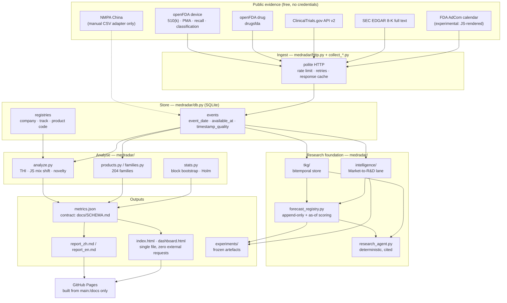
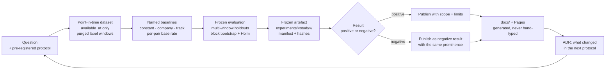

# README / Front-Page Redesign Proposal — MedRadar

**Deliverable:** A6 · REFOUNDATION-001 · owner `comms-lead`
**Status:** proposal only. **This file does not modify `README.md`, `README.zh-CN.md`, `docs/index.html`, or any asset.**
**Audit snapshot:** 2026-11-12 (Asia/Shanghai), all facts read from the local git object store at
`origin/main` = `b2a14c0a92332c004445de686daee97754cf94cb` (PR #11 merge, 2026-11-02).

---

## 0. Scope / Method / Evidence base / Limits

**Scope.** (a) The four public entry surfaces a stranger meets first: `README.md`, `README.zh-CN.md`,
the GitHub Pages root (`docs/index.html`), and the hero image `docs/preview.png`; plus the supporting
front-door documents they link (`CONTRIBUTING.md`, `ROADMAP.md`, `docs/METHODS.md`,
`docs/ATTRIBUTION.md`, `.github/pull_request_template.md`). (b) A replacement information
architecture, full English and Chinese copy drafts, a visual system spec, and a migration checklist.
Out of scope: implementing the change, editing real assets, evaluating research quality (that is
`research-registrar`'s and `data-governance`'s remit), and any branch that is not `main`.

**Method.** Every claim below was read from git objects, not from rendered prose. Extraction commands:

```bash
git show origin/main:README.md | ...                  # 480 lines
git show origin/main:README.zh-CN.md | ...            # 408 lines
git show origin/main:docs/index.html | ...            # 112,129 B on disk, 190 lines
git grep -n -E "..."  origin/main -- '*.md'           # duplicated-claim sweep
git ls-tree -r --name-only origin/main -- .github     # workflow inventory
git diff --stat origin/main...origin/<branch> -- '*.md'
```

**Evidence base.**
`docs/refoundation/_FACTS.md` (fact base), `docs/refoundation/_evidence/repo_facts.json`
(machine-readable), and a byte-for-byte extraction of every front-door file into
`docs/refoundation/_evidence/comms/` (see §11 index). File sizes are the on-disk sizes of
`origin/main` blobs; README/README.zh-CN sizes match `_FACTS.md` §6 (31,738 B / 26,132 B) within
normalisation.

**Labels.** Every statement carries one of **[FACT]** (read directly from a cited file or command),
**[INFERENCE]** (reasoned from facts, chain stated), **[RECOMMENDATION]** (a proposed action, not a
finding), **[UNVERIFIED]** (could not be checked; reason given). Unverifiable numbers in the copy
drafts are marked as HTML comments `<!-- VERIFY: ... -->` and must not be replaced by guesses.

**Limits.**
1. **[UNVERIFIED]** Whether `main`'s own CI is currently green. GitHub Actions status for the default
   branch was not queried by this auditor. The only test figure I can attribute is the Lead's
   measured run (see F-04); everything else is a claim found in a file.
2. **[UNVERIFIED]** Rendering of the README on github.com (mobile wrap, table overflow, image
   scaling) was not captured; visual findings below are geometric (dimensions, byte size, pixel
   density), not screenshot-based.
3. **[UNVERIFIED]** Third-party perceptions (what a recruiter, grant reviewer, or FDA-domain reader
   concludes) — no reader testing was possible.
4. I did not run `medradar run`, so runtime-derived numbers are reported exactly as their committed
   source states them, with that source cited; I do not re-derive them.
5. Open PRs are treated as drafts. Anything on `feat/*`, `research/*`, `foundation/*`,
   `integration/*` is **not** a `main` capability and is never presented as one here.

---

## 1. What the front door is today (inventory)

All sizes from `git cat-file`-equivalent reads of `origin/main`; all pages are published from
`main:/docs` only.[^pages]

| Surface | Size | What it actually is | Label |
|---|---|---|---|
| `README.md` | 480 lines / 31,738 B | English front page: FDA weekly-intelligence brief + paper-trading lane + research-foundation log | FACT |
| `README.zh-CN.md` | 408 lines / 26,132 B | Chinese mirror, structurally similar but not line-equivalent | FACT |
| `docs/index.html` | 190 lines / 112,129 B | **Generated** 19-chapter Chinese report, `lang="zh-CN"`, zero `<h1>`, 18 `<h2>`, 0 ``, no OG/Twitter card meta | FACT |
| `docs/preview.png` | 1440×5200 px / 488,736 B | The single hero image referenced by both READMEs | FACT |
| `docs/dashboard.html` | 3,350,819 B | Single-file 7-view interactive dashboard, `lang="zh-CN"`, dark theme | FACT |
| `docs/dashboard_*.png` | 5 files, 54–172 KB, 1440×1000 / 390×844 | Screenshots of the dashboard, referenced by neither README | FACT |
| `docs/report_zh.md`, `docs/report_en.md`, `docs/summary.csv`, `docs/metrics.json` | 55.8 KB / 6.9 KB / 68.5 KB / 468.6 KB | Generated artefacts backing the Pages site | FACT |
| Badges | 1 (`img.shields.io`) | Only badge is "built with DeepSeek Harness · deepseek-flash" (`README.md:3`) | FACT |
| Diagrams | 0 | `README.md` contains no Mermaid block and no architecture diagram | FACT |
| Licence / CoC / Security / Citation | `LICENSE` only | No `CODE_OF_CONDUCT.md`, no `SECURITY.md`, no `CITATION.cff` at repo root | FACT |

[^pages]: `_FACTS.md` §7: Pages `build_type=legacy`, `source=main:/docs`, last build commit
`b2a14c0`. **[INFERENCE]** The `weekly-radar` workflow (`.github/workflows/weekly.yml:10-11`,
"Settings → Pages → Source = GitHub Actions") requires an Actions-based Pages source, which
contradicts the observed `build_type=legacy`. Either the workflow has never deployed, or Pages is
served by the legacy builder and the workflow's `upload-pages-artifact` output is unused. This is
finding **G-09** and must be resolved before any front-page promise depends on the live site.

### 1.1 The fourteen things wrong with it

**F-01 — The hero image is unusable as a hero. [FACT]** `docs/preview.png` is 1440×5200 px. At the
README's rendered content width (~860 px on github.com) it displays ~860×3100 px, i.e. a 3.6:1 tall
ribbon whose text is illegible and which pushes the table of contents off-screen. It is also 489 KB,
of which most is layout chrome, not information. `README.zh-CN.md` repeats the same image.

**F-02 — The front page's own headline contradicts the repository description. [FACT]** `README.md:6-11`
sells "a weekly, quantified, Chinese-language intelligence brief … what US majors are actually
building next". The repository description and homepage say "evidence-first research platform"
(`_FACTS.md` §8 C3). **F-02b [FACT]**: `research/STATE.json:6-7` (on `main`) declares the current
mission as `"MedRadar — Global MedTech Intelligence & Foresight"` with architecture
`Observe -> Understand -> Anticipate`. Three different positionings are live at once, all on `main`.

**F-03 — Version claims are stale against the package on the same commit. [FACT]** `pyproject.toml`
says `version = "0.5.0"`, `medradar/__init__.py` says `__version__ = "0.5.0"`, `CHANGELOG.md:7` has
`## [0.5.0] — 2026-11-02`. `README.md:13-15` still says "The stable core through `v0.2.2` … `v0.3.0`
consolidates their branches". A reader cannot tell what version the front page describes.

**F-04 — Test counts disagree across seven files on `main`. [FACT]** Every one of these is committed
to `main`:

| Claim | Locator |
|---|---|
| 274 offline tests | `docs/GOOD_FIRST_ISSUES.md:76`; `CHANGELOG.md:322` |
| 578 offline tests | `docs/INTEGRATION_2026-11-02.md:94` |
| 625 offline tests | `docs/ATTRIBUTION.md:55` |
| 636 tests OK (skipped=3) | `docs/TKG_INTEGRATION.md:10,210` |
| **678 offline tests** | `README.md:42` |
| 679 offline tests | `research/DECISIONS.md:14` |
| 795 tests | `research/STATE.json:35` (`"expected"`) |

The Lead measured `python -m pytest` on `origin/main` at `b2a14c0` → exit 0, **1,074 tests
collected** (2026-11-12) **[FACT, external measurement; not reproducible by this auditor without
running the suite]**. My independent static count of `def test_` across 49 test modules under
`tests/` on `main` is **1,065** **[FACT, static]** — consistent with pytest collecting 1,074 once
parametrisation is counted **[INFERENCE]**.

**F-05 — The published report still carries a result the roadmap calls superseded. [FACT]**
`ROADMAP.md:44-49` states the v0.2 event-study result "is superseded and must be rebuilt in v0.3.0",
and `README.md:32` says v0.3.0 "recomputes studies … instead of carrying forward old category
counts". But the Pages-published `docs/report_zh.md` (generated 2026-10-31T05:31:22Z,
`report_zh.md:3`) still tabulates the 2,384-case 1/5/20/60-day study (`report_zh.md:601-619`), and
`docs/metrics.json` still carries `cases.stats.total = 2384`, `hit_rate_20d = 0.4518`. Nothing in the
published file marks it superseded — a grep for `superseded|已被取代|旧口径` in `docs/report_zh.md`
returns zero hits **[FACT, `git show origin/main:docs/report_zh.md | Select-String ...`]**. The site
therefore ships a number the roadmap disowns.

**F-06 — The front page's own table contradicts itself. [FACT]** `README.md:44` says "2,740 Chinese
product names"; `README.md:88` (same table system, 44 lines later) says "2,000 Chinese product
names". Both cannot be current.

**F-07 — Signal counts contradict the metrics artefact. [FACT]** `README.md:31` says "Signals emitted
281 (→ tradable subset)". The committed `docs/metrics.json` `trading.meta` records
`"n_signals": 127, "n_tradable_signals": 85`. Same snapshot date (2026-10-30), different numbers.

**F-08 — Database size drifts between generated and hand-written docs. [FACT]** `docs/DATA.md:36`
(a generated file) states 1.3 GiB = 1,368,469,504 B. `README.md:29,47`, `README.zh-CN.md:22` and
`docs/METHODS.md:206` say 1.2 GiB. `ROADMAP.md:35` says 1.3 GiB. **[INFERENCE]** The generated file
is authoritative and the hand-written prose is stale — which is the entire argument for generated
numbers in §7 and in the governance protocol.

**F-09 — "Reproducible from one command" is overstated. [FACT]** `README.md:50` says "every one of
them is reproducible from `medradar run`". But the same README (`README.md:305-311`) documents that
the Market-to-R&D numbers come from `python -m medradar.intelligence.pipeline …` +
`experiments/reverse_rd_v2/run_v2.py` + `run_ablation.py` + `merge_ablation.py`, and
`docs/METHODS.md:206` says the 1.2 GiB SQLite database and raw HTTP cache "are not committed", so a
clean clone must re-download and re-run for hours before reproducing a table that presents itself as
one command. Also relevant: no Releases exist (`_FACTS.md` §1), so the "or download the Release ZIP"
instruction in `README.md:57,206` points at nothing.

**F-10 — Two lanes with different scientific status sit side by side with equal visual weight.
[FACT]** The paper-trading lane (`README.md:116-201`, `401-409`) is an in-sample, long-only, simulated
book; the research-foundation lane (`README.md:269-399`) is point-in-time, purged, baseline-compared
research. The README gives the simulation lane more vertical space (≈86 lines vs ≈20 for the negative
results it buries at `README.md:320-331`). `docs/metrics.json` `trading.summary` reports
`total_return 0.1919`, `sharpe 2.2957` from `n_trades 38` over `2025-11-21 → 2026-10-30`, against a
`SPY` benchmark of `0.1583` — a 38-trade, ~11-month in-sample window presented in the same voice as
the 43,420-fact research dataset. **[RECOMMENDATION]** Demote the simulation lane to a labelled
appendix ("legacy demonstrator, in-sample, 38 trades, not a result") or remove it from the front page
entirely.

**F-11 — The strongest scientific asset — measured negative results — is buried. [FACT]**
`README.md:320-331` contains a genuinely strong passage: seven source ablations, "**No added source
produces a statistically detectable ranking gain**", every marginal PR-AUC delta negative, and a
persistence baseline (AP 0.7913) that is statistically indistinguishable from the model (0.7935,
Δ +0.0022, 95% CI [−0.032, +0.037]). `research/STATE.json` (on `main`) additionally records a
measured detection probability of **0.223** for injected monthly shifts and states outright that
"2x shifts remain undetectable at any honest budget". This is the most credible thing in the
repository and it appears at line 320 of 480, in a subsection headed "Source ablation".

**F-12 — The front door describes capabilities that only exist on draft branches. [FACT]** Shared
`_FACTS.md` §4: PRs #12–#30 (19 drafts, 2,824,212 added lines vs 541,569 merged) carry MedRadar 2.0,
Live Observatory, PHOENIX, ATLAS, HORIZON, CONVERGENCE, S-028…S-031, QLoRA. None is on `main`, and
Pages cannot show any of it. The current README is mostly honest about this, but the *absence of an
explicit capability ledger* is what let the drift happen in three other files at once (F-02b).

**F-13 — The two front pages are structurally parallel but not provably synchronised. [FACT +
UNVERIFIED]** Both have exactly **15 `##` headings** and share the same section spine
(`git show origin/main:README.md | Select-String '^## '` → 15; same for zh). The Chinese page is
**72 lines shorter** (408 vs 480), so content volume differs somewhere. I verified specific parity on
the easiest-to-miss item: the AdCom "returns `empty`/`source_changed`, marked experimental, rows
rendered client-side" caveat **is** present in the Chinese version **[FACT]** — an earlier draft of
this finding claimed it was missing and was wrong. **[UNVERIFIED]** A full line-by-line semantic diff
of the two documents was not performed, so undetected drift is possible but **not proven**. Two front
pages maintained independently is still a losing position **[INFERENCE]**, which is why §8 and the
protocol's `g2` gate mandate a structural-parity check rather than trusting prose review.

**F-14 — There is no front page for the front page. [FACT]** Pages root is `docs/index.html`: a
generated Chinese report with no `<h1>`, no English version, no navigation to the repo, no
`og:image`, and its only outbound links are `dashboard.html` and `replay_intraday.html`
(`docs/index.html` tagline line). A visitor arriving from the repo's homepage URL lands inside a
Chinese analytics report with no way back to "what is this project".

Additionally, small but real: **F-15 [FACT]** `.github/pull_request_template.md` (25 lines) classifies
work as bugfix / data / new-metric / docs, so there is no field for "which research question does
this serve", no branch-stack field, and no experiment-freeze field — the same template gap that let
PRs #12–#30 stack 3-deep (§8 of the companion protocol).

---

## 2. New information architecture

Ordered sections, with the reason each sits where it does. The ordering principle is: **a cold
technical reader must be able to answer "what is this, is it real, what did it find, can I run it" in
ninety seconds, and a domain reader must never be surprised later by something the front page hid.**

| # | Section | Why here | Budget |
|---|---|---|---|
| 1 | Title + one-line mission + status strip | The only thing visible above the fold on mobile; must contain the scientific question, not a product pitch | ≤ 6 lines |
| 2 | Visual intro (1 image, cropped) | One picture earns a scroll; a 5200-px ribbon loses one | 1 image, ≤ 200 KB |
| 3 | Status at a glance (generated table) | Answers "is it alive, what version, does CI pass, how many tests" without reading prose | 6–9 rows |
| 4 | The core scientific question | The positioning fix (F-02). Everything below must serve it | ≤ 12 lines |
| 5 | **What `main` can do today vs what is only on draft branches** | The single most important honesty block (F-12); prevents every future overclaim by making the boundary structural | 2 tables |
| 6 | System architecture (Mermaid) | Lets an engineer decide in 10 s whether the engineering is credible | 1 diagram |
| 7 | Global data sources & evidence coverage | The actual moat and the actual gaps; sets the reader's trust baseline | 1 table + 1 caveat list |
| 8 | Research results **including negative results** | The reason a scientist stays (F-11). Negative results sit at the same level as positive ones | 1 results table + 1 negative-results block |
| 9 | Reproducible quickstart | Only now is the reader asked to spend effort; comes after credibility, not before | ≤ 20 lines of commands |
| 10 | Limitations & unproven capabilities | Deliberate, named, numbered — the credibility signal | 6–10 items |
| 11 | Research workflow (Mermaid) + how to cite this | For the reader who wants to contribute or reuse | 1 diagram |
| 12 | Roadmap / contributing / licence | Housekeeping at the bottom, where housekeeping belongs | ≤ 20 lines |

**What moved out of the front page** (and where it goes): the 8-K LLM-judge calibration table →
`docs/CALIBRATION.md` (already exists, already linked); the four-level execution-guard list → the
simulation appendix; the Phase 1/2/3 engineering log → `docs/PHASE*.md`; the full `medradar` module
inventory → `docs/ARCHITECTURE.md` (to be created; PR #17 drafts `docs/REPOSITORY_AUDIT.md` for
part of this) **[RECOMMENDATION]**.

---

## 3. English copy draft

> This is copy, not a file to copy over `README.md`. It replaces `README.md` in full if approved.
> Every bracketed number carries its provenance in §5. Lines marked `<!-- VERIFY -->` must be
> resolved or the sentence deleted before shipping.

```markdown
# MedRadar

**An evidence-first research instrument for one question: can publicly observable evidence give
reliable early warning of meaningful change in medical-technology development?**

MedRadar ingests free public regulatory, clinical-trial and corporate-filing evidence about
medical-device and drug makers into a single auditable event store, then tests — with point-in-time
data, frozen experiments and named baselines — whether that evidence carries signal. So far the
honest answer is *partly, weakly, and in one narrow place*, and we publish the negative results
alongside the positive ones.

It is a research instrument, not a product, not a forecasting service, and nothing in this repository
is investment advice.

> 中文 → [README.zh-CN.md](README.zh-CN.md) · Status → generated table below ·
> Method contract → [docs/METHODS.md](docs/METHODS.md) · Live site → <https://chazy11.github.io/medradar/>

## Status at a glance

<!-- GENERATED: do not hand-edit. Source = PROJECT_STATE.yaml + docs/metrics.json. See
     docs/refoundation/AGENT_COLLABORATION_PROTOCOL.md §M6. -->

| Field | Value |
|---|---|
| Version | `0.5.0` (from `pyproject.toml`; single source of truth) |
| `main` HEAD | `b2a14c0` — 2026-11-02 |
| Offline test suite | 1,074 tests, green at `b2a14c0` on 2026-11-12 (py3.10/3.11/3.12, no network) |
| CI | `.github/workflows/ci.yml` — 3 Python versions + Windows install + offline demo |
| Data snapshot | metrics generated 2026-10-30T19:23:33Z, window 2025-01-01 → 2026-10-30 |
| Licence | MIT |
| Published site | generated from `main:/docs` only |

## The question

> **Can publicly observable evidence give reliable early warning of meaningful change in
> medical-technology development?**

Everything in the repository serves that question in one of three ways: **observe** activity in
public evidence, **understand** what changed with traceable evidence, or **test** whether the change
could have been seen earlier. Work that serves none of the three is out of scope.

## What `main` can do today

These capabilities exist on `main`, at `b2a14c0`, and are exercised by the offline suite.

| Capability | Where | Status |
|---|---|---|
| Ingest openFDA 510(k) / PMA / recall / classification, drug approvals, ClinicalTrials.gov v2, SEC EDGAR 8-K | `medradar/collect_*.py` | working |
| One unified, point-in-time `events` table with `available_at` + `timestamp_quality` | `medradar/db.py` | working |
| Company / subsidiary and technology-track resolution with visible unmatched counts | `medradar/config.py`, `config/*.json` | working |
| Track heat (THI, Gamma–Poisson shrinkage), direction (Jensen–Shannon mix shift), novelty (first occurrence) | `medradar/analyze.py` | working |
| 204 device product families + 2,740 Chinese product names | `medradar/products.py`, `medradar/families.py` | working |
| Event study with block bootstrap + Holm correction; simulated long-only book (in-sample) | `medradar/eventstudy.py`, `medradar/paper.py` | working, simulation only |
| Bitemporal knowledge store (valid time vs knowledge time) and append-only forecast registry with as-of scoring | `medradar/tkg/`, `medradar/forecast_registry.py` | working |
| Purged multi-window Market-to-R&D evaluation with 7-source ablation and naive baselines | `experiments/reverse_rd_v1/`, `reverse_rd_v2/` | working, frozen artefacts committed |
| Deterministic evidence-grounded research agent (cited, not generative) | `medradar/research_agent.py` | working |
| Self-contained offline demo, zero external requests | `medradar demo`, `docs/dashboard.html` | working |
| Offline test suite | `tests/` (1,074 tests) | green at `b2a14c0` |

### Not on `main` — do not attribute these to the released code

`main` contains only the work merged through PR #11. Twenty pull requests (#1, #12–#30) are open,
nineteen of them drafts. The following are **branch-only drafts** and none of them is served by the
live site:

| Work | Branch / PR | State |
|---|---|---|
| MedRadar 2.0 product surface (company/radar/analyst/evidence web layer) | `feat/medradar-2.0-mvp` / #12 | draft |
| Live Observatory v1 (append-only observation ledger) | `feat/live-observatory-v1` / #13 | draft |
| Observatory reliability (durable persistence, supervision) | `feat/observatory-reliability-v1` / #14 | draft |
| S-028 temporal-graph early-signal study | `research/s028-…` / #15 | draft, negative results |
| S-029 evidence-based relation reconstruction | `research/s029-…` / #16 | draft |
| Repository consolidation (docs + asset register) | `maintenance/repository-consolidation` / #17 | draft |
| Local-LLM foundation and overnight QLoRA | `research/local-llm-foundation` / #19, #20 | draft |
| Innovation Signals Observatory (Phase 4) | `research/innovation-signals-observatory` / #21 | draft |
| S-031 hiring-capability study | `research/s031-…` / #22 | draft |
| PHOENIX-001/002/003 | `research/phoenix-*` / #23–#26 | drafts, NO-GO results |
| DATA-EXPANSION-001, ATLAS-001, HORIZON-001, CONVERGENCE-001 | #27–#30 | drafts |

If you came here looking for "MedRadar 2.0", "Live Observatory", "ATLAS", "HORIZON" or
"CONVERGENCE": those are unmerged drafts. See the PR list, not this README.

## Architecture



Honest reading of the diagram: the ingest → store → analyse path is the part that is finished and
tested. The research foundation is real but its two headline instruments (forecast registry
calibration, temporal-graph features feeding models) are not yet productive — see Limitations.

## Data sources and evidence coverage

All free, all public, no credentials required.

| Source | Content | Freshness (measured 2026-10-31) | Tradable? |
|---|---|---|---|
| openFDA `device/510k` | 510(k) clearances, 176,466 records | T−12 d | via signal only |
| openFDA `device/pma` | PMA and supplements, 57,372 | T−12 d | via signal only |
| openFDA `device/recall` | device recalls, 59,646 | T−2 d | alert only |
| openFDA `device/classification` | product codes → regulated definitions | static | n/a |
| openFDA `drug/drugsfda` | NDA/BLA/ANDA review and approvals, 29,000 | T−2 d | via signal only |
| ClinicalTrials.gov v2 | trial registrations, drug and device | ≤ 21 d after first enrollment | terminations only |
| SEC EDGAR full-text | 8-K regulatory/clinical/designation stream, 20,976 filings | seconds | yes |
| FDA Advisory Committee calendar | meetings, agendas, briefing materials | **experimental — parses zero rows** | no |
| NMPA (China) | — | **deliberately not scraped** (WAF) | no |

Total in the committed snapshot: **375,378 events**, 89 companies, 60 tracks, 204 device product
families, 7,097 product codes. The database that produced it (1.3 GiB SQLite) and the raw HTTP cache
are **not** committed — a clean clone starts empty and must re-download.

Two data decisions worth knowing before you trust any number:

1. **NMPA is not scraped and never fabricated.** `www.nmpa.gov.cn` answers HTTP 412 and
   `www.cmde.org.cn` HTTP 202 behind a JavaScript WAF. Drop a CSV export at
   `data/nmpa_registrations.csv` and the China-gap table fills; without it every CN value is `null`
   and the report says so. It never emits a zero in place of unknown.
2. **AdCom is experimental.** FDA renders the Advisory Committee calendar client-side, so a static
   fetch parses zero meetings. `collect --sources adcom` returns `status="empty"`/`"source_changed"`
   with a warning instead of a silent `"ok"`.

## What the research has found — including what it failed to find

### The positive result, stated at its real size

Direction-aligned abnormal returns, block bootstrap, Holm correction over the full
category × horizon family. The 60-day horizon is the only one that survives:

| Horizon | n | Mean abnormal return | t | 95% CI |
|---|---|---|---|---|
| +1 d | 122 | +0.15 % | 0.57 | [−0.33 %, +0.65 %] |
| +5 d | 109 | −0.37 % | −0.92 | [−1.17 %, +0.42 %] |
| +20 d | 89 | +1.14 % | 1.17 | [−0.65 %, +3.13 %] |
| **+60 d** | **61** | **+5.65 %** | **2.45** | **[+1.35 %, +10.32 %]** |

Provenance: `docs/metrics.json` → `trading.event_study`, generated 2026-10-30T19:23:33Z, on `main`,
snapshot window 2025-11-21 → 2026-10-30. Scope limit: this is the simulation lane's event study, not
the 2,384-case corpus study; the corpus study is a superseded snapshot and is **not** carried forward
here.

### The negative results, which are the more important half

The Market-to-R&D lane asks whether R&D/regulatory milestones can be forecast 12 months ahead from
public evidence. Frozen artefacts: `experiments/reverse_rd_v1/`, `experiments/reverse_rd_v2/`
(55,090 in-window FDA events · 43,420 SEC facts across 32 companies · 6,701 continuation examples
over 25 quarterly origins · 41,003 dormant→active entry examples over 24 origins).

| Finding | Number | Interpretation |
|---|---|---|
| Every added source fails to improve ranking | marginal PR-AUC on continuation: financial −0.0013, market −0.0015, publication −0.0001, all-sources −0.0068 | more data did **not** buy better ranking |
| The model barely beats persistence | AP 0.7935 (model) vs 0.7913 (per-pair base rate), Δ +0.0022, 95 % CI [−0.032, +0.037] | the "signal" is mostly the base rate |
| All-source model improves calibration, not ordering | ECE 0.0811 → 0.0628; FPR 0.2753 → 0.2472 | better calibrated, same ranking |
| Entry target (dormant→active) is unstable | three-window mean favours richer specs, final holdout favours the shared baseline; differences sit inside the 0.014–0.026 window std | not a stable effect |
| Change detection is weak by measurement | 0.223 of injected sustained monthly shifts recovered; 2× shifts remain undetectable at any honest budget | data density is the binding constraint |

Two capability gaps are stated rather than hidden: **patents were not evaluated** (USPTO Open Data
Portal requires an API key) and **procurement is excluded** (its snapshot is not point-in-time
usable). Hiring is deferred.

> If you are looking for a system that predicts medical-technology direction: this is not it, and we
> can show you the experiments that failed to make it one. If you are looking for an instrument that
> measures what is observable, with the failure modes quantified, that is what exists.

## Run it

```bash
git clone https://github.com/ChazY11/medradar.git && cd medradar
pip install -e .
medradar demo            # offline, committed snapshot, no API key, no network, < 60 s
# → open out/demo/index.html
```

That is the whole reproduction for the demo. For the radar over live public data (~3 min, still no
API key):

```bash
medradar run --months 24 --with-trade --with-dashboard
#   out/index.html          report
#   docs/dashboard.html     interactive dashboard (7 views, single file, zero external requests)
#   out/report_zh.md        Chinese report
#   out/summary.csv         flat metrics
```

The research tables above need the `[bulk]` extra and a longer run; the exact commands are in
[docs/METHODS.md](docs/METHODS.md) and `experiments/`. The 1.3 GiB SQLite database is not committed,
so reproducing the frozen tables means re-downloading from the public sources — plan for hours, not
minutes. We would rather say that than imply a one-liner.

## Limitations and unproven capabilities

1. **No matured forecast yet.** The forecast registry holds 25 registered nowcasts, 0 matured;
   calibration state is `insufficient_matured_forecasts`. No calibration claim is made.
2. **The temporal graph's knowledge clock is backfill time**, not historical publication time.
   As-of queries are structurally correct but not historically faithful for the current import.
3. **Change detection is too weak to alert on** (0.223 recovery; 2× shifts undetectable).
4. **Patents and hiring are absent evidence**, and procurement is not point-in-time usable.
5. **510(k)/PMA rows carry no public timestamp**, so they enter industry counts but never return
   studies. This is a real loss of sample, deliberately not papered over.
6. **AdCom parsing returns zero rows** and is marked experimental.
7. **The simulated book is in-sample, long-only, 38 trades, ~11 months.** Shorts are alerted, never
   traded; borrow fees, squeeze-outs and delisting mechanics are unmodelled. It is a demonstrator.
8. **The 2,384-case corpus study and its return table are a superseded snapshot** and are not a
   current result.
9. **`main` cannot show the product surface.** Everything web-facing beyond the generated report and
   dashboard is an unmerged draft.
10. **No claims are made about causality.** DiD / synthetic control are roadmap items, not results.

## How the research is run



No claim enters this README without a frozen artefact behind it. If a number cannot be regenerated
from a committed manifest, it does not appear.

## Roadmap, contributing, licence

**Next, in order:** (1) mature enough forecast windows to make any calibration claim at all;
(2) feed graph features into the models rather than only the agent; (3) patent features once a USPTO
ODP key exists; (4) versioned historical track taxonomy; (5) NMPA CSV importer. Full list:
[ROADMAP.md](ROADMAP.md).

**Contributing.** The highest-value contributions are the curated knowledge files, not code:
company/subsidiary aliases, track dictionaries, product-code mappings. Code must stay
standard-library-only for the core, and every new metric must update `docs/METHODS.md` and
`docs/SCHEMA.md` first. See [CONTRIBUTING.md](CONTRIBUTING.md) and
[docs/GOOD_FIRST_ISSUES.md](docs/GOOD_FIRST_ISSUES.md).

**Licence.** MIT. Source data belongs to its publishers. Nothing here is investment advice; this is
a research and education project.
```

---

## 4. Chinese copy draft

> Structural mirror of §3. Same provenance table (§5) applies; the two drafts must not diverge.

```markdown
# MedRadar

**一个以证据为先的研究工具，只回答一个问题：公开可观察的信息，能否为医疗技术发展的重要变化提供可靠的早期信号？**

MedRadar 把公开、免费的监管、临床试验与公司披露证据，收录进一个可审计的事件库，然后用时点数据、
冻结实验与具名基线，检验这些证据是否真的携带信号。到目前为止，诚实的答案是：**部分是，很弱，而且
只在一个很窄的地方**；我们把负结果与正结果放在同等位置发表。

这是一个研究工具，不是产品，不是预测服务，本仓库任何内容都不构成投资建议。

> English → [README.md](README.md) · 方法契约 → [docs/METHODS.md](docs/METHODS.md) ·
> 在线站点 → <https://chazy11.github.io/medradar/>

## 当前状态一览

<!-- 自动生成，禁止手改。数据源：PROJECT_STATE.yaml + docs/metrics.json -->

| 项目 | 值 |
|---|---|
| 版本 | `0.5.0`（取自 `pyproject.toml`，唯一来源） |
| `main` HEAD | `b2a14c0` —— 2026-11-02 |
| 离线测试 | 1,074 个测试，`b2a14c0` 上于 2026-11-12 全绿（py3.10/3.11/3.12，不联网） |
| CI | `.github/workflows/ci.yml` —— 三个 Python 版本 + Windows 安装 + 离线 demo |
| 数据快照 | metrics 生成于 2026-10-30T19:23:33Z，窗口 2025-01-01 → 2026-10-30 |
| 许可证 | MIT |
| 在线站点 | 仅由 `main:/docs` 构建 |

## 研究问题

> **公开可观察的信息，能否为医疗技术发展的重要变化提供可靠的早期信号？**

仓库里的每一件事都服务于这个问题的一个方向：**观察**公开证据中的活动、**理解**变化并保留可追溯证据、
**检验**该变化是否能被更早看到。三者之外的工作不在范围内。

## `main` 现在能做什么

以下能力存在于 `main`（`b2a14c0`），并由离线测试覆盖。

| 能力 | 位置 | 状态 |
|---|---|---|
| 采集 openFDA 510(k) / PMA / 召回 / 分类、药品批准、ClinicalTrials.gov v2、SEC EDGAR 8-K | `medradar/collect_*.py` | 可用 |
| 统一时点事件表（`available_at` + `timestamp_quality`） | `medradar/db.py` | 可用 |
| 公司/子公司与赛道消歧，未匹配数量可见 | `medradar/config.py`、`config/*.json` | 可用 |
| 赛道热度（THI，Gamma–Poisson 收缩）、方向（JS 混杂度位移）、新颖性（首次出现） | `medradar/analyze.py` | 可用 |
| 204 个器械产品族 + 2,740 条中文产品名 | `medradar/products.py`、`families.py` | 可用 |
| 事件研究（block bootstrap + Holm）与模拟多头组合（样本内） | `medradar/eventstudy.py`、`paper.py` | 可用，仅模拟 |
| 双时态知识库（有效时间 vs 知识时间）与追加式预测注册表、as-of 评分 | `medradar/tkg/`、`forecast_registry.py` | 可用 |
| purged 多窗口 Market-to-R&D 评估、7 组来源消融、朴素基线 | `experiments/reverse_rd_v1/`、`v2/` | 可用，冻结产物已入库 |
| 确定性的、带引用的研究智能体（不生成式臆造） | `medradar/research_agent.py` | 可用 |
| 完全离线的自包含 demo，零外部请求 | `medradar demo`、`docs/dashboard.html` | 可用 |
| 离线测试套件 | `tests/`（1,074 个测试） | `b2a14c0` 上全绿 |

### 不在 `main` 上 —— 请不要把这些算作已发布能力

`main` 只包含合并到 PR #11 为止的工作。另有 20 个 PR（#1、#12–#30）处于打开状态，其中 19 个是草稿。
以下全部是**分支草稿**，在线站点不会展示其中任何一个：

| 工作 | 分支 / PR | 状态 |
|---|---|---|
| MedRadar 2.0 产品面（公司/雷达/分析师/证据 Web 层） | `feat/medradar-2.0-mvp` / #12 | 草稿 |
| Live Observatory v1（追加式观测账本） | `feat/live-observatory-v1` / #13 | 草稿 |
| Observatory 可靠性（持久化、监督、备份） | `feat/observatory-reliability-v1` / #14 | 草稿 |
| S-028 时态公司–技术图早期信号研究 | `research/s028-…` / #15 | 草稿，负结果 |
| S-029 基于证据的时态关系重建 | `research/s029-…` / #16 | 草稿 |
| 仓库整理（文档 + 数据资产登记） | `maintenance/repository-consolidation` / #17 | 草稿 |
| 本地 LLM 底座与隔夜 QLoRA | `research/local-llm-foundation` / #19、#20 | 草稿 |
| 创新信号观测站（Phase 4） | `research/innovation-signals-observatory` / #21 | 草稿 |
| S-031 招聘能力研究 | `research/s031-…` / #22 | 草稿 |
| PHOENIX-001/002/003 | `research/phoenix-*` / #23–#26 | 草稿，NO-GO 结果 |
| DATA-EXPANSION-001、ATLAS-001、HORIZON-001、CONVERGENCE-001 | #27–#30 | 草稿 |

如果你是为了 "MedRadar 2.0"、"Live Observatory"、"ATLAS"、"HORIZON"、"CONVERGENCE" 而来：这些都是
未合并的草稿。请看 PR 列表，而不是这份 README。

## 系统架构

（与英文版同一张 Mermaid 图，逐节点一致；中文版仅替换节点标签，不增删节点。）

<!-- 迁移时直接复用英文版 mermaid 源码，仅把 subgraph / 节点标签译为中文；
     两版图的节点集合必须有 CI 校验（见 AGENT_COLLABORATION_PROTOCOL.md §M6）。 -->

## 数据来源与证据覆盖

全部免费、公开、无需凭证。

| 数据源 | 内容 | 新鲜度（2026-10-31 实测） | 是否可交易 |
|---|---|---|---|
| openFDA `device/510k` | 510(k) 许可，176,466 条 | T−12 天 | 仅通过信号 |
| openFDA `device/pma` | PMA 及补充，57,372 条 | T−12 天 | 仅通过信号 |
| openFDA `device/recall` | 器械召回，59,646 条 | T−2 天 | 仅告警 |
| openFDA `drug/drugsfda` | NDA/BLA/ANDA 审评与批准，29,000 条 | T−2 天 | 仅通过信号 |
| ClinicalTrials.gov v2 | 药物与器械试验登记 | 首次入组后 ≤21 天 | 仅终止事件 |
| SEC EDGAR 全文 | 8-K 监管/临床/认定事件流，20,976 份 | 秒级 | 是 |
| FDA 顾问委员会日历 | 会议、议程、简报材料 | **实验性：当前解析为零行** | 否 |
| NMPA（中国） | —— | **有意不抓取**（WAF） | 否 |

已提交快照合计：**375,378 条事件**、89 家公司、60 个赛道、204 个器械产品族、7,097 个产品码。
产生该快照的数据库（1.3 GiB SQLite）与原始 HTTP 缓存**不入库**——干净克隆是空的，必须重新下载。

两条必须先知道的数据决定：

1. **不抓取 NMPA，也绝不编造。** `www.nmpa.gov.cn` 返回 HTTP 412，`www.cmde.org.cn` 在 JavaScript
   WAF 后返回 HTTP 202。把 CSV 导出放到 `data/nmpa_registrations.csv`，中国空白度表就会亮起；没有
   该文件时所有 CN 值为 `null`，报告会明确说明，绝不以 0 代替未知。
2. **AdCom 是实验性数据源。** FDA 在前端渲染顾问委员会日历，静态抓取解析到零场会议；
   `collect --sources adcom` 返回 `status="empty"`/`"source_changed"` 并告警，而不是静默返回 `"ok"`。

## 研究发现了什么 —— 包括没发现什么

### 正结果，按它的真实大小陈述

方向对齐的超额收益、block bootstrap、在「类别 × 窗口」全家族内做 Holm 校正。只有 60 日窗口通过：

| 窗口 | n | 平均超额收益 | t | 95% 置信区间 |
|---|---|---|---|---|
| +1 日 | 122 | +0.15 % | 0.57 | [−0.33 %, +0.65 %] |
| +5 日 | 109 | −0.37 % | −0.92 | [−1.17 %, +0.42 %] |
| +20 日 | 89 | +1.14 % | 1.17 | [−0.65 %, +3.13 %] |
| **+60 日** | **61** | **+5.65 %** | **2.45** | **[+1.35 %, +10.32 %]** |

来源：`docs/metrics.json` → `trading.event_study`，生成于 2026-10-30T19:23:33Z，位于 `main`，
快照窗口 2025-11-21 → 2026-10-30。范围限制：这是模拟层的事件研究，不是 2,384 例语料研究；
语料研究是**已被取代的旧快照**，不在此沿用。

### 负结果，才是更重要的那一半

Market-to-R&D 层问的是：能否用公开证据预测 12 个月后的研发/监管里程碑。冻结产物：
`experiments/reverse_rd_v1/`、`reverse_rd_v2/`（窗口内 55,090 条 FDA 事件 · 32 家公司的 43,420 条
SEC 财务事实 · 25 个季度起点的 6,701 条持续性样本 · 24 个起点的 41,003 条「休眠→进入」样本）。

| 发现 | 数字 | 解读 |
|---|---|---|
| 增加数据源没有改善排序 | 持续性目标边际 PR-AUC：财务 −0.0013、市场 −0.0015、论文 −0.0001、全来源 −0.0068 | 加数据没有换来更好的排序 |
| 模型几乎打不过持续性基线 | AP 0.7935（模型）vs 0.7913（逐对历史基准率），Δ +0.0022，95% CI [−0.032, +0.037] | 「信号」主要来自基准率 |
| 全来源模型改善校准、不改善排序 | ECE 0.0811 → 0.0628；FPR 0.2753 → 0.2472 | 校准更好，排序没变 |
| 「进入」目标不稳定 | 三窗口均值偏向更丰富特征，最终留出集偏向共享基线；差异落在 0.014–0.026 窗口标准差内 | 不是稳定效应 |
| 变化检测实测很弱 | 注入的持续月度位移仅能找回 0.223；2 倍位移在任何诚实预算下都检测不到 | 数据密度是硬约束 |

两个能力缺口是明确写出的，而不是隐藏的：**专利未评估**（USPTO Open Data Portal 需要 API key），
**采购数据被排除**（其快照不具备时点可用性），招聘信号暂缓。

> 如果你在找一个能预测医疗技术方向的系统：不是这个，而且我们能把让它变成一个预测系统的实验失败
> 在哪儿给你看。如果你在找一个测量可观察事实、并把失效模式量化出来的工具：这就是存在的那个东西。

## 跑起来

```bash
git clone https://github.com/ChazY11/medradar.git && cd medradar
pip install -e .
medradar demo            # 离线，使用已提交快照，无 API key，不联网，< 60 秒
# → 打开 out/demo/index.html
```

以上是 demo 的完整复现路径。要跑真实公开数据的雷达（约 3 分钟，仍无需 API key）：

```bash
medradar run --months 24 --with-trade --with-dashboard
#   out/index.html          报告
#   docs/dashboard.html     交互式看板（7 视图，单文件，零外部请求）
#   out/report_zh.md        中文报告
#   out/summary.csv         平表
```

上面那些研究表格需要 `[bulk]` 扩展与更长的运行；确切命令见 [docs/METHODS.md](docs/METHODS.md) 与
`experiments/`。1.3 GiB 的 SQLite 数据库不在仓库里，复现冻结表格意味着要从公开数据源重新下载——
请按小时计，不要按分钟计。我们宁愿这样说，也不愿暗示一行命令就能完成。

## 局限与尚未证明的能力

1. **还没有到期预测。** 预测注册表里有 25 条 nowcast、0 条到期；校准状态为
   `insufficient_matured_forecasts`，不作任何校准声明。
2. **时态图的知识时钟是回填时间**，不是历史发布时间。as-of 查询在结构上正确，但对当前导入而言
   并非历史忠实。
3. **变化检测弱到不能用于告警**（找回率 0.223；2 倍位移检测不到）。
4. **专利与招聘是缺失的证据**，采购数据不具备时点可用性。
5. **510(k)/PMA 行没有公开时间戳**，因此进入产业计数、但永不进入收益研究。这是真实的样本损失，
   我们刻意没有掩盖。
6. **AdCom 解析目前返回零行**，已标注为实验性。
7. **模拟组合是样本内、仅多头、38 笔交易、约 11 个月。** 做空只告警不交易；借券费、并购逼平与
   退市机制未建模。它是演示器。
8. **2,384 例语料研究与收益表是被取代的旧快照**，不是当前结果。
9. **`main` 无法展示产品面。** 生成报告与看板之外的任何 Web 能力都是未合并草稿。
10. **不作因果声明。** DiD / 合成控制是路线图条目，不是结果。

## 研究是怎么跑的

（与英文版同一张研究流程 Mermaid 图，节点一一对应，仅译标签。）

任何数字进入本 README 都必须有冻结产物支撑。若一个数字无法从已提交的 manifest 重新生成，它就不出现。

## 路线图、贡献、许可证

**接下来，按顺序：**（1）积累足够多的到期预测窗口，使任何校准声明成为可能；（2）把图特征接进模型，
而不只是接进智能体；（3）拿到 USPTO ODP key 后加入专利特征；（4）版本化的历史赛道分类；
（5）NMPA CSV 导入界面。完整列表：[ROADMAP.md](ROADMAP.md)。

**贡献。** 最有价值的贡献不是代码，而是让数据可信的策展知识文件：公司/子公司别名、赛道词典、
产品码映射。核心代码必须保持仅用标准库；每一个新指标都必须先更新 `docs/METHODS.md` 与
`docs/SCHEMA.md`。见 [CONTRIBUTING.md](CONTRIBUTING.md) 与
[docs/GOOD_FIRST_ISSUES.md](docs/GOOD_FIRST_ISSUES.md)。

**许可证。** MIT。源数据归其发布方所有。本仓库不构成投资建议，是研究与教育项目。
```

---

## 5. Provenance rule and number ledger

**The rule (normative).** Any numeral that appears in `README.md`, `README.zh-CN.md`, or the Pages
landing page must be traceable to one of exactly three sources, in this precedence order:

1. **A generated artefact** committed in the repo (`docs/metrics.json`, `docs/DATA.md`,
   `docs/summary.csv`, `experiments/*/manifest.json`) → cite the path and the artefact's own
   `generated_at`.
2. **A repository fact read from a ref** (`pyproject.toml`, `.github/workflows/*.yml`,
   `git rev-parse`, test collection output) → cite the path and the ref.
3. **A frozen study manifest** (`experiments/reverse_rd_v*/…`) → cite the manifest path and hash.

If a numeral has no such source, it must be replaced by `<!-- VERIFY: <the exact command or file that
would settle it> -->`. Hand-typed numbers are a release blocker (§8, **DNS-3**).

**Ledger for the copy in §3–§4.** "On main?" means: is the value derivable from `origin/main` at
`b2a14c0` without referencing a branch.

| # | Number as published | Source | Snapshot | Ref | On `main`? | Scope / limit | Label |
|---|---|---|---|---|---|---|---|
| N-01 | `0.5.0` | `pyproject.toml:version`; `medradar/__init__.py:__version__`; `CHANGELOG.md:7` | 2026-11-02 | `b2a14c0` | yes | package version, not a release tag (no Releases exist) | FACT |
| N-02 | `b2a14c0`, 2026-11-02 | `git rev-parse origin/main`; HEAD subject = PR #11 merge | 2026-11-02 | `b2a14c0` | yes | HEAD moves; must be regenerated | FACT |
| N-03 | **1,074 tests** | Lead's `python -m pytest` on `origin/main` | 2026-11-12 | `b2a14c0` | yes | measured, exit 0; static `def test_` count is 1,065, difference = parametrisation | FACT (external measurement) |
| N-04 | metrics generated `2026-10-30T19:23:33Z` | `docs/metrics.json` → `trading.meta.generated_at` | 2026-10-30 | `b2a14c0` | yes | the artefact, not the code, dates itself | FACT |
| N-05 | window `2025-01-01 → 2026-10-30` (8 quarters) | `docs/index.html` tagline; `docs/report_zh.md:3` | 2026-10-31T05:31:22Z | `b2a14c0` | yes | report-generation window | FACT |
| N-06 | 375,378 events (510k 176,466 · PMA 57,372 · recall 59,646 · trials 55,592 · drug 5,326 · 8-K 20,976) | `docs/DATA.md:23`; `README.md:28`; `research/DATA_PROVENANCE.md:42` | 2026-10-30 | `b2a14c0` | yes | **not reproducible from a clean clone** — the 1.3 GiB DB is uncommitted | FACT (as committed claim) |
| N-07 | 89 companies, 60 tracks, 204 families, 7,097 product codes | `README.md:29`; `docs/metrics.json` `products.coverage.families = 204` | 2026-10-30 | `b2a14c0` | yes (204 via metrics.json); others README-only | 89/60/7,097 have no committed generator output found by this audit → `<!-- VERIFY: medradar status on the snapshot DB -->` | FACT / UNVERIFIED |
| N-08 | 7,097 product codes | `README.md:29` only | — | — | claim only | no artefact found; keep only if `medradar status` emits it | UNVERIFIED |
| N-09 | 1.3 GiB SQLite (1,368,469,504 B) | `docs/DATA.md:36` (generated) | 2026-10-30 | `b2a14c0` | yes | **supersedes README's 1.2 GiB** — fix F-08 | FACT |
| N-10 | 20,976 8-K filings | `ROADMAP.md:36`; `docs/metrics.json` `cases.stats.corpus_total` | 2026-10-30 | `b2a14c0` | yes | corpus size, not a sample | FACT |
| N-11 | 2,740 Chinese product names | `README.md:44`; `ROADMAP.md:38`; `docs/ATTRIBUTION.md:39` | 2026-10-31 | `b2a14c0` | yes | contradicts `README.md:88`'s 2,000 → keep 2,740, fix line 88 | FACT |
| N-12 | 55,090 / 43,420 / 3,453 / 6,701 / 25 origins | `README.md:305-311`; `experiments/reverse_rd_v1/` | 2026-11-02 | `b2a14c0` | yes | one committed config; left-censoring stated | FACT |
| N-13 | 41,003 entry examples / 24 origins / 1.23 % base rate | `README.md:310-311`; `experiments/reverse_rd_v2/` | 2026-11-02 | `b2a14c0` | yes | label window closes later; documented | FACT |
| N-14 | PR-AUC 0.7935 / 0.7922; Brier 0.1721; ECE 0.0811 / 0.0737 | `README.md:315-318`; `experiments/reverse_rd_v2/ablation_metrics.json` | 2026-11-02 | `b2a14c0` | yes | holdout 2025-10-01, 307 rows / 129 positives | FACT |
| N-15 | marginal Δ PR-AUC: financial −0.0013, market −0.0015, publication −0.0001, all −0.0068 | `README.md:320-331` | 2026-11-02 | `b2a14c0` | yes | 3 windows; per-window std 0.014–0.026 | FACT |
| N-16 | persistence baseline AP 0.7913 vs model 0.7935, Δ +0.0022, CI [−0.032, +0.037] | `README.md:330-331` | 2026-11-02 | `b2a14c0` | yes | paired bootstrap | FACT |
| N-17 | 0.223 shift recovery; "2× undetectable" | `research/STATE.json` `layer_status.observe.measured` | 2026-11-04 | `b2a14c0` | yes | 104 monthly cells; injected-shift simulation | FACT |
| N-18 | event study +60 d: n=61, mean 0.0564852, t=2.4545, CI [0.0135, 0.1032] | `docs/metrics.json` → `trading.event_study.horizons["60"]` | 2026-10-30 | `b2a14c0` | yes | simulation lane; independent of the superseded 2,384-case corpus study | FACT |
| N-19 | 25 nowcasts, 0 matured, `insufficient_matured_forecasts` | `README.md:363-365`; `docs/PHASE3_REGISTRY.md` | 2026-11-02 | `b2a14c0` | yes | windows end 2027-10 | FACT |
| N-20 | 57,381 nodes / 114,419 edges / 171,800 assertions, PIT sha256 `b60c8360…` | `README.md:367-369`; `CHANGELOG.md` v0.5.0 entry | 2026-11-02 | `b2a14c0` | yes | knowledge clock = backfill time (limit N-L2) | FACT |
| N-21 | research agent: 5 questions / 55 claims / 224 cited ids / 0 missing | `README.md:374-375`; `experiments/reverse_rd_v2/agent_demo.json` | 2026-11-02 | `b2a14c0` | yes | determinism demo, not a capability benchmark | FACT |
| N-22 | 38 trades, total return 0.1919, Sharpe 2.2957, SPY 0.1583 | `docs/metrics.json` → `trading.summary` | 2026-10-30 | `b2a14c0` | yes | **in-sample, long-only, ~11 months, 38 trades** — must never be shown without these four qualifiers | FACT |
| N-23 | 127 signals / 85 tradable | `docs/metrics.json` → `trading.meta` | 2026-10-30 | `b2a14c0` | yes | supersedes README's "281" (F-07) | FACT |
| N-24 | 2,384 cases, hit_rate_20d 0.4518 | `docs/metrics.json` → `cases.stats` | 2026-10-30 | `b2a14c0` | yes | **superseded snapshot** per `ROADMAP.md:44-49`; publish only with the superseded banner | FACT |
| N-25 | 25 hand-labelled 8-Ks; type acc 1.00 vs 0.60; direction 0.92 vs 0.72; ρ 0.80 | `README.md:188-197`; `docs/CALIBRATION.md`; `docs/calibration/ground_truth.csv` | 2026-10-31 | `b2a14c0` | yes | n=25 is small; state it | FACT |
| N-26 | 1,074-test CI matrix py3.10/3.11/3.12 + Windows | `.github/workflows/ci.yml:14-18,62-64` | 2026-11-02 | `b2a14c0` | yes | matrix exists; greenness UNVERIFIED | FACT (matrix) |
| N-27 | 4 workflows on `main` | `git ls-tree origin/main -- .github/workflows` | 2026-11-12 | `b2a14c0` | yes | `ci, forecast-cycle, live, weekly` — **no `observatory.yml`** (see G-10) | FACT |
| N-28 | 20 open PRs / 19 drafts / 34 branches | `repo_facts.json` → `pull_request_summary` | 2026-11-12 | API | yes | moves daily; must be generated | FACT |

**Placeholders that remain open after this proposal** (each must be closed or the sentence removed):

| ID | Placeholder | Settled by |
|---|---|---|
| V-1 | `<!-- VERIFY: 89 companies / 60 tracks / 7,097 product codes have no committed generator output -->` | `medradar status` on the snapshot DB, or delete from copy |
| V-2 | `<!-- VERIFY: does main's ci.yml currently pass on b2a14c0? -->` | Actions API / workflow run list |
| V-3 | `<!-- VERIFY: weekly-radar workflow has ever produced a Pages deployment? -->` | `build_type` + deployment history (G-09) |
| V-4 | `<!-- VERIFY: "T−12 d / T−2 d" freshness for each source, re-measured -->` | `medradar status` / `docs/DATA.md` regeneration |
| V-5 | `<!-- VERIFY: 60 tracks vs "50 device tracks across 23 domains" -->` (README:29 vs README:34 vs ROADMAP:16) | track registry count from `config/tracks_device.json` |

---

## 6. "What `main` can do today" vs "only on unmerged branches"

This block is the centrepiece and must appear verbatim (translated) in both READMEs. It exists
because three separate committed files on `main` currently describe different projects (F-02).

**FACT — the boundary.** `main` = `b2a14c0` = the PR #11 merge (2026-11-02). Merged PRs: #2–#11 plus
#4 (all 2026-11-02). Open PRs: #1 and #12–#30; 19 of those are drafts. Added lines on unmerged
branches: 2,824,212 versus 541,569 merged. Pages builds from `main:/docs` only, so **no branch
content can appear on the public site**.

| Bucket | Rule for inclusion | Contents |
|---|---|---|
| **A. On `main`, tested** | present at `b2a14c0` and exercised by the offline suite | ingest, event store, resolution, THI/JS/novelty, products, replay, event study, simulated book, TKG, forecast registry, Market-to-R&D evaluation, research agent, demo, dashboard |
| **B. On `main`, experimental** | present at `b2a14c0` but measurably unreliable | AdCom collector (parses zero rows), `forecast-cycle.yml` (never dispatched), `live.yml` (opt-in, best-effort scheduler) |
| **C. On `main`, superseded** | present but disowned by the roadmap | the 2,384-case corpus study and its return table (F-05) |
| **D. Branch-only draft** | any other branch | MedRadar 2.0, Live Observatory, observatory reliability, S-028, S-029, S-031, PHOENIX-001/002/003, local-LLM/QLoRA, Innovation Signals Observatory, DATA-EXPANSION-001, ATLAS-001, HORIZON-001, CONVERGENCE-001 |

**[INFERENCE]** If the front page does not carry bucket D explicitly, readers will import branch
capability into their model of the shipped code — because that is exactly what already happened
inside the repository (F-02b, and `research/DECISIONS.md` D-001 which states "`main` is frozen at
`7a639f7` (v0.2.2)" while `main` is **154 commits ahead** of that commit at `b2a14c0`
**[FACT: `git rev-list --count 7a639f7..origin/main` = 154]**).

**Note on prior art — PR #17 already drafts a replacement README. [FACT]** `maintenance/repository-consolidation`
(#17, draft) rewrites `README.md` (689 changed lines), `README.zh-CN.md` (443 changed lines) and adds
`docs/PROJECT_STATUS.md`, `docs/REPOSITORY_AUDIT.md`, `docs/DATA_ASSET_REGISTER.md`. Its positioning
is the same research-first framing this proposal recommends, and its four-bucket capability model is
the same idea as §6. **[RECOMMENDATION]** Do not run two competing README rewrites. Sequence them:
resolve #17 first (it is the closer mechanism), then apply this proposal as a second pass that adds
what #17 lacks — the provenance ledger, the two-language parity check, the visual system, and the
migration gate. Its `PROJECT_STATUS.md` should then be **generated** from `PROJECT_STATE.yaml` rather
than maintained by hand, or it becomes the eighth competing state document (see protocol §M1).

---

## 7. Visual system spec

### 7.1 Typography and structure (GitHub-rendered Markdown)

The README is rendered by GitHub, so there is no CSS control. Typography is therefore **structural**
and the spec is enforceable:

| Rule | Value | Why |
|---|---|---|
| Heading depth | max `###`; never `####` | deep nesting is unreadable in the GitHub sidebar |
| H2 count | ≤ 12 | the sidebar must fit one screen |
| Section length | ≤ 45 lines between headings | prevents the current 480-line wall |
| Tables over prose for any ≥3-key comparison | required | scannability; the current README already does this well |
| Code block language tags | always set (`bash`, `json`, `yaml`, `markdown`) | syntax highlighting is the only typographic control available |
| Long commands | one per line, never wrapped by hand | copy-paste integrity |
| Inline emphasis | `**bold**` for numbers only | bold loses meaning when everything is bold (current README has 22 bold spans containing digits **[FACT, regex count]**) |
| CJK/ASCII spacing | a space between Chinese text and Latin/digits | the zh README is inconsistent today |
| Line length | no hard wrap in source; one paragraph per line | diffs stay reviewable |

### 7.2 Colour

There is no README colour control. Colour lives only in the generated HTML, and it should be
**inherited, not invented**: `docs/index.html` already defines the project palette in `:root`
(`--accent:#1f4e79`, `--teal:#0f766e`, `--amber:#b45309`, `--red:#b91c1c`, `--green:#15803d`,
`--bg:#f5f6f8`, `--ink:#17202a`) **[FACT]**. **[RECOMMENDATION]** Adopt those five semantic tokens as
the project's badge/OG/diagram palette so the README, the report and the dashboard stop looking like
three different products. Dashboard uses a dark variant (`--bg:#0d1117`) — allow one dark surface
(the dashboard) and keep the README/OG assets on the light tokens for print/screenshot legibility.

Semantics, binding: **green = verified working**, **amber = experimental / limited**, **red =
known-broken or superseded**, **teal = negative result**, **navy = structural**. A badge or diagram
node using amber/red must correspond to a named limitation in §10 of the copy.

### 7.3 Badge set

Currently there is exactly one badge, and it advertises the development tool rather than the project
**[FACT, `README.md:3`]**. **[RECOMMENDATION]** Replace with a set where **every badge is
machine-derived** (no hand-typed numbers), max 5:

| Badge | Source of truth | Example | Fail condition |
|---|---|---|---|
| Licence | `LICENSE` + GitHub metadata | `license: MIT` | GitHub currently reports "Other" (`_FACTS.md` §8 C2) — fix the file header/SPDX first |
| Python | `pyproject.toml` `requires-python` | `python: 3.10+` | — |
| Tests | CI badge for `.github/workflows/ci.yml` on `main` | `ci: passing` | if CI is not green on `main`, **omit this badge** rather than publish a lie |
| Version | `pyproject.toml` version | `version: 0.5.0` | — |
| Docs | Pages deployment status for `main` | `site: generated from main:/docs` | — |

Explicitly banned: star/fork counts (vanity, moves daily), "coverage" without a coverage job, "tests:
N passed" as a static string (becomes stale — see F-04), and any badge whose text was typed by a
human. The attribution badge currently on line 3 moves to a one-line credit near the licence.

### 7.4 Mermaid diagram 1 — system architecture (truthful to `main`)

Source given in §3. Rules:

* Every node must map to a real path in `main`'s tree. Node labels carry the module path.
* Experimental or blocked inputs get a **dashed edge** and the word `experimental` — currently AdCom
  and NMPA (`A5`, `A6`).
* No node may represent a branch-only component. MedRadar 2.0, Observatory, ATLAS, HORIZON,
  CONVERGENCE are **not** in the diagram.
* The Pages node must say `built from main:/docs only`.
* Max 3 levels of `subgraph`; max ~25 nodes.

### 7.5 Mermaid diagram 2 — research workflow (truthful to `main`)

Source in §3, "How the research is run". Rules: every box must correspond to a directory or script on
`main` (`experiments/`, `docs/METHODS.md`, `research/DECISIONS.md`); the negative-result branch must
be drawn with equal visual weight (teal), not as a terminal error path; the loop back through the ADR
must be present, because that is the mechanism that stops re-running the same failed experiment.

### 7.6 Diagram rules (both)

* No numeric value inside a diagram. Numbers live in tables with provenance (N-01…N-28). A number in
  a picture cannot be regenerated by CI and is the easiest place to lie.
* Diagram source is reviewed like code: changing a node requires touching the same PR that changes
  the module list.
* Both language versions share node IDs; only labels are translated. A CI check compares the sorted
  node-ID list of the two Mermaid blocks and fails on mismatch (§M6 of the protocol).

### 7.7 Screenshot policy

| Rule | Detail |
|---|---|
| Max images above the fold | 1 |
| Max total images | 3 (hero + one dashboard still + optionally one results table screenshot — never a chart that implies a result not in a provenance table) |
| Hero geometry | landscape, 16:9 to 3:1, width 1200–1440 px, ≤ 200 KB, ≤ 1× viewport tall |
| Current hero verdict | `docs/preview.png` 1440×5200 / 489 KB **fails all three** rules (F-01) |
| Replace with | a 1440×900 crop of `docs/dashboard_overview.png` (already 1440×1000, 75 KB, in-repo) **[RECOMMENDATION]** |
| Provenance caption | every image must be captioned with the artefact it came from and the snapshot date, e.g. "Generated from `docs/metrics.json`, snapshot 2026-10-30" |
| Rasterisation | serve PNG (screenshots) or SVG (diagrams); no JPEG for text |
| Forbidden | fabricated images, mock-ups of unmerged UI, any image implying a capability absent from §6 bucket A, hand-drawn "results", AI-generated charts |
| Mobile | one screenshot at 390×844 (`docs/dashboard_mobile.png`) may be shown in a `<details>` block, collapsed |
| Dark mode | Images must be legible on both GitHub light and dark themes: prefer light surfaces, avoid pure-white or pure-black backgrounds |

### 7.8 Alt-text rules

1. Alt text describes **what the image shows and where it came from**, in ≤ 125 characters, then a
   full sentence in the caption.
2. Alt text must name the artefact and snapshot: `alt="MedRadar dashboard overview, generated from
   metrics.json on 2026-10-30"`.
3. Never write "screenshot" or "image of" as the whole alt text.
4. Never put a claim in alt text that is not in the body copy (screen-reader users must not receive a
   different scientific claim).
5. Chinese and English alt texts must carry the same content.
6. Decorative-only images are not allowed in this repository — every image is evidence and must be
   captioned.

---

## 8. Migration checklist

**Pre-condition.** This proposal writes nothing to `README.md`. Migration happens in a separate,
reviewed PR.

### Stage 0 — unblock

- [ ] Decide the relationship with **PR #17** (draft README rewrite already exists). Options:
      (a) land #17 first and apply this as a second pass, (b) close #17 and use this proposal,
      (c) merge the two into one PR. **Owner decision required** — do not ship two front pages.
- [ ] Fix the licence metadata so the licence badge is true (`_FACTS.md` C2): SPDX-recognisable MIT.
- [ ] Confirm `main`'s CI status; if not green, no tests/CI badge ships.

### Stage 1 — generate before you write

- [ ] Create `PROJECT_STATE.yaml` at repo root (schema in `AGENT_COLLABORATION_PROTOCOL.md` §M1).
- [ ] Add `scripts/gen_readme_status.py` that renders the §3 "Status at a glance" table and the
      badge block from `PROJECT_STATE.yaml` + `pyproject.toml` + `docs/metrics.json`.
- [ ] Add `scripts/gen_facts.py --check` that fails if any numeral in the README is not present in
      the ledger (§5) — the enforcement hook for DNS-3.
- [ ] Resolve placeholders V-1…V-5 or delete the affected sentences.

### Stage 2 — swap the content

- [ ] Write `README.md` from §3 with generated blocks delimited by
      `<!-- BEGIN GENERATED: status -->` … `<!-- END GENERATED: status -->`.
- [ ] Write `README.zh-CN.md` from §4 with the same delimiters; both fetch the same generated block.
- [ ] Replace `docs/preview.png` hero with a 1440×900 crop (do **not** delete the original until the
      new one is committed; keep the original as `docs/dashboard_full.png` for archival).
- [ ] Add the two Mermaid blocks; verify rendering on GitHub (Mermaid is enabled by default for
      public repos but must be visually checked).
- [ ] Move every removed table to its new home (`docs/CALIBRATION.md`, `docs/PHASE*.md`,
      `docs/ARCHITECTURE.md`) and add a link from the README so nothing is lost.

### Stage 3 — Pages front door

- [ ] Create `docs/README.md`? **No.** Instead: make `docs/index.html` carry an optional
      `<h1>` + one-paragraph project masthead + a link back to the repo, or ship a hand-written
      `docs/landing.html` and leave the generated report at `docs/index.html` with a redirect note.
      **[RECOMMENDATION]** Add the masthead to the generator (`medradar/report.py`) so it cannot drift.
- [ ] Add `og:title` / `og:description` / `og:image` (a 1200×630 crop) to the generator output.
- [ ] Resolve G-09: pick exactly one Pages source (`legacy main:/docs` **or** Actions artifact) and
      make `.github/workflows/weekly.yml` consistent with that choice. Currently they disagree.

### Stage 4 — verify before merge

- [ ] `python -m pytest` green; `python -m medradar selftest` green.
- [ ] `python scripts/gen_facts.py --check` green.
- [ ] Rendered check on github.com: mobile width, table overflow, Mermaid render, images not blurry.
- [ ] Read the English and Chinese versions side by side; section counts and table row counts must
      match.
- [ ] Every numeral in the new README appears in §5's ledger.

### "Do not ship until" list

| # | Blocking condition | Why |
|---|---|---|
| **DNS-1** | The "What `main` can do today / only on draft branches" block is present in **both** languages | F-12; the single largest credibility risk |
| **DNS-2** | Version is generated from `pyproject.toml`, never typed | F-03 |
| **DNS-3** | Every numeral is in the provenance ledger, and a CI check enforces it | F-04, F-06, F-07, F-08 (four live contradictions on `main`) |
| **DNS-4** | The superseded 2,384-case study either disappears or is explicitly banner-labelled "superseded, not a current result" | F-05: the public site currently contradicts the roadmap |
| **DNS-5** | Hero image is ≤ 1440×900 and ≤ 200 KB, with provenance caption and alt text | F-01 |
| **DNS-6** | No badge whose value is not machine-derived; no tests badge unless `main` CI is verified green | §7.3 |
| **DNS-7** | Negative results (N-15, N-16, N-17) appear above the quickstart, at the same weight as positive ones | F-11: it is the project's strongest asset |
| **DNS-8** | The trading simulator is either removed from the front page or carries all four qualifiers (in-sample, long-only, 38 trades, ~11 months) inline | F-10; N-22 |
| **DNS-9** | No claim of a capability that is not in §6 bucket A; table cross-checked against `git ls-tree origin/main` | F-12 |
| **DNS-10** | The relationship with PR #17 is resolved — one front page, one owner | G-08 |
| **DNS-11** | `docs/index.html` either links back to the project or is replaced by a landing page | F-14 |
| **DNS-12** | No image, diagram, or sentence describing unmerged UI | §7.7 |

---

## 9. Findings register (for the executive summary)

| ID | Finding | Severity | Fix owner |
|---|---|---|---|
| F-01 | 1440×5200 / 489 KB hero used as a banner | high | comms-lead → front-end |
| F-02 | Three incompatible positionings live on `main` | critical | Lead + owner |
| F-03 | README version claims vs `pyproject` 0.5.0 | high | generated status block |
| F-04 | Seven different test counts on `main` | critical | generated status block + CI |
| F-05 | Pages ships a result the roadmap disowns | critical | report generator |
| F-06 | README contradicts itself (2,740 vs 2,000) | medium | copy pass |
| F-07 | README "281 signals" vs metrics 127/85 | medium | generated status block |
| F-08 | 1.2 vs 1.3 GiB drift; generated file is right | medium | generated status block |
| F-09 | "Reproducible from `medradar run`" overstated; no Releases exist | high | copy pass |
| F-10 | In-sample 38-trade simulation given research-lane prominence | high | copy pass |
| F-11 | Strongest asset (negative results) buried at line 320/480 | high | new IA |
| F-12 | No explicit main-vs-branch capability ledger | critical | §6 block |
| F-13 | zh/en parity unproven: 15 `##` headings each, 72-line content gap, no line-by-line diff done | medium | parity CI check |
| F-14 | Pages root is a generated Chinese report with no masthead | high | report generator |
| F-15 | PR template has no research/branch/freeze fields | medium | protocol §M3 |
| G-08 | PR #17 already drafts a competing README | high (process) | owner decision |
| G-09 | `weekly.yml` assumes Actions-based Pages; live site is `legacy main:/docs` | critical | infra |
| G-10 | `observatory.yml` was cited as a `main` workflow in the task brief and in the first snapshot of `_FACTS.md` §7, but exists only on branches (`feat/live-observatory-v1`, `feat/observatory-reliability-v1`, `integration/phase4-base`); `main` has exactly 4. **The fact base was corrected on 2026-11-12** (`_FACTS.md:240` now reads "exactly four … `observatory.yml`, `atlas.yml`, `convergence.yml` exist only on branches", and notes `CODEOWNERS` is absent) — the finding stands as the reason gate `g3b` exists: branch state was mistaken for `main` state by the audit itself | high (fact base) | lead (done) |

---

## 10. Open questions for the owner

1. **Which project is this?** Three positionings are committed on `main` today (README's FDA
   weekly brief; the repo description's "evidence-first research platform"; `research/STATE.json`'s
   "Global MedTech Intelligence & Foresight"). This proposal assumes the research framing. Confirm or
   override — everything downstream depends on it.
2. **PR #17 or this proposal — or both, in which order?** It already rewrites both READMEs and adds
   three status docs. Two simultaneous front pages is the exact failure the protocol exists to
   prevent.
3. **Does the paper-trading lane stay on the front page at all?** My recommendation is a labelled
   appendix. If you want it kept (it may be the reason some readers arrived), it needs the four
   qualifiers inline, always.
4. **What do we tell readers about the 2,384-case study?** Delete it, or banner it as superseded and
   keep it as a documented historical snapshot? `ROADMAP.md` says it must be rebuilt; nothing in the
   public site says so.
5. **Is 1,074 the number we publish?** It comes from the Lead's measurement on `b2a14c0`; the
   committed CI job runs `python -m medradar selftest`, not pytest, so the badge must cite whichever
   command CI actually runs. Pick one command and make the published number its output.
6. **Do you want the Chinese front page to be a mirror or a curated abridgement?** A mirror costs
   maintenance and needs a parity check; an abridgement needs a stated policy about what is dropped.
7. **Which Pages source is canonical?** `legacy main:/docs` (current) or the Actions artifact
   (`weekly.yml`'s assumption). The front page cannot promise "updated weekly" until this is decided.
8. **Who owns the hero image?** No result image may be fabricated, so the replacement must come from
   the committed dashboard screenshots or a fresh local run — who runs it, and on which snapshot?

---

## 11. Evidence index (`docs/refoundation/_evidence/comms/`)

| File | Extracted from | Bytes |
|---|---|---|
| `main_README.md` | `origin/main:README.md` | 480 lines |
| `main_README.zh-CN.md` | `origin/main:README.zh-CN.md` | 408 lines |
| `main_index.html` | `origin/main:docs/index.html` | 190 lines |
| `main_CONTRIBUTING.md` | `origin/main:CONTRIBUTING.md` | 47 lines |
| `main_ROADMAP.md` | `origin/main:ROADMAP.md` | 94 lines |
| `main_METHODS.md` | `origin/main:docs/METHODS.md` | 208 lines |
| `main_ATTRIBUTION.md` | `origin/main:docs/ATTRIBUTION.md` | 96 lines |
| `main_ci.yml` | `origin/main:.github/workflows/ci.yml` | 88 lines |
| `main_live.yml` | `origin/main:.github/workflows/live.yml` | 57 lines |
| `main_weekly.yml` | `origin/main:.github/workflows/weekly.yml` | 59 lines |
| `main_forecast-cycle.yml` | `origin/main:.github/workflows/forecast-cycle.yml` | 107 lines |
| `main_pr_template.md` | `origin/main:.github/pull_request_template.md` | 25 lines |
| `main_pyproject.toml`, `main_LICENSE` | `origin/main:pyproject.toml`, `LICENSE` | 1,537 B / 1,357 B |
| `main_DATA.md`, `main_CASES.md`, `main_RESEARCH.md`, `main_MARKET_DATA.md`, `main_GOOD_FIRST_ISSUES.md` | `origin/main:docs/…` | supporting |

All extractions are read-only copies for audit traceability; they are **not** intended to replace the
real files and must not be shipped as documentation.
